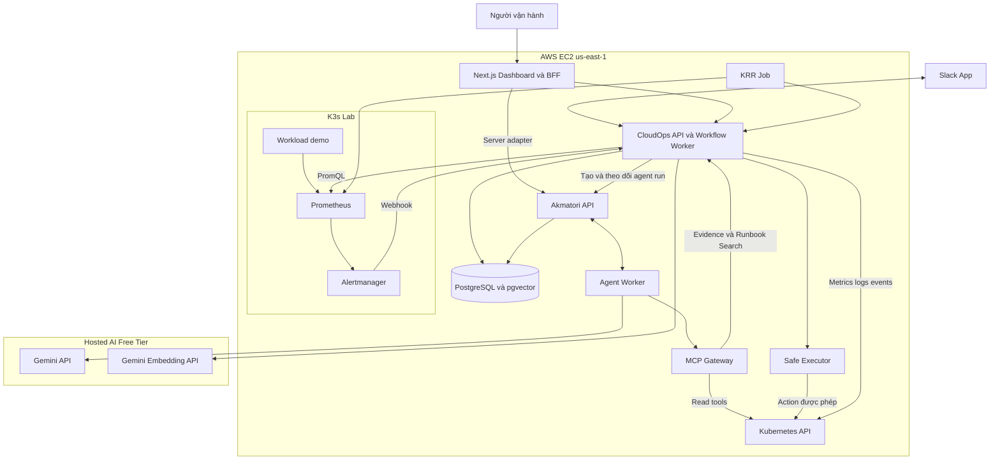
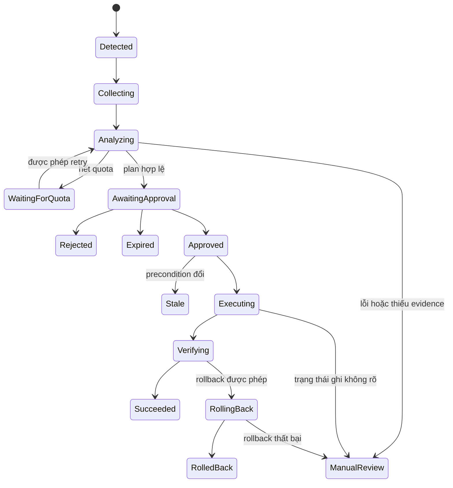

# Kế hoạch phát triển CloudOps Copilot

> Bản kế hoạch ban đầu, giữ lại để đối chiếu. Định hướng thay thế sau nghiên cứu và phản biện ngày 21/10/2026 nằm trong [Release proposal](CLOUDOPS_COPILOT_RELEASE_PROPOSAL.md), sử dụng React/Vite, kèm [UI/UX spec](CLOUDOPS_COPILOT_UI_UX_SPEC.md) và template tương tác. Các lựa chọn Next.js và phạm vi trong tài liệu cũ dưới đây không còn là quyết định hiện hành.

CloudOps Copilot hỗ trợ phát hiện, điều tra và xử lý sự cố Kubernetes có phê duyệt, đồng thời đề xuất tối ưu tài nguyên. Hệ thống triển khai trên AWS, sử dụng Akmatori làm nền tảng agent và dashboard Next.js làm giao diện vận hành thống nhất.

## 1. Mục tiêu và phạm vi

### 1.1 Mục tiêu sản phẩm

- Thu thập metrics, logs, Kubernetes events và lịch sử triển khai theo từng workload.
- Phân tích nguyên nhân sự cố bằng agent có truy xuất runbook và trích dẫn evidence.
- Tạo action plan có cấu trúc, giới hạn quyền và bắt buộc phê duyệt trước khi thực thi.
- Theo dõi sau xử lý, lưu audit và rollback khi đáp ứng điều kiện.
- Đề xuất requests/limits CPU và RAM dựa trên dữ liệu sử dụng.
- Cung cấp dashboard theo dõi incident, evidence, approval và FinOps trong cùng luồng thao tác.

### 1.2 Phạm vi bàn giao

| Hạng mục | MVP bắt buộc | Mở rộng sau MVP |
|---|---|---|
| Kubernetes lab | Một cluster K3s trên EC2; ba kịch bản Pod crash, OOM, traffic spike | Nhiều node, nhiều cluster |
| Telemetry | Prometheus, Alertmanager, Kubernetes logs/events | Loki, Tempo và distributed tracing |
| Detection | Threshold baseline và rolling median/MAD | Isolation Forest hoặc forecasting |
| RCA | Evidence, runbook retrieval, structured output và abstention | Đánh giá nhiều provider/model |
| Remediation | Ba action template, approval qua dashboard/Slack, post-check và rollback | Kế hoạch nhiều bước, nhiều cấp duyệt |
| FinOps | KRR, resource recommendations và ước tính chi phí phân bổ | OpenCost và AWS billing integration |
| Dashboard | Overview, Incidents, Incident Detail, Approvals, FinOps | Trang cấu hình đầy đủ và phân tích chuyên sâu |
| Đánh giá | Scenario có nhãn, trường hợp âm và dữ liệu KPI | Benchmark nhiều môi trường |

## 2. Nền tảng mã nguồn và chiến lược tái sử dụng

### 2.1 Repository tham khảo

| Repository | Vai trò trong dự án |
|---|---|
| [akmatori/akmatori](https://github.com/akmatori/akmatori) | Incident API, agent runtime, MCP Gateway, quản lý tool/runbook và execution history |
| [vercel/next.js](https://github.com/vercel/next.js) | Framework cho dashboard và Backend for Frontend |
| [shadcn-ui/ui](https://github.com/shadcn-ui/ui) | Component nền cho dashboard |
| [fastapi/fastapi](https://github.com/fastapi/fastapi) | Workflow API và các module CloudOps |
| [googleapis/python-genai](https://github.com/googleapis/python-genai) | SDK chính thức cho embedding hosted |
| [pgvector/pgvector](https://github.com/pgvector/pgvector) | Lưu vector và tìm kiếm runbook |
| [prometheus-community/helm-charts](https://github.com/prometheus-community/helm-charts) | Cài monitoring qua kube-prometheus-stack |
| [k3s-io/k3s](https://github.com/k3s-io/k3s) | Kubernetes lab trên EC2 |
| [robusta-dev/krr](https://github.com/robusta-dev/krr) | Khuyến nghị tài nguyên từ Prometheus |
| [opencost/opencost](https://github.com/opencost/opencost) | Phân bổ chi phí Kubernetes ở giai đoạn mở rộng |

### 2.2 Ranh giới tái sử dụng

Commit Akmatori làm cơ sở phân tích: [`4b9e984`](https://github.com/akmatori/akmatori/tree/4b9e984fbfb6818d3e5798228af1010c1fc0ddc8).

| Thành phần | Cách áp dụng |
|---|---|
| Go API và PostgreSQL | Tái sử dụng incident lifecycle và API; CloudOps có database/schema riêng |
| TypeScript agent worker và pi SDK | Tái sử dụng để chạy RCA Investigator và Remediation Planner |
| MCP Gateway | Tái sử dụng read tools và HTTP connector gọi evidence/RAG tools |
| Frontend React/Vite gốc | Giữ làm trang quản trị nội bộ khi cần; dashboard người dùng phát triển bằng Next.js |
| Kubernetes connector | Dùng đọc trạng thái; executor ghi được xây riêng |
| Proposals gốc | Chỉ tái sử dụng ý tưởng review/diff; action approval Kubernetes thuộc module CloudOps |
| Runbook/memory gốc | Giữ chức năng nền; bổ sung semantic retrieval và citation validation |

MVP không chuyển toàn bộ mã giao diện Vite sang Next.js. Dashboard mới tập trung năm màn hình vận hành và tích hợp qua API; các cấu hình upstream ít sử dụng tiếp tục nằm trong trang quản trị nội bộ.

Các điểm mở rộng phải được xác minh bằng hợp đồng API. API tạo incident hiện hỗ trợ `task` và `context`; lựa chọn role/tool scope cần dùng cơ chế skill của upstream hoặc bổ sung patch nhỏ có whitelist. Không mặc định các tham số này đã được API hỗ trợ.

Nguồn mã liên quan: [Incident API](https://github.com/akmatori/akmatori/blob/4b9e984fbfb6818d3e5798228af1010c1fc0ddc8/internal/handlers/api_incidents.go), [agent worker](https://github.com/akmatori/akmatori/blob/4b9e984fbfb6818d3e5798228af1010c1fc0ddc8/agent-worker/src/agent-runner.ts), [Kubernetes connector](https://github.com/akmatori/akmatori/blob/4b9e984fbfb6818d3e5798228af1010c1fc0ddc8/mcp-gateway/internal/tools/k8s/k8s.go), [proposal models](https://github.com/akmatori/akmatori/blob/4b9e984fbfb6818d3e5798228af1010c1fc0ddc8/internal/database/models_proposals.go).

## 3. Kiến trúc tổng thể



### 3.1 Các lớp chức năng

| Lớp | Trách nhiệm |
|---|---|
| Next.js dashboard | Giao diện vận hành, route layout, biểu đồ, filter, evidence viewer và approval |
| BFF | Quản lý cookie phiên, hợp nhất dữ liệu CloudOps/Akmatori, giữ credential backend ở server |
| CloudOps API | Incident mapping, workflow, evidence, RAG, policy, approval, FinOps và audit |
| Akmatori | Thực thi agent session, gọi tool và lưu lịch sử điều tra |
| Safe executor | Kiểm tra action đã duyệt, thực thi Kubernetes API và xác minh kết quả |
| PostgreSQL | Trạng thái bền vững, job/outbox, approval, evidence metadata và vectors |
| Monitoring | Thu telemetry và kích hoạt incident |
| Hosted AI | Suy luận và embedding qua API, không triển khai model trên laptop hoặc EC2 |

### 3.2 Quy tắc triển khai

- Akmatori, dashboard và extension chạy bằng Docker Compose; workload demo và monitoring chạy trong K3s.
- Namespace `cloudops-lab` chứa workload được phép tác động; injector sự cố dùng credential riêng.
- Agent/collector dùng Kubernetes credential chỉ đọc; executor giữ credential ghi giới hạn theo namespace và tài nguyên.
- CloudOps và Akmatori dùng database/user riêng; integration thông qua API.
- Job nền lưu trong PostgreSQL; MVP chỉ chạy một workflow worker để đơn giản hóa đồng bộ.
- Model provider là dịch vụ ngoài AWS. AWS lưu trữ và vận hành ứng dụng; Gemini Developer API cung cấp inference/embedding.
- Dashboard được deploy bằng Next.js standalone output; build image trong môi trường phát triển/CI để giảm tải EC2 demo.

## 4. Tech stack và quản lý phiên bản

### 4.1 Frontend

Các phiên bản dưới đây là baseline được kiểm tra từ registry chính thức. Lockfile chốt patch chính xác sau bước kiểm tra peer dependencies và build ban đầu.

| Công nghệ | Baseline | Mục đích |
|---|---|---|
| Next.js | 16.4.1 | App Router, Server Components, Route Handlers, standalone deployment |
| React / React DOM | 19.3.1 | Giao diện và tương tác |
| TypeScript | 7.0.2 | Kiểu dữ liệu và API contracts |
| Node.js | 24.22.0 LTS | Runtime cho dashboard và worker tương thích |
| pnpm | 12.11.2 | Workspace và dependency lock |
| Tailwind CSS / PostCSS plugin | 4.3.3 | Design tokens và responsive styling |
| shadcn CLI | 4.21.5 | Khởi tạo component; source component được lưu trong repo |
| TanStack Query | 5.104.2 | Server state, polling và invalidation |
| Recharts | 3.10.1 | Biểu đồ metrics và FinOps |
| Zod | 4.6.7 | Kiểm tra dữ liệu/form ở dashboard |
| Lucide React | 1.57.0 | Icon thống nhất |
| ESLint | 10.12.0 | Lint qua flat config |

Nguồn: [Next.js 16.4](https://nextjs.org/blog/next-16-4), [Node.js releases](https://nodejs.org/en/about/previous-releases), [shadcn Next.js setup](https://ui.shadcn.com/docs/installation/next), [npm next](https://registry.npmjs.org/next/latest), [npm React](https://registry.npmjs.org/react/latest), [npm TypeScript](https://registry.npmjs.org/typescript/latest), [npm Tailwind](https://registry.npmjs.org/tailwindcss/latest).

### 4.2 Backend và dữ liệu

| Công nghệ | Baseline | Mục đích |
|---|---|---|
| Python | 3.15.0 | Runtime extension |
| FastAPI | 0.143.1 | API, webhook, workflow endpoints |
| Uvicorn | 0.54.0 | ASGI runtime |
| Pydantic | 2.14.1 | Schema validation |
| pydantic-settings | 2.16.0 | Cấu hình runtime |
| SQLAlchemy | 2.1.4 | Database access |
| Alembic | 1.20.0 | Database migrations |
| Psycopg | 3.3.6 | PostgreSQL driver |
| HTTPX | 0.28.1 | Gọi Akmatori, Prometheus và provider |
| Google Gen AI SDK | 2.31.0 | Hosted embedding API |
| Kubernetes Python client | 37.0.1 | Collector và executor |
| Slack SDK | 3.45.0 | Socket Mode và approval messages |
| NumPy / Pandas | 2.5.4 / 3.0.6 | Detection và xử lý chuỗi thời gian |
| PostgreSQL | 18.6 | Database stable được hỗ trợ |
| pgvector | 0.8.7 | Vector search, chọn image hỗ trợ PostgreSQL 18 |
| Go toolchain | 1.27.2 | Build backend/gateway upstream khi cần patch |

Nguồn: [Python 3.15](https://www.python.org/downloads/release/python-3150/), [FastAPI package](https://pypi.org/project/fastapi/), [Pydantic package](https://pypi.org/project/pydantic/), [SQLAlchemy package](https://pypi.org/project/SQLAlchemy/), [Google SDK](https://pypi.org/project/google-genai/), [PostgreSQL versioning](https://www.postgresql.org/support/versioning/), [pgvector tags](https://github.com/pgvector/pgvector/tags), [Go releases](https://go.dev/dl/).

### 4.3 Hạ tầng và monitoring

| Công nghệ | Baseline | Quy tắc sử dụng |
|---|---|---|
| K3s | 1.37.1+k3s1 | Kiểm tra API compatibility với client 37 và manifests |
| Helm | 4.3.1 | Lock chart version, kiểm tra render và upgrade notes |
| kube-prometheus-stack | 92.7.0 | Lock chart cùng CRDs và dependencies |
| Prometheus | Chart-managed; stable tham chiếu 3.15.0 | Ưu tiên tổ hợp image/chart đã xác minh |
| Alertmanager | Chart-managed; stable tham chiếu 0.34.1 | Không override riêng version nếu chưa kiểm tra chart |
| KRR | 1.31.0 | Container riêng, lock image/digest và runtime dependencies của KRR |
| Docker Compose | 5.6.0 | Compose Specification hiện hành |
| OpenTofu | 1.13.1 | EC2, security group, volume và bootstrap |

Nguồn: [K3s releases](https://github.com/k3s-io/k3s/releases), [Helm releases](https://github.com/helm/helm/releases), [chart source](https://github.com/prometheus-community/helm-charts/blob/main/charts/kube-prometheus-stack/Chart.yaml), [Prometheus releases](https://github.com/prometheus/prometheus/releases), [Alertmanager releases](https://github.com/prometheus/alertmanager/releases), [KRR releases](https://github.com/robusta-dev/krr/releases), [Compose releases](https://github.com/docker/compose/releases), [OpenTofu releases](https://github.com/opentofu/opentofu/releases).

### 4.4 Kiểm soát tương thích và cú pháp

1. Khởi tạo dependency mới bằng bản stable, loại pre-release/canary; kiểm tra peer dependencies trước khi chốt baseline. Phiên bản mới không tự bảo đảm tương thích.
2. Commit `pnpm-lock.yaml`, Python lockfile, `go.sum`, chart lock và image digest. CI cài bằng chế độ frozen/locked; môi trường deploy không dùng tag `latest`.
3. Next.js sử dụng App Router; `params`, `searchParams`, `cookies()` và `headers()` theo API async hiện hành. Dùng `proxy.ts` khi cần network boundary; kiểm tra quyền vẫn đặt tại API/data layer.
4. Chạy ESLint riêng; không dùng lệnh `next lint`. Tailwind dùng cấu hình CSS-first và plugin v4; không chép cấu hình Tailwind v3.
5. TanStack Query dùng API object theo v5. Pydantic dùng `model_validate`/`model_dump`; cấu hình tách qua pydantic-settings. FastAPI dùng lifespan. SQLAlchemy dùng cú pháp `select` và API 2.x.
6. Gemini dùng SDK `google-genai`; không dùng SDK `google-generativeai` cũ. Embedding tuân theo định dạng đúng model và tài liệu hiện tại.
7. Akmatori/pi SDK được nâng cấp có kiểm soát bằng một change riêng; không thay major toàn bộ dependency upstream trong cùng lần dựng dashboard.
8. Python 3.15 phải cài được wheels cho dependency native; thử import, migration và adapter trong giai đoạn nền tảng. Thay đổi version vì compatibility phải có ghi chú và bản stable còn hỗ trợ thay thế.
9. PostgreSQL 18 dùng cấu hình volume/data directory đúng image. Không gắn trực tiếp volume database major cũ vào major mới; dùng migration/restore và kiểm tra upstream migrations trên database sạch.
10. Release candidate đóng băng major/minor; chỉ cập nhật bảo mật/bugfix có kiểm tra lại luồng liên quan.

Nguồn API hiện hành: [Next.js upgrade guide](https://nextjs.org/docs/app/guides/upgrading/version-16), [Tailwind documentation](https://tailwindcss.com/docs/installation/framework-guides/nextjs), [Google libraries](https://ai.google.dev/gemini-api/docs/libraries).

## 5. Hosted AI và chính sách miễn phí

### 5.1 Model được lựa chọn

| Tác vụ | Provider / model | Cách tích hợp |
|---|---|---|
| RCA Investigator | Gemini Developer API, `gemini-3.8-flash` | Provider Google trong Akmatori |
| Remediation Planner | Dùng cùng model, session và instruction riêng | Chỉ chọn action template đã cung cấp |
| Embedding runbook và query | Gemini Developer API, `gemini-embedding-2` | Google Gen AI SDK từ CloudOps API |
| Detection / FinOps | Thuật toán thống kê / KRR | Không cần inference |

Các model trên được liệt kê có Free Tier trong bảng giá hiện hành. Quota thực tế phụ thuộc project/model và phải kiểm tra trong AI Studio. Dịch vụ hosted miễn phí không có bảo đảm quota vô hạn hoặc khả dụng liên tục. Nguồn: [Gemini pricing](https://ai.google.dev/gemini-api/docs/pricing), [rate limits](https://ai.google.dev/gemini-api/docs/rate-limits).

### 5.2 Điều kiện vận hành không phát sinh phí model

- Dùng project/API key thuộc Free Tier; xác minh trạng thái billing trước integration và trước demo.
- Provider/model allowlist chỉ chứa cấu hình miễn phí đã kiểm tra; không tự fallback sang paid project, Bedrock, Vertex AI hoặc model trả phí.
- Đọc RPM/TPM/RPD thực tế của project; cấu hình token budget, concurrency và hàng đợi tương ứng. Mỗi vòng tool call cũng tiêu thụ request/token.
- Lượt RCA và planner chạy tuần tự; khởi đầu một incident đồng thời, giới hạn tool calls và tối đa một lần sửa JSON.
- Gặp 429 thì tôn trọng Retry-After, exponential backoff với jitter, giới hạn retry và chuyển `waiting_for_quota` nếu hết quota ngày. Đổi model trong cùng project không được coi là cách vượt quota.
- Cache evidence/retrieval theo hash; không gọi LLM cho title, formatting và summarization nếu có thể tạo bằng template.
- Không bật web grounding, managed agents hoặc các API phụ ngoài luồng đã kiểm tra giá.
- Log sử dụng ghi model ID, số request, token, retry và lỗi quota; dashboard hiện trạng thái provider degraded.

Free Tier có chính sách xử lý dữ liệu riêng. Chỉ gửi telemetry lab đã loại token, secret và định danh không cần thiết; thực hiện redaction trước khi tạo context. Nguồn: [Gemini pricing và data policy](https://ai.google.dev/gemini-api/docs/pricing).

### 5.3 RAG hosted

- Chunk runbook theo heading và nội dung thao tác, kích thước mục tiêu khoảng 400–700 token, overlap có giới hạn.
- Gắn metadata service, namespace, loại sự cố, document version và checksum.
- Chọn embedding output 768 chiều, normalize theo hướng dẫn model và lưu `vector(768)` trong pgvector.
- Với `gemini-embedding-2`, đưa nhiệm vụ retrieval vào nội dung theo tài liệu; không dùng tham số `task_type` của model embedding đời trước.
- Cache embedding theo model ID, dimension, document hash và input format; chỉ embed lại phần thay đổi.
- Truy vấn kết hợp metadata filter và vector similarity; trả 3–5 đoạn kèm document/chunk ID.
- Evidence live và runbook knowledge là hai nguồn riêng: runbook hướng dẫn cách điều tra, telemetry hỗ trợ kết luận nguyên nhân.
- Khi đổi embedding model hoặc dimension, tạo index/version mới và re-embed; không trộn vector khác không gian vào cùng index.

Nguồn: [Embedding API và định dạng retrieval](https://ai.google.dev/gemini-api/docs/embeddings).

## 6. Dashboard UI và UX

### 6.1 Định hướng thiết kế

Dashboard có phong cách công cụ vận hành: bố cục thoáng, mật độ thông tin vừa phải, trạng thái rõ và thao tác theo ngữ cảnh. Dùng light/dark theme, hệ màu trung tính và màu nhấn xanh; màu cảnh báo dùng nhất quán cho severity/action status.

| Thành phần thiết kế | Quy định |
|---|---|
| App shell | Sidebar thu gọn, topbar với environment, time range, search và user menu |
| Layout | Grid responsive; desktop ưu tiên vùng phân tích, tablet dùng drawer |
| Typography | Sans-serif cho nội dung, monospace cho resource ID, log, JSON và số liệu |
| Spacing | Thang 4/8 px; section/card có khoảng cách nhất quán |
| Status | Badge gồm icon và chữ; không truyền đạt trạng thái chỉ bằng màu |
| Charts | Tooltip có đơn vị, legend rõ, timestamp thống nhất, annotation lúc deploy/action |
| Motion | Chuyển trạng thái ngắn, hỗ trợ reduced motion; tránh animation liên tục trên dữ liệu |
| Accessibility | Keyboard navigation, focus visible, semantic labels và contrast phù hợp |
| Data states | Loading skeleton, empty, stale, error và retry được thiết kế đầy đủ |

### 6.2 Các màn hình MVP

| Màn hình | Nội dung và hành động |
|---|---|
| Overview | Incident đang mở, workload bị ảnh hưởng, approval chờ duyệt, resource opportunity; biểu đồ latency/error và recent activity |
| Incidents | Bảng filter severity/status/workload/time; search, sort, pagination, URL lưu trạng thái filter |
| Incident Detail | Header trạng thái; timeline; RCA và giả thuyết; evidence có citation; metrics/logs/events; action plan và execution history |
| Approvals | Danh sách plan chờ duyệt, thời gian hết hạn, before/after diff, evidence, Approve/Reject và lý do từ chối |
| FinOps | Requests/limits hiện tại và đề xuất, sử dụng quan sát, confidence dữ liệu, window, buffer, tác động SLO và estimate |

Trang Settings trong giai đoạn đầu hiển thị health, model, quota status và integration status; cấu hình sâu mở bằng đường dẫn quản trị nội bộ. Không xây lại toàn bộ màn hình quản trị Akmatori.

### 6.3 Tương tác quan trọng

- Citation mở evidence drawer và giữ nguyên context incident; cho xem nguồn, timestamp, resource và nội dung gốc liên quan.
- Action plan có diff cụ thể, target, điều kiện, TTL và rollback trước khi duyệt.
- Mutation chỉ đổi trạng thái thành công khi server xác nhận; chặn submit lặp nhưng server vẫn xử lý idempotency.
- Khi resource/plan đã stale, tắt Approve và giải thích cần tạo lại plan.
- Polling 5–10 giây cho trạng thái hoạt động; giảm/tắt khi tab ẩn. SSE chỉ triển khai khi backend có replay/event contract rõ.
- Hiển thị `last_updated_at` và dữ liệu stale khi mất kết nối; không biến dữ liệu thiếu thành số 0.
- Loading, demo fixture và dữ liệu live có nhãn rõ trong môi trường phát triển; bản nghiệm thu dùng dữ liệu live hoặc dataset được ghi nguồn.

### 6.4 Cấu trúc frontend

```text
apps/dashboard/
  app/
    (auth)/login/
    (dashboard)/overview/
    (dashboard)/incidents/
    (dashboard)/incidents/[id]/
    (dashboard)/approvals/
    (dashboard)/finops/
    api/                         # BFF route handlers
  components/
    ui/                          # shadcn components
    layout/
    incidents/
    evidence/
    approvals/
    finops/
  lib/
    api/                         # server adapters và DTO mapping
    auth/
    query/
    validation/
  styles/
```

## 7. Workflow vận hành

### 7.1 Xử lý incident

1. Prometheus/Detector nhận diện dấu hiệu bất thường và Alertmanager gửi webhook.
2. CloudOps ghi event, deduplicate bằng fingerprint và ACK; xử lý tiếp bằng job nền.
3. Collector tạo evidence snapshot theo workload và time window: metrics, current/previous logs, events, resource settings và deployment record.
4. Retrieval tìm runbook; CloudOps tạo RCA session qua Akmatori API và lưu mapping UUID.
5. RCA Investigator trả JSON với cause category, evidence IDs, hypotheses và limitations; thiếu bằng chứng trả `insufficient_evidence`.
6. Validator kiểm tra schema, ID tồn tại, resource và timestamp. Kết luận OOM chỉ được nâng thành memory leak khi có thêm bằng chứng phù hợp.
7. Remediation Planner chọn action/template và tham số trong giới hạn. Không có hành động phù hợp thì trả `manual_only`.
8. Policy engine kiểm tra target UID, namespace, label, bounds, capacity/HPA và preconditions; lưu plan bất biến cùng hash và expiry.
9. Dashboard và Slack hiển thị cùng plan, diff và TTL; người có quyền Approve/Reject.
10. Approval service kiểm tra actor, version/hash và expiry trong transaction, sau đó ghi outbox. Plan bị sửa phải tạo approval mới.
11. Executor claim action, đọc lại trạng thái target; stale hoặc không đủ điều kiện thì từ chối.
12. Thực thi qua Kubernetes API, theo dõi rollout/SLO và lưu before/after.
13. Post-check xác nhận thành công; rollback có điều kiện hoặc chuyển xử lý thủ công khi trạng thái không rõ.



### 7.2 Detection và FinOps

Detection so sánh threshold với rolling median/MAD trên cùng bộ dữ liệu có nhãn. Chuyển counter thành rate trước khi phân tích; xử lý missing data và cooldown để hạn chế alert trùng.

KRR phân tích lịch sử Prometheus theo window đã thu được. Mỗi report ghi coverage, requests/limits, CPU/memory usage, buffer và recommendation. Khi dữ liệu chưa đủ hoặc workload vừa OOM, report thể hiện giới hạn và không tự đề xuất giảm bộ nhớ thiếu điều kiện.

FinOps trình bày resource reduction và chi phí phân bổ ước tính theo rate card có nguồn/region/version. Giảm requests trên EC2 cố định không tự làm giảm hóa đơn; số tiền tiết kiệm thực tế chỉ được khẳng định khi có thay đổi tài nguyên tính tiền và dữ liệu billing đối chiếu.

## 8. Dữ liệu, API và kiểm soát thực thi

### 8.1 Các thực thể chính

| Thực thể | Dữ liệu bắt buộc |
|---|---|
| Incident | Fingerprint, workload, state, RCA/planner run UUID và timestamps |
| Evidence | Source, observed_at, target UID, payload reference, hash và retention |
| KnowledgeChunk | Document version, scope, text, embedding model và vector |
| RCAResult | Cause category, evidence IDs, hypotheses, limitations và schema version |
| ActionPlan | Enum action, target, params, preconditions, snapshot, hash, expiry và status |
| Approval | Actor, source dashboard/Slack, plan hash, decision và event/idempotency key |
| Execution | Action ID duy nhất, before/after, verification và rollback result |
| FinOpsReport | Data window, coverage, recommendations và rate card version |
| Job / Outbox | Trạng thái, attempts, lease và next_attempt_at |
| AuditEvent | Actor, operation, resource, timestamp và kết quả |
| User / Session | Role, session hash, expiry và trạng thái revoke |
| BenchmarkRun | Scenario version, ground truth, cấu hình và timestamps |

### 8.2 API dự kiến

| Endpoint | Chức năng |
|---|---|
| POST /auth/login; POST /auth/logout | Phiên đăng nhập CloudOps |
| GET /auth/me | Danh tính và role hiện tại |
| POST /webhooks/alertmanager | Nhận alert có xác thực nguồn |
| GET /incidents; GET /incidents/{id} | Incident list/detail |
| GET /incidents/{id}/evidence | Evidence theo scope |
| POST /tools/evidence/search | Read tool cho agent |
| POST /tools/runbooks/search | Read tool cho RAG |
| GET /actions; GET /actions/{id} | Plan, diff, approval và execution |
| POST /actions/{id}/approve | Phê duyệt có plan hash, quyền và idempotency |
| POST /actions/{id}/reject | Từ chối và ghi lý do |
| GET /finops/recommendations | Report FinOps |
| GET /integrations/status | Provider, quota và integration health |
| GET /health; GET /metrics | Health và observability |

API của agent không có quyền duyệt hoặc thực thi. Endpoint tools có authentication và incident scope; dùng POST cho search không mang nghĩa có side effect.

### 8.3 Authentication và authorization

- CloudOps quản lý tài khoản/role tối thiểu: viewer, reviewer và admin. Password được hash bằng thư viện duy trì hiện hành; session là opaque token có expiry và revoke, lưu hash ở database.
- Next.js BFF giữ session trong cookie HttpOnly, Secure trên HTTPS và SameSite phù hợp; backend luôn xác thực session và role lại cho mutation.
- Kiểm tra Origin/CSRF cho thao tác thay đổi trạng thái. Route protection ở frontend chỉ hỗ trợ UX, không thay cho authorization backend.
- Browser chỉ gọi BFF; credential Akmatori/provider chỉ tồn tại server-side. BFF gọi Akmatori qua tài khoản dịch vụ và map DTO sang contract CloudOps.
- Slack actor phải thuộc team/user allowlist và map sang reviewer. Dashboard và Slack gọi cùng approval service để chống race/bấm lặp.
- MVP truy cập qua port forwarding hoặc HTTPS reverse proxy; không mở database, Kubernetes API, provider key hoặc admin upstream ra Internet.

### 8.4 Hành động được phép

| Action | Phạm vi tham số | Điều kiện |
|---|---|---|
| restore_deployment_template | Bản tốt đã lưu và xác định version/digest | Đúng deployment UID, snapshot và field preconditions |
| set_memory_profile | Profile server-side đã định nghĩa | Không vượt resource/capacity bounds |
| scale_deployment | Replica count trong khoảng cho phép, ví dụ 1–3 | Đủ headroom và không xung đột HPA |

Executor giữ Kubernetes credential riêng và quyền ghi chỉ trong namespace lab. Dùng validation giới hạn label/tên/field vì Kubernetes RBAC không giới hạn toàn bộ nội dung patch.

Claim action bằng transaction và execution ID duy nhất. Mất kết nối sau write phải reconcile trạng thái; không chạy lại mù. Rollback chỉ phục hồi field thuộc action nếu tài nguyên vẫn khớp trạng thái dự kiến. Workload đã tự hồi phục trước action được ghi `no_op`, không tính thành công cho remediation.

## 9. AWS deployment và ngân sách

### 9.1 Topology

- Region triển khai: US East (N. Virginia), `us-east-1`.
- Một EC2 Linux khoảng 4 vCPU/8 GiB, lựa chọn instance theo estimate tại `us-east-1`.
- Cấu hình AWS CLI, OpenTofu provider, bootstrap và deployment environment thống nhất `AWS_REGION=us-east-1`; EBS và snapshot phục vụ lab đặt cùng region.
- EBS gp3 khoảng 40 GiB cho container images, database và TSDB; giới hạn retention và log rotation.
- Docker Compose chạy Next.js standalone, Akmatori, extension, executor và PostgreSQL.
- K3s chạy monitoring và workload demo có resource quota/limits.
- Provider traffic đi outbound qua HTTPS; Slack dùng Socket Mode. Không có GPU, model server hoặc tunnel về laptop.
- Compose networks tách frontend, internal API/database và executor access. Security Group giới hạn quản trị theo nguồn truy cập.

Host chung chỉ dùng cho workload lab. Resource exhaustion phải bị giới hạn để tránh làm sập control services; lỗi EC2/node không thuộc benchmark MVP.

### 9.2 Ngân sách vận hành mục tiêu

Hệ thống vận hành theo nhu cầu. Chỉ bật EC2 khi cần tích hợp, thu dữ liệu, kiểm thử hoặc demo; kết thúc phiên sử dụng thì dừng dịch vụ an toàn và chuyển EC2 sang trạng thái `stopped`. Công việc lập trình, review và chuẩn bị tài liệu thực hiện trên môi trường phát triển; ngân sách AWS tính theo tổng giờ chạy tích lũy của các phiên.

**Cơ sở tính ngân sách:** mục tiêu 40–60 giờ EC2 cho giai đoạn triển khai và nghiệm thu; dự phòng tối đa 100 giờ khi cần thêm dữ liệu hoặc sửa lỗi. Hourly rate 0,25 USD dưới đây là giả định trần để lập kế hoạch, cần đối chiếu giá instance thực tế tại `us-east-1`.

| Khoản | Ngân sách mục tiêu | Trần dự phòng |
|---|---:|---:|
| EC2: 40–60 giờ; dự phòng tối đa 100 giờ | 10–15 USD | 25 USD |
| EBS trong thời gian lưu môi trường | 8 USD | 8 USD |
| Public IPv4 theo thời gian cấp phát | 1 USD | 1 USD |
| Data transfer và chi phí nhỏ | 3 USD | 3 USD |
| Snapshot/backup | 3 USD | 3 USD |
| Tổng ngân sách hạ tầng | 25–30 USD | 40 USD |
| Hosted inference/embedding | 0 USD trong Free Tier hợp lệ | Không tự chuyển sang paid tier |

**Quy trình mỗi phiên sử dụng:**

1. Bật EC2, kiểm tra Compose/K3s, database, monitoring và kết nối provider trước khi chạy workload.
2. Chỉ chạy những thành phần cần cho phiên tích hợp, kiểm thử hoặc demo; ghi nhận thời điểm bắt đầu và mục đích sử dụng.
3. Khi hoàn tất, kết thúc load generator và các tác vụ đang chạy, lưu kết quả/evidence, xử lý action còn chờ và dừng dịch vụ an toàn.
4. Stop EC2 và xác nhận trạng thái `stopped` trong AWS. Chỉ tắt container vẫn để instance tiếp tục chạy và tính phí compute.
5. Ghi tổng giờ đã dùng, kiểm tra chi phí tích lũy và tài nguyên còn được giữ trước phiên tiếp theo.

EBS và snapshot được giữ để tiếp tục sử dụng có thể phát sinh phí trong thời gian EC2 dừng. Tránh giữ Elastic IP không cần thiết; nếu dùng public IPv4 tự cấp, địa chỉ có thể thay đổi sau stop/start và cần cập nhật cấu hình truy cập tương ứng. Sau khi kết thúc dự án, backup dữ liệu cần thiết rồi xóa các tài nguyên không còn sử dụng.

Monitoring chỉ thu thập khi môi trường hoạt động. Những phiên FinOps hoặc benchmark cần lịch sử liên tục phải dành đủ thời gian warm-up trong một phiên được lên kế hoạch; các khoảng EC2 tắt được ghi nhận là thiếu dữ liệu. KRR/detector phải kiểm tra coverage trước khi đưa ra kết luận.

Lập [AWS Pricing Calculator estimate](https://calculator.aws/) theo số giờ bật dự kiến, thời gian giữ EBS/snapshot và data transfer tại `us-east-1`. Rate card FinOps cũng sử dụng giá `us-east-1`, ghi rõ ngày cập nhật và nguồn giá. Điều chỉnh số giờ nếu giá thực cao hơn giả định. AWS Budgets hỗ trợ cảnh báo; thao tác stop EC2 sau mỗi phiên và kiểm tra tài nguyên còn giữ là cơ chế kiểm soát chi phí chủ động.

Nguồn: [EC2 stop/start](https://docs.aws.amazon.com/AWSEC2/latest/UserGuide/Stop_Start.html), [VPC pricing](https://aws.amazon.com/vpc/pricing/), [AWS Budgets](https://docs.aws.amazon.com/cost-management/latest/userguide/budgets-managing-costs.html).

## 10. Kế hoạch triển khai và phân công

### 10.1 Trách nhiệm

| Vai trò | Trách nhiệm |
|---|---|
| Developer | Nền tảng, dashboard Next.js, API/adapters, RAG, approval/executor, FinOps và deployment |
| Reviewer | Review code/contracts, UI/UX, failure cases, runbook/scenario, số liệu đánh giá, tài liệu và chỉnh sửa được thống nhất |

Mỗi tính năng bàn giao bằng thay đổi nhỏ có hướng dẫn chạy và acceptance criteria. Review trong ngày làm việc kế tiếp; demo tích hợp hằng tuần. Hoàn thiện golden flow OOM trước khi mở rộng scenario để kiểm soát số nhánh chưa tích hợp.

### 10.2 Timeline

| Giai đoạn | Thời gian | Công việc developer | Công việc reviewer | Kết quả nghiệm thu |
|---|---|---|---|---|
| Nền tảng | 15–18/10 | Pin upstream, lập dependency baseline, thử Gemini/tool calling/embedding, tạo skeleton Next.js và API adapter | Kiểm tra version/source, quota, navigation và API contract | Incident trả response; hosted model và embedding chạy; dashboard build được |
| Telemetry và app shell | 19–25/10 | EC2/K3s, sample app, metrics/webhook, evidence; shell Next.js, auth, Overview và Incidents cơ bản | Review UI states, quyền, setup và evidence OOM | OOM tạo incident/evidence; đăng nhập và theo dõi được trên Next.js |
| RCA và Incident Detail | 26/10–01/11 | RAG hosted, validator, hai agent roles, evidence drawer, timeline và action diff | Review citation, thiếu dữ liệu, prompt injection và hierarchy màn hình | RCA có citation; plan được validate; Incident Detail đọc được dữ liệu thật |
| Approval và executor | 02–08/11 | Approvals UI, Slack app, executor OOM, TTL/idempotency/preconditions, post-check | Thử reject, sai role, bấm lặp, stale target, expiry và rollback | Golden flow OOM hoàn chỉnh qua dashboard và Slack |
| Ba scenario và UI hoàn thiện | 09–15/11 | Pod crash, traffic spike, baseline/MAD; filters, charts, responsive và trạng thái degraded | Review reset/ground truth, UX keyboard và không tính auto-recovery nhầm | Ba scenario chạy end-to-end; UI năm màn hình nhất quán |
| FinOps và đánh giá | 16–22/11 | KRR adapter, FinOps page, data warm-up, benchmark, quota monitoring | Kiểm tra resource/cost calculation, coverage và bảng KPI | Report FinOps có evidence; có kết quả đo và demo tích hợp |
| Release candidate | 23–29/11 | Freeze feature, sửa lỗi, backup/restore, source/config package và video | Cài lại theo hướng dẫn, hoàn thiện báo cáo/slide và diễn tập | Chạy lại được từ tài liệu; không còn lỗi P0 |
| Bàn giao | 30/11 | Chốt version, kiểm tra package và nộp | Đối chiếu checklist và dữ liệu minh chứng | Bộ nộp đầy đủ và có backup |

### 10.3 Các mốc kiểm soát phạm vi

- Cuối giai đoạn nền tảng: xác nhận provider/model quota, JSON, tool calls, API adapters và version compatibility; không triển khai nhiều module khi hợp đồng nền chưa ổn.
- Trước 08/11: phải có OOM được duyệt và xử lý có xác minh. Nếu chậm, giữ dashboard năm trang ở mức chức năng, giảm chart phụ và trang cấu hình.
- Sau 15/11: khóa ba action template; không thêm quyền AWS write hay incident type mới.
- Sau 22/11: chỉ sửa lỗi, hoàn thiện dữ liệu và tài liệu; hoãn multi-cluster, SSE phức tạp, OpenCost, Loki/Tempo và ML nâng cao.

## 11. Kịch bản kiểm chứng và KPI

### 11.1 Incident lab

| Scenario | Injection | Evidence | Kết quả cần xác nhận |
|---|---|---|---|
| Pod crash | Deploy cấu hình khởi động lỗi có deployment record | Previous logs, CrashLoopBackOff, revision/diff | Restore template tốt, rollout ready và không restart mới |
| OOM | Memory limit thấp hơn nhu cầu workload đã biết | OOMKilled, memory/limit, restart count | Chuyển profile hợp lệ, không OOM mới trong cửa sổ xác minh |
| Traffic spike | Load generator tăng request khi node còn headroom | RPS, latency, errors, CPU/throttling, replicas | Scale theo plan; latency/error cải thiện dưới cùng mức tải |

Injector và reset tách khỏi agent/executor. Dừng load/reset phải được ghi thời điểm để không tính nhầm thành remediation thành công.

### 11.2 Chỉ số đánh giá

| Nhóm | Chỉ số và cách đo |
|---|---|
| Detection | Precision/recall/F1, median/P95 latency; cùng label protocol cho threshold và MAD |
| RCA | Cause-category accuracy, abstention rate, citation validity và relevance chấm theo rubric |
| AI provider | Request/token count, quota errors, retry, model latency và schema-valid output rate |
| Remediation | Approval enforcement, action success, no-op, stale rejection, duplicate prevention và rollback |
| Thời gian xử lý | Inject → detect → RCA → approval → apply → recovery; tách thời gian chờ con người |
| FinOps | Coverage, resource reduction và estimate có nguồn; tách khỏi bill savings |
| UI/UX | Hoàn thành luồng xem incident → evidence → duyệt → xem kết quả; loading/error/stale states và keyboard access |
| Tái lập | Reviewer cài và chạy golden flow từ tài liệu |

Tối thiểu năm lượt độc lập mỗi scenario và năm trường hợp bình thường/thiếu evidence. Tách bộ tinh chỉnh khỏi bộ đánh giá cuối; không truyền ground truth cho agent. Mục tiêu RCA ban đầu ít nhất 12/15 lượt đúng, báo kèm abstention và giới hạn mẫu. Chỉ số độ trễ chốt sau đo theo cấu hình scrape và quota thực tế.

### 11.3 Các ca bắt buộc trước release

- Alert trùng, worker restart và mất kết nối Akmatori/provider.
- Evidence thiếu/sai scope, JSON lỗi, citation bịa và log có prompt injection.
- Hosted API hết quota: giữ job, thông báo trên dashboard, không chuyển sang paid API.
- Role trái phép, CSRF/origin không hợp lệ, approve lặp, approve/reject đồng thời và plan hết hạn.
- Resource UID/field thay đổi, không đủ capacity, HPA xung đột và namespace ngoài allowlist.
- Mất mạng sau write, post-check thất bại, rollback stale hoặc thất bại.
- FinOps chưa warm-up, gaps dữ liệu và proposal giảm memory sau OOM.
- Frontend typecheck/lint/build; contract tests; ba E2E flows; kiểm tra responsive và accessibility cơ bản.
- Backup/restore database và smoke test sau restart EC2.

## 12. Cấu trúc repository và tiêu chuẩn bàn giao

```text
cloudops-copilot/
  apps/dashboard/                # Next.js dashboard và BFF
  services/cloudops/
    app/
      api/
      auth/
      adapters/                  # Akmatori, Prometheus, Gemini, Slack, KRR
      workflow/
      evidence/
      rag/
      planning/
      policy/
      executor/                  # entrypoint/container riêng
      finops/
    migrations/
    tests/
  integrations/akmatori/          # commit pin, patches và configs
  deploy/
    compose/
    aws/
    k3s/
  scenarios/
  runbooks/
  benchmarks/
    protocol.md
    datasets/
    results/
  docs/
    architecture.md
    api-contracts.md
    setup.md
    user-guide.md
    evaluation.md
    dependency-baseline.md
    attribution.md
  .env.example
  pnpm-lock.yaml
  LICENSE
```

| Bộ bàn giao | Nội dung |
|---|---|
| Source | Dashboard, extension, upstream pin/patches, licenses và dependency locks |
| Kiến trúc | Deployment/data flow, actors/use cases, API/schema, state machine và quyền hạn |
| Cài đặt | IaC/Compose/Helm, model/project config, secret template và smoke checklist |
| Lab | Ba scenario injection/reset, load profiles và ground truth |
| Đánh giá | Protocol, raw results, script tính KPI, biểu đồ và giới hạn |
| Sử dụng/vận hành | Incident review, approval, quota handling, rollback, backup/restore và cleanup AWS |
| Báo cáo | Nội dung theo yêu cầu học phần, phần tự phát triển và nguồn tái sử dụng rõ ràng |
| Trình bày | Slide tiếng Anh, video và kịch bản live demo |

## 13. Tài liệu kỹ thuật chính

- [Akmatori GitHub](https://github.com/akmatori/akmatori)
- [Next.js documentation](https://nextjs.org/docs)
- [Next.js 16.4 release](https://nextjs.org/blog/next-16-4)
- [Next.js authentication](https://nextjs.org/docs/app/guides/authentication)
- [Tailwind CSS documentation](https://tailwindcss.com/docs)
- [shadcn/ui documentation](https://ui.shadcn.com/docs)
- [FastAPI documentation](https://fastapi.tiangolo.com/)
- [Pydantic documentation](https://docs.pydantic.dev/latest/)
- [SQLAlchemy documentation](https://docs.sqlalchemy.org/)
- [Gemini pricing](https://ai.google.dev/gemini-api/docs/pricing)
- [Gemini rate limits](https://ai.google.dev/gemini-api/docs/rate-limits)
- [Gemini embeddings](https://ai.google.dev/gemini-api/docs/embeddings)
- [Gemini SDKs](https://ai.google.dev/gemini-api/docs/libraries)
- [PostgreSQL supported versions](https://www.postgresql.org/support/versioning/)
- [K3s documentation](https://docs.k3s.io/)
- [Slack Socket Mode](https://docs.slack.dev/apis/events-api/using-socket-mode/)
- [AWS Pricing Calculator](https://calculator.aws/)
