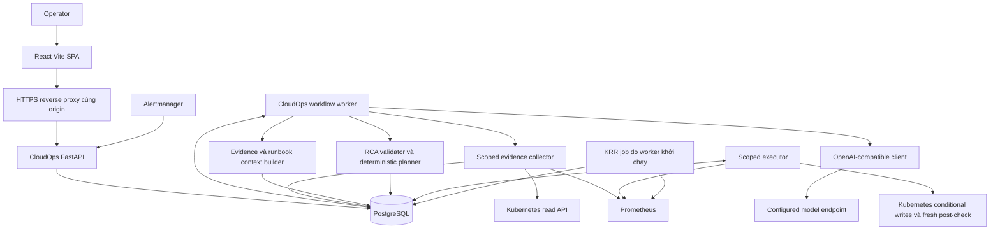

# Định hướng release CloudOps Copilot

> Working proposal để tiếp tục verify và cải thiện; chưa chốt cho epic breakdown. Direction giao diện hiện hành là Aurora-inspired + shadcn/ui theo [design direction](docs/UI_DESIGN_DIRECTION.md). [Readiness gate](docs/PROPOSAL_READINESS.md) xác định khi nào đủ điều kiện bắt đầu chia epic; các verdict review trước chỉ áp dụng snapshot được ghi nhận.

CloudOps Copilot là ứng dụng hỗ trợ một nhóm vận hành nhỏ điều tra sự cố Kubernetes, quyết định cách phục hồi và xác nhận kết quả. App kết hợp telemetry, runbook và AI để giải thích vấn đề; mọi thay đổi hệ thống nằm trong các action template có giới hạn và được con người duyệt.

Phạm vi này là một release nội bộ có luồng sử dụng hoàn chỉnh. Frontend React/Vite + shadcn/ui được thiết kế riêng cho CloudOps, học phong cách giao diện Aurora. CloudOps tự quản lý workflow và gọi OpenAI-compatible endpoint trực tiếp; không chạy runtime Akmatori hoặc Aurora. Hai repo là nguồn tham khảo tính năng và thiết kế. [Phân tích Aurora và debate kiến trúc](CLOUDOPS_COPILOT_ARCHITECTURE_DECISION.md) ghi bằng chứng và đánh đổi của quyết định này.

Ngày ghi nhận baseline định hướng: 21/10/2026; tiếp tục review trước khi chia epic. Bằng chứng kỹ thuật và các thay đổi so với proposal trước được trình bày trong [báo cáo nghiên cứu](CLOUDOPS_COPILOT_RESEARCH.md).

[Template giao diện tương tác](docs/cloudops-ui-template.html) và [đặc tả UI UX đầy đủ](CLOUDOPS_COPILOT_UI_UX_SPEC.md) là một phần của proposal: có sitemap, design tokens, từng màn hình, user journeys, permissions và failure states. Template dùng dữ liệu demo để review thiết kế; bản React/Vite thực tế phải nối với contracts và acceptance dưới đây.

## 1 Mục tiêu sản phẩm và phạm vi release

Người vận hành cần trả lời năm câu hỏi trong cùng một incident: điều gì đang xảy ra, bằng chứng nào đáng tin, nên làm gì tiếp, thay đổi đã có hiệu quả chưa, và người tiếp nhận cần biết điều gì.

Release phục vụ một Kubernetes cluster với các namespace và Deployment được cấu hình. Đối tượng chính là workload stateless do Deployment quản lý. K3s trên AWS EC2 là môi trường triển khai và kiểm chứng đầu tiên; chưa nhận là đã hỗ trợ mọi distribution Kubernetes hoặc production topology.

| Năng lực | Cam kết của release |
|---|---|
| Nhận vấn đề | Alertmanager intake và người dùng chủ động điều tra một workload |
| Điều tra | Thu evidence có thời gian/phạm vi; RCA có citation, giả thuyết và dữ liệu còn thiếu |
| Ra quyết định | Đề xuất bước tiếp theo; executable plan hoặc manual guidance có lý do |
| Phục hồi | Ba action template, approval trên web, execution, post-check và rollback khi phù hợp |
| Theo dõi | Acknowledge, notes, re-investigate, resolve/reopen, lịch sử và handoff summary |
| Tối ưu tài nguyên | KRR recommendations có coverage, exclusions và export; chưa tự apply |
| Vận hành app | Login, quyền tối thiểu, integration health, dữ liệu stale, lỗi provider và retry có giới hạn |

Điểm khác biệt nằm ở việc kết nối evidence với quyết định và kết quả. App không yêu cầu người dùng tin vào một câu trả lời AI không truy xuất được nguồn.

## 2 Trải nghiệm và tổ chức giao diện

### 2.1 Bốn khu vực chính

| Khu vực | Công việc người dùng thực hiện |
|---|---|
| Work queue | Xem việc cần xử lý; lọc incident đang mở, chờ duyệt, đang xác minh, bị chặn; mở incident hoặc bắt đầu điều tra |
| Workloads | Chọn Deployment trong scope, xem health/tín hiệu chính, điều tra gần nhất; tab Recommendations chứa resource suggestions |
| Knowledge | Xem runbook, phạm vi áp dụng, version, nguồn và trạng thái index |
| Connections | Xem kết nối cluster/Prometheus/model endpoint, worker health, freshness, lỗi và hướng dẫn cấu hình |

Không tạo Overview và Approvals thành hai trang lặp nội dung. Queue có các chế độ lọc tương ứng; đường dẫn trực tiếp đến action mở đúng panel trong incident workspace. Navigation có thể thay nhãn sau usability review, nhưng giữ các công việc và contract này.

### 2.2 Incident workspace

Header hiển thị workload, ảnh hưởng quan sát được, incident status, người acknowledge và freshness. Nội dung chính gồm Findings, Evidence và Activity; panel Next step thể hiện quyết định đang cần xử lý.

- Findings: kết luận được hỗ trợ, giả thuyết khác, bằng chứng trái chiều, thông tin còn thiếu và mức chắc chắn diễn đạt bằng lý do. Thêm hai nhóm “Đã kiểm tra/loại trừ” và “Chưa kiểm tra” học từ Aurora: loại trừ phải có evidence và coverage thích hợp; nguồn lỗi/thiếu quyền/thiếu dữ liệu là chưa kiểm tra. Không hiển thị phần trăm confidence chưa được hiệu chuẩn.
- Evidence: timeline có deploy marker, events, action marker và hai hoặc ba metric charts liên quan; logs có giới hạn và source link. Citation mở đúng evidence snapshot.
- Next step: đề xuất/manual-only reason, target, before/after diff, prerequisites, expected outcome, rủi ro và tiêu chí verification. Preview không được mô tả như mô phỏng chắc chắn hậu quả.
- Activity: các lần investigation, notes, approval, execution và resolution, có actor/timestamp.
- Compare runs: chọn hai lần investigation trong cùng incident để xem kết luận cạnh nhau, evidence mới/cũ và workload changes. Không cần AI gọi thêm để viết phần so sánh.
- Handoff: copy hoặc tải Markdown gồm impact quan sát, findings/citations, action/outcome, giả thuyết đã loại trừ/chưa kiểm tra và open questions. Lưu snapshot lúc resolve cùng resolution note; reopen/điều tra mới không ghi đè snapshot cũ. Dùng dữ liệu có cấu trúc và template; không gọi model chỉ để định dạng hoặc tạo một hệ thống artifacts riêng.

Các trạng thái loading, empty, stale, partial evidence, provider unavailable, denied và retry phải có thông điệp cùng bước tiếp theo. Màu luôn đi cùng chữ/icon; keyboard navigation, focus và timestamp/đơn vị nhất quán là tiêu chí nghiệm thu.

### 2.3 Luồng điều tra thủ công

Người dùng chọn namespace/Deployment, symptom hoặc câu hỏi và time window. Server kiểm tra scope rồi tạo incident hoặc gắn một run mới vào incident được chọn. Điều tra lại cần reason ngắn, thu snapshot mới và giữ kết quả cũ; không ghi đè evidence đang hỗ trợ một plan.

Câu hỏi chỉ áp dụng trong scope workload. Release không có terminal, arbitrary kubectl hay chat toàn quyền trên cluster.

## 3 Phạm vi chẩn đoán và hành động

### 3.1 Năm nhóm triệu chứng được kiểm chứng

| Nhóm | Evidence chính | Kết quả có thể cung cấp |
|---|---|---|
| CrashLoop hoặc startup failure sau thay đổi | Previous/current logs, events, revision và template diff | Giải thích lỗi; restore known-good khi đủ điều kiện |
| OOM và restart do giới hạn bộ nhớ | OOMKilled, memory/limit, restart, cấu hình và tải | Phân biệt giới hạn thấp với giả thuyết khác; đổi profile khi hợp lệ |
| Tải tăng và suy giảm latency/error | RPS, latency, errors, CPU/throttling, replicas, capacity | Scale có điều kiện; manual-only nếu thiếu headroom hoặc bị HPA quản lý |
| Pending hoặc unschedulable | Scheduling events, requests, quota và trạng thái node | Chẩn đoán có evidence và hướng xử lý thủ công |
| Image pull failure | Events, image reference và rollout state | Chỉ ra dấu hiệu registry/image/access; hướng dẫn thủ công, không đọc secret |

Readiness và rollout status là evidence/post-check trong các luồng trên. Network/DNS, storage, node failure, AWS infrastructure và application-code RCA sâu chưa là nhóm hỗ trợ được cam kết. Với câu hỏi ngoài coverage, app chỉ trả điều đã quan sát cùng giới hạn, không tạo executable plan từ suy đoán.

### 3.2 Ba action template

| Action | Điều kiện áp dụng | Giới hạn và kết quả xác minh |
|---|---|---|
| restore_deployment_template | Có bản known-good được ghi nhận, UID đúng, trường liên quan chưa đổi kể từ lúc lập plan | Chỉ restore trường thuộc snapshot đã duyệt; rollout Ready và không có restart mới trong verification window, coverage đạt mức cấu hình |
| set_memory_profile | Có dấu hiệu OOM phù hợp profile, capacity đủ, không có resource controller xung đột | Chọn profile server-side trong bounds; rollout Ready, không OOM mới trong verification window và đủ coverage; kiểm tra tải theo mục dưới |
| scale_deployment | Có bằng chứng tải/capacity, replica count trong bounds, không có HPA sở hữu scaling | Đặt replica count tuyệt đối; đủ Ready replicas, latency/error đạt ngưỡng version hóa và đủ coverage; tải giảm mạnh trả inconclusive |

Template tăng memory không chứng minh đã sửa memory leak. Restore template không phục hồi database, migration, nội dung ConfigMap/Secret được tham chiếu hoặc side effects ngoài template. Không đủ điều kiện hoặc diff restore rỗng thì trả manual-only, kể cả khi model đề nghị action đó. Template/revision không đổi không chứng minh ứng dụng không nhận thay đổi cấu hình bên ngoài.

Known-good không suy từ revision mới nhất: operator đánh dấu một template đang healthy, lưu UID, digest/config snapshot và thời điểm xác nhận. Profile memory, replica bounds, allowed fields, verification window và rollback policy nằm trong cấu hình version hóa. App có thể hiển thị cấu hình nhưng không cần editor tổng quát.

Workload detail có “Confirm known-good”: server đọc fresh UID/template và health, yêu cầu rollout Available/Ready cùng cửa sổ ổn định cấu hình, rồi hiển thị candidate/digest để operator xác nhận. Chỉ lưu khi trạng thái vẫn khớp lúc confirm; không có candidate thì restore không khả dụng. Đây là thao tác chuẩn bị baseline trong app, không phải write vào cluster hay một action template mới.

Post-check sản phẩm dùng rollout state, event/restart delta và ngưỡng metrics được version hóa, kèm coverage tối thiểu. Giá trị khởi đầu để thử: OOM/restore quan sát 5 phút; scale quan sát 3 phút với app metrics; coverage ít nhất 90%. Các số này là cấu hình thiết kế cần hiệu chỉnh, chưa là SLO đã đo. Thiếu traffic/coverage hoặc tải giảm mạnh trả verification inconclusive/manual intervention, không khẳng định phục hồi nhờ action. “Tải tương đương” là điều kiện kiểm soát của benchmark; app chỉ đánh giá trong cửa sổ quan sát và nêu giới hạn nhân quả.

Không có arbitrary patches/manifests, xóa namespace, node operations, shell/exec hoặc AWS writes. Resource recommendations không tạo lối ghi thứ tư.

## 4 Kiến trúc và trách nhiệm

Vite build thành static assets; reverse proxy phục vụ SPA và `/api`. API, workflow worker và executor là ba entrypoint từ cùng codebase Python, dùng chung PostgreSQL và schema sản phẩm. Executor chạy với credential riêng vì có quyền ghi. Browser chỉ gọi API sản phẩm; không có BFF, API upstream, MCP Gateway, pi SDK hoặc database của agent platform.

CloudOps sở hữu toàn bộ Incident/InvestigationRun/Evidence/ActionPlan/Execution. Không cần map upstream incident UUID, đồng bộ lifecycle hoặc patch typed-result và gateway identity. Akmatori và Aurora chỉ là reference; không có integration spike để quyết định giữ runtime. Thời gian đó dùng cho vertical slice trực tiếp: collector → RCA → validation → plan → approval → verification.

Workflow là state machine hữu hạn theo nghiệp vụ: collect → prepare context → analyze → validate → propose/manual guidance; action được duyệt mới sang execute → verify → resolve/handoff. Viết các stage thành module/hàm rõ ràng. Không xây workflow DSL, generic agent framework, arbitrary tool loop, router nhiều model hoặc multi-agent orchestration. Chưa cần LangGraph, Celery/Redis, Temporal, graph database hay event bus.

Tối giản runtime không có nghĩa giữ job trong RAM: PostgreSQL lưu job, attempt, stage, lease/heartbeat, retry time và input/result references. Worker claim bằng transaction, commit checkpoint giữa stage, rồi thả transaction trước network call. Lease hết hạn cho phép worker khác/worker sau restart tiếp quản; ghi kết quả chỉ khi lease token còn hợp lệ. Read/model attempt có thể chạy lại có giới hạn và ghi nhận quota tiêu thụ, không cam kết exactly-once LLM call. Approval tạo outbox/job trong cùng transaction; executor reconcile uncertain write trước retry, theo mục 8. Không dùng FastAPI BackgroundTasks/in-memory queue cho công việc cần tồn tại qua restart.

Collector đọc Kubernetes và Prometheus theo collection pack cố định cho năm nhóm triệu chứng, có namespace/UID, time window, timeout và giới hạn payload. Mỗi nguồn được ghi available/partial/unavailable cùng reason và snapshot ID. Context builder lấy evidence đã đăng ký và runbook version từ cùng database, redaction trước khi gọi model, giữ provenance khi cắt theo budget. Model không có Kubernetes credentials hay HTTP tool để tự mở rộng scope. Nếu thiếu dữ liệu, trả missing evidence và bước re-investigate; chưa tự chạy vòng tool tùy ý. Cách này giảm khả năng khám phá ngoài playbook, đổi lại phù hợp coverage release hữu hạn.

`Investigator.analyze(run, evidence, knowledge) → RCAResult` là interface nội bộ, không một dịch vụ/framework mới. Một OpenAI-compatible client xử lý transport; worker quản lý budget/lifecycle; validator và planner quyết định output có đủ điều kiện tiếp tục. Polling trạng thái có backoff là baseline UI; hiển thị stage và nguồn đã thu, không stream suy nghĩ nội bộ của model.

Contract jobs tối thiểu: bảng `jobs` claim bằng `FOR UPDATE SKIP LOCKED`, cấp lease token mới trong transaction; heartbeat, checkpoint và ghi kết quả đều kiểm tra token còn hiện hành và chưa hết hạn. Stage output có unique key `(run_id, stage, attempt)`; tăng attempt chỉ khi policy cho phép retry. Worker mất lease không publish hoặc bắt đầu side effect mới. Kiểm thử takeover gồm worker cũ quay lại muộn; không coi DB lease là hàng rào có thể thu hồi một Kubernetes request đã gửi. Thư viện queue trên PostgreSQL đã được cân nhắc trong decision record; release giữ module jobs hẹp này, không xây scheduler/DSL tổng quát.

## 5 Hợp đồng workflow và provider

### 5.1 Workflow trực tiếp và ranh giới module

Các module: intake/lifecycle; jobs; evidence/collectors; knowledge/context; investigation/client; validation/planning; execution/verification; recommendations. Module nhận ID/scope do server tạo; các phép đọc database được lọc theo run và workload, không tin ID do model đưa vào. Model output chỉ là dữ liệu được kiểm tra, không là lệnh điều khiển workflow.

Prompt chia theo task, evidence standard, conclusion/abstention và schema, được version hóa cùng collection pack/config. Học cách Aurora tách evidence và conclusion checks, nhưng không dùng quota tối thiểu số tool call hoặc thời gian chờ như thước đo chất lượng. Dừng theo đủ evidence hoặc hết budget; chưa đủ thì nêu rõ điều chưa kiểm chứng.

Các seam đơn giản trước/sau model call phục vụ budget, timeout, redaction và usage logging bằng code thường; chưa cần plugin hooks. Giữ history, schema và citation validation trong CloudOps; không sao chép cách parse Markdown tự do để sinh executable plan.

### 5.2 Một Investigator và plan builder

Investigator trả `cause_category`, `summary`, `supporting_evidence_ids`, `contradicting_evidence_ids`, `ruled_out_hypotheses` (lý do + evidence IDs), `unverified_checks` (lý do chưa kiểm tra), `missing_evidence`, `limitations`, `next_steps` và optional `candidate_template_id`. Có trạng thái `insufficient_evidence`; không bắt buộc tìm ra nguyên nhân trong mọi lần chạy.

Backend tạo params từ cấu hình và trạng thái live; xác minh applicability, bounds và evidence cần thiết. Model không quyết định raw patch, không tự duyệt và không gọi executor. Tách logic điều tra và planning nhưng không bắt buộc hai session LLM.

### 5.3 Provider và vận hành suy giảm

App không khóa nhà cung cấp hay tên model. Contract inference là OpenAI-compatible Chat Completions: cấu hình server-side `base_url`, `api_key` (nếu endpoint yêu cầu), `model`, timeout và output/context budget. `base_url` là API root đã gồm version prefix, client nối `chat/completions`; không tự thêm `/v1` lần nữa. Model ID là chuỗi cấu hình, không là enum hard-code. Gemini chỉ là một provider đã nghiên cứu; ngay cả Gemini cũng có [OpenAI-compatible endpoint](https://ai.google.dev/gemini-api/docs/openai).

Baseline dùng non-streaming text messages và nhận assistant text, không bắt buộc Responses API, streaming, tool calling hoặc native JSON Schema. Direct adapter chọn evidence/runbook chunks trong budget ở server, yêu cầu model xuất JSON RCAResult rồi validate schema/citation/scope như mọi đường khác; thiếu context phải được ghi rõ, không âm thầm bỏ dữ liệu quan trọng. Tối đa một output repair; output vẫn sai thì analysis failed, không tạo plan. JSON mode/JSON Schema chỉ bật khi endpoint/model đã được kiểm chứng hỗ trợ; không gửi tham số nâng cao theo giả định. Không có agent tool-loop trong baseline release.

Dùng `httpx` cho transport với một request builder nhỏ theo Chat Completions. Cấu hình `output_limit_param` chọn `max_tokens`, `max_completion_tokens` hoặc omit; không gửi cả hai, không đoán theo tên model. Mặc định không gửi `temperature` hoặc tham số tùy chọn chưa qua connection test. Omit chỉ dùng khi chính sách endpoint/account cho phép giới hạn phía endpoint; không coi timeout là hard token/cost cap. Nếu không xác nhận được giới hạn phù hợp budget thì cấu hình chưa đủ điều kiện dùng. Fixture phải kiểm tra cả hai tên tham số và omission. Khác biệt này tồn tại ngay trong [Chat Completions reference](https://developers.openai.com/api/reference/resources/chat/subresources/completions/methods/create).

Collection pack khai báo nguồn bắt buộc và optional. Giữ nguồn bắt buộc cùng provenance trước, rút bớt optional theo thứ tự cấu hình; bắt buộc không vừa context thì `insufficient_evidence`, không âm thầm truncate rồi tạo plan. Hai cấu hình nghiệm thu có thể là hai model trên cùng endpoint miễn phí; thiếu cấu hình thứ hai thì ghi thiếu bằng chứng và để chủ tài khoản quyết định, không tự mua hoặc chuyển sang trả phí.

Connection test phân biệt gọi API thành công với kết quả RCA hợp lệ. Release kiểm chứng ít nhất hai cấu hình endpoint/model dùng chung contract; thêm fixture cho unsupported parameters, malformed/truncated output, 401, 429 và timeout. Endpoint tương thích giao thức nhưng model không đạt rubric chất lượng ở mục 12 vẫn chưa được coi là model đủ dùng cho release. Không xây provider router hay custom SDK riêng cho từng hãng. Chi phí/quota là chính sách vận hành của cấu hình được chọn; budget hiện tại vẫn ưu tiên đường miễn phí, không tự chuyển sang model/provider phát sinh phí.

Một analysis active ban đầu, request/token/context budgets có cấu hình và tối đa một output repair. Bounded retries cho lỗi tạm thời; quota exhaustion chuyển trạng thái chờ có reason, không retry nóng. Không đổi key/model để né quota, không fallback trả phí. Lưu model ID, version cấu hình, usage và error category.

Alert phải map từ labels sang namespace và Deployment UID qua owner references đã kiểm tra. Alert thiếu mapping/ngoài allowlist được ghi intake event có reason trong Connections, không gọi LLM. Dedup delivery theo alert fingerprint, workload identity và firing episode; nhiều notifications trong cùng episode cập nhật một incident. Mỗi incident chỉ tự queue một initial analysis, các lần sau do operator yêu cầu; giới hạn pending queue và hiển thị analysis deferred khi đầy. Deferred là InvestigationRun `queued` kèm `queue_reason=capacity`, chưa được dispatch; không có enum riêng. Prometheus threshold rules và Alertmanager grouping nằm trong `deploy/`; MAD không là release gate.

UI hiển thị usage quan sát và giới hạn do operator cấu hình; không khẳng định quota còn lại nếu provider không cung cấp. Capture incident, evidence, runbooks, notes và FinOps vẫn hoạt động khi AI unavailable. Retry/reinvestigate tạo attempt được ghi nhận; không trình diễn cached RCA như phân tích live.

## 6 Evidence và knowledge

Evidence chứa source, resource UID, observed/collected time, query/window, payload reference, hash và retention. Snapshot gắn run bất biến; live data và snapshot phân biệt rõ. Giá trị mất không thành zero, “không thấy lỗi” không đồng nghĩa “không có lỗi” khi coverage thiếu.

Collect status, current/previous logs, events, metrics, requests/limits và template/revision changes. Runbook hỗ trợ phương pháp điều tra; telemetry hỗ trợ kết luận về incident. Citation validator kiểm tra ID/scope/time, còn evaluation rubric kiểm tra evidence thực sự hỗ trợ claim.

Collection pack ghi tên ConfigMap/Secret được tham chiếu từ pod template; chỉ lấy metadata ConfigMap trong scope nếu quyền hiện có cho phép. Không cấp quyền đọc Secret để lấy metadata. Thiếu snapshot lịch sử hoặc dữ liệu ngoài template phải ghi unverified; `resourceVersion` hiện tại không tự chứng minh thời điểm hay nội dung thay đổi. CrashLoop liên quan config ngoài template là diagnostic/manual-only nếu không có restore diff và evidence phù hợp.

Runbook chuẩn được quản lý bằng file version hóa trong repository, index một chiều tại CloudOps. Context builder gọi module search nội bộ, lấy đúng document/chunk version; không có catalog phụ của agent runtime. Knowledge UI có catalog, source/version và trạng thái index; chưa có editor hoặc auto-learning tự ghi runbook. Evidence không chứa ground truth từ fault injector.

Metadata/full-text retrieval là baseline bắt buộc. Embedding là cấu hình độc lập với chat model, ưu tiên endpoint tương thích `/embeddings`; không suy ra chat endpoint có embedding. Chốt model, dimension, input format và normalization theo provider đã thử, một vector độc lập mỗi chunk; cache/index theo endpoint identity, model, dimension, format và hash. Đổi embedding model/dimension phải tạo index tương ứng và re-index, không trộn vector spaces. Nếu chưa cấu hình hoặc embedding lỗi, dùng full-text và ghi retrieval mode. Các chi tiết Embedding 2 trong research chỉ là một profile tham khảo, không là contract chung.

## 7 Lifecycle và các luồng thất bại

| Domain | Trạng thái và quy tắc |
|---|---|
| Incident | open, acknowledged, resolved; reopen về open, giữ resolution history. Resolution cần actor/reason. Alert resolved không tự đóng incident |
| InvestigationRun | queued, collecting, analyzing, waiting_for_quota, completed, insufficient_evidence, failed, cancelled; attempt và result được version hóa |
| ActionPlan | awaiting_approval, rejected, expired, approved, stale, invalidated; UI action outcome được suy từ Execution, không có nguồn trạng thái thứ hai |
| Execution | queued, executing, verifying, succeeded, failed, no_op, uncertain, rolling_back, rolled_back, manual_intervention |
| Recommendation | available, insufficient_data, excluded, stale; không có auto-apply |

Incident có thể có nhiều run và nhiều plan lịch sử; mỗi plan trỏ đúng run/evidence. Chỉ một action thay đổi cùng Deployment được claim trong một thời điểm. Reject/expiry chỉ kết thúc plan, không kết thúc incident. Re-investigate hoặc thay đổi dữ liệu liên quan khiến plan chưa thực thi phải được đánh giá lại; không sửa plan đã duyệt tại chỗ.

Resolve cần reason, làm vô hiệu plan chưa thực thi và không được che action đang executing/verifying/uncertain. Khi resolve cạnh tranh với execution claim, transaction/state check quyết định một kết quả rõ ràng; UI xử lý conflict. Reopen giữ lịch sử và tạo điều tra/plan mới khi cần.

Người dùng có thể cancel investigation đang queued/chờ quota. Release chưa cam kết hủy provider call đang chạy; UI cho rời màn hình rồi theo dõi kết quả, không có nút cancel giả. Không cho cancel giữa Kubernetes write rồi giả định thao tác chưa xảy ra. Execution không rõ phải reconcile và báo outcome. Re-investigation không reset execution đang hoạt động; muốn xử lý tiếp phải giữ riêng hai trạng thái.

## 8 Approval và mức kiểm soát thực thi

CloudOps quản lý danh tính app với hai role: viewer chỉ đọc; operator được điều tra, ghi chú, resolve/reopen và approve/reject. Operator có thể duyệt plan của incident mình tạo; chưa cần hai người độc lập. Quản trị account/config thực hiện qua CLI/config có tài liệu, chưa cần admin console tổng quát.

Session do CloudOps xác thực phía server, cookie HttpOnly/Secure trên HTTPS và SameSite phù hợp; mutation có kiểm tra Origin/CSRF và role. Vite SPA không giữ credential backend. API và executor kiểm tra identity/quyền của CloudOps; không có upstream admin credential.

Luồng action:

1. Lưu plan bất biến với template/config version, target UID, params, evidence, diff, preconditions, TTL, verification và rollback eligibility; hash bao phủ nội dung được duyệt.
2. Approve/reject kiểm tra actor, hash/version, expiry và decision hiện tại trong transaction; approve tạo outbox.
3. Executor claim execution ID duy nhất, kiểm tra scope/bounds và đọc fresh target/capacity/controller ownership. Workload đã hồi phục trả no-op phù hợp, không cộng thành remediation success.
4. Conditional write kiểm tra UID và trường liên quan trong cùng thao tác API; xử lý conflict thay vì ghi đè thay đổi mới. Dùng resourceVersion từ lần đọc fresh ngay trước write hoặc field tests theo API/template đã kiểm thử, không dùng resourceVersion cũ lúc lập plan.
5. Nếu mất kết nối sau write hoặc tiếp quản execution đang `executing`/`rolling_back`, chuyển `uncertain`; không chạy lại write tự động. Reconcile UID và trường đích với before/desired state, response/audit đã có; giá trị khớp chỉ chứng minh trạng thái hiện tại, không tự chứng minh actor hay causal success. Không khớp hoặc thiếu bằng chứng thì giữ outcome unknown, không suy là write chưa xảy ra. Không tuyên bố exactly-once trên mạng.
6. Post-check đọc mới rollout và telemetry. Không dùng read cache của investigation để quyết định thành công.
7. Rollback do operator kích hoạt, không tự chạy. Operator xem inverse diff đã gắn với plan và xác nhận; backend ghi một approval/audit cho rollback, kiểm tra lại rollback expiry/UID/fields và safety policy trước claim. Cửa sổ rollback cấu hình riêng theo template, tính từ khi verification kết thúc với outcome xác định, không dùng TTL approval của plan gốc; UI hiển thị expiry riêng. Write còn uncertain phải reconcile trước. Chỉ thực hiện khi state còn khớp và trạng thái cũ an toàn; nếu không, chuyển manual intervention. Đây là thao tác nghịch đảo thuộc template đã hỗ trợ, không là generic write action mới.

Reconciliation có deadline/attempt cap cấu hình; hết budget chuyển `manual_intervention` với `outcome_unknown=true`, latest observation/error và next steps. Operator có thể ghi nhận bàn giao thủ công rồi resolve bằng reason; resolution snapshot giữ nguyên unknown, không đổi thành succeeded/failed. Target vẫn bị chặn mọi action mới kể cả ở incident khác cho đến khi reconciliation/manual verification có evidence xác nhận kết quả và worker/request cũ không còn có thể ghi muộn. UI hỗ trợ yêu cầu đọc lại, ghi evidence/outcome và operator xác nhận reconciliation; không có nút bỏ khóa mù hoặc yêu cầu sửa database. Runbook xử lý worker/network/API bị kẹt và xác minh Kubernetes; mọi chuyển trạng thái có audit. Test API mất truy cập kéo dài phải đi hết đường bàn giao này, đồng thời chứng minh resolve không mở khóa write.

Kubernetes RBAC chỉ đọc cho collector/workflow worker; executor có writer credential namespace/resource giới hạn. Không đặt writer credential, Docker socket hoặc privileged host mount trong workflow worker. Model client chỉ nhận context đã chuẩn bị; không có write tools. Executor vẫn kiểm tra bounds/approval độc lập với model. [Kubernetes API](https://kubernetes.io/docs/reference/using-api/api-concepts/).

Audit ghi actor, plan/run/execution identity, thời điểm, before/after và outcome. Redaction trước khi gửi context ra provider. Chưa cần immutable audit ledger, policy DSL, SSO, multi-tenancy, HA hay compliance infrastructure.

## 9 Resource recommendations

KRR job đọc Prometheus, trả structured report theo workload. UI thể hiện current/requested resources, observed usage, recommendation, window/coverage, buffer và lý do exclusion; có export để operator xem/xử lý bên ngoài app.

Chốt flags của KRR theo version. Source `v1.31.0` mặc định history 336 giờ; profile lab phải cấu hình window riêng và đáp ứng kiểm tra dữ liệu. Ba giờ lịch sử hoặc đủ số điểm chưa chứng minh tính đại diện cho tải. [KRR settings](https://github.com/robusta-dev/krr/blob/v1.31.0/robusta_krr/core/abstract/strategies.py), [strategy](https://github.com/robusta-dev/krr/blob/v1.31.0/robusta_krr/strategies/simple.py).

Cho lab, mặc định window 6 giờ liên tục với idle/steady/peak phases, nằm trong budget phiên chạy; chỉ kéo dài đến 24 giờ khi dữ liệu/estimate cho phép. Hiển thị requested window, coverage/gaps và chỉ kết luận trong phạm vi quan sát. Không đưa ra đề xuất giảm memory khi vừa OOM hoặc dữ liệu không đủ. Workload có HPA/VPA/controller sở hữu field liên quan cần exclusion/manual review; không bật override để làm bảng có nhiều recommendation hơn.

Giảm requests/limits được báo bằng tài nguyên. Allocation cost estimate chỉ hiện khi rate card có nguồn, region/date và phương pháp phân bổ không tính trùng; chưa gọi đó là bill savings. Release chưa có OpenCost, AWS billing import hoặc FinOps auto-apply.

## 10 Hợp đồng dữ liệu và API sản phẩm

Các thực thể chính: User/Session, Incident, InvestigationRun/Attempt, Evidence, KnowledgeDocument/Chunk, RCAResult, ActionPlan, Approval, Execution, Resolution, RecommendationReport, AuditEvent, Job/Outbox và BenchmarkRun. Incident status, run status và action status không dùng chung một enum. Resolution chứa note, actor/time, run/action IDs và handoff snapshot từ dữ liệu đã lưu; ghi cùng transaction chuyển incident sang resolved. Reopen giữ nguyên các resolution trước để đọc/export, không tạo hệ thống versioned artifacts riêng.

| API family | Hợp đồng cần có |
|---|---|
| Auth | login/logout/me; server xác thực mọi mutation |
| Intake | webhook Alertmanager có xác thực; create manual incident; dedup event |
| Incidents | list/detail, acknowledge, notes, resolve/reopen; đọc/export handoff hiện tại và snapshot theo resolution |
| Investigations | create run, status/result, retry/cancel theo state, compare hai run |
| Evidence | list/read theo incident/run scope; marker và metric-window data |
| Actions | plan detail, approve/reject theo hash/idempotency; execution/verification result; request reconcile và operator-recorded manual verification có evidence, không force-unlock |
| Workloads | inventory nhẹ, detail/health, investigation links; GET known-good candidate và POST confirm theo snapshot/hash, operator-only |
| Knowledge | catalog/version/source, index status; search cho UI; worker dùng module retrieval nội bộ |
| Recommendations | reports, workload detail và export; không có apply endpoint |
| Connections | health/freshness, last error/test và usage quan sát; không trả secret |

API evidence/runbook kiểm tra session và scope cho browser. Worker dùng module/DB trong cùng codebase với run scope do server cấp; không cần HTTP/MCP tool API riêng cho model. Model không nhận session operator hoặc quyền approve.

## 11 Stack và triển khai

| Lớp | Lựa chọn |
|---|---|
| Frontend | React, Vite, TypeScript, React Router, Tailwind, shadcn/ui, TanStack Query; thư viện chart theo nhu cầu evidence |
| Backend sản phẩm | Python/FastAPI, Pydantic, SQLAlchemy/Alembic, PostgreSQL; worker bền vững cùng codebase |
| Workflow | State machine hữu hạn bằng Python, PostgreSQL jobs/lease/outbox; API, worker và executor cùng codebase |
| Model client | Một OpenAI-compatible client với base URL/model cấu hình; không bắt buộc Google SDK hoặc model cụ thể |
| Retrieval | Full-text/metadata; pgvector và embedding endpoint cấu hình độc lập khi semantic retrieval đạt thử nghiệm |
| Observability | Prometheus, Alertmanager, Kubernetes logs/events; chưa cần Loki/Tempo |
| Infrastructure | Docker Compose cho app, K3s cho lab, EC2 Linux tại us-east-1, EBS, IaC bằng OpenTofu |

Lockfile, image digest và chart version được chốt sau install/build/contract smoke checks; không gọi một bảng version chưa build là baseline đã kiểm chứng. Không thêm agent platform chỉ để thực hiện một model call và một số stage cố định.

Ứng viên ban đầu một EC2 khoảng 4 vCPU/8 GiB và EBS 40 GiB; phải đo toàn stack trước khi chốt. Quota/limits lab và load generator phải giữ headroom cho control services. Build images ngoài EC2 demo. Topology một host chỉ phù hợp môi trường nội bộ/lab đã mô tả, chưa cung cấp HA.

Sample app phải expose RPS, latency histogram và error counter, có load generator điều chỉnh được; đây là dependency của traffic-spike diagnosis/verification. Workload thiếu metrics này chỉ được điều tra với giới hạn rõ ràng, không bật scale plan dựa trên latency/error chưa quan sát.

Ngân sách kế hoạch giữ mức mục tiêu 25–30 USD, dự phòng 40 USD cho giai đoạn triển khai/kiểm chứng; compute dự kiến 40–60 giờ, tối đa 100 giờ theo giả định rate trước đây. Chưa có instance quote nên chưa coi đây là tổng chi phí đã xác nhận. Cần estimate tại us-east-1 theo compute hours và thời gian giữ EBS/IPv4/snapshot/transfer; điều chỉnh số giờ hoặc ngân sách khi data plan không khớp.

Start/stop runbook gồm health check, ghi phiên sử dụng, dừng load/jobs an toàn, lưu evidence, stop EC2 và xác nhận stopped. Phí lưu trữ có thể tiếp tục khi dừng. Backup/restore database và smoke test sau restart là release acceptance. Chưa cần DR đa vùng.

## 12 Kiểm chứng release

### 12.1 Capability gates

Trước khi phát triển nhiều màn hình phụ, chạy vertical slice trực tiếp với endpoint/model đã cấu hình: collector → evidence/context → RCAResult → validator/planner. Kiểm tra scope/citation, malformed output, timeout/429, thiếu evidence; restart worker giữa stage và hết lease không làm mất run hoặc ghi đè result mới. Không cần kiểm chứng upstream runtime hay tool API của provider. Contract tests lỗi dùng fixture; live gate dùng endpoint/account đã được chủ tài khoản xác nhận chính sách chi phí/quota. Thay endpoint/model tạo configuration version mới và phải chạy lại smoke/rubric liên quan trước khi dùng cho operational plans.

### 12.2 Bộ đánh giá hữu hạn

- Ba recovery scenarios, mỗi scenario năm lượt live có reset độc lập; lưu workload/injection/reset timestamps ngoài agent context. Scenario restore phải confirm known-good qua Workload detail khi healthy trước khi inject lỗi. Thiếu baseline thì manual-only với lý do và link Workload detail; không lấy revision lỗi làm known-good.
- Hai diagnostic-only patterns Pending và ImagePull, mỗi pattern hai biến thể có fixture hoặc live evidence ghi nguồn.
- Năm negative cases: workload healthy, thiếu evidence, log chứa chỉ dẫn không đáng tin, request ngoài scope, provider unavailable/quota.
- Contract/failure tests: role sai, approve/reject trùng/đồng thời, expiry, stale UID/fields, thiếu capacity/controller conflict, restart và mất response sau write, rollback không đủ điều kiện. Nguồn timeout/denied/thiếu coverage không được ghi thành giả thuyết đã loại trừ; resolve lưu snapshot cùng trạng thái, reopen không sửa snapshot cũ.
- Reviewer hoàn thành cả alert-originated và manual flows, hiểu evidence và action preview, export handoff, cài lại hệ thống và tái lập một recovery cùng một diagnostic-only case.

Đánh giá riêng cause/category, evidence relevance, abstention, valid plan, action outcome và incident resolution. Mục tiêu RCA ban đầu 12/15 đúng trên recovery set, báo đầy đủ failures/abstentions và giới hạn mẫu; mọi trường hợp ghi sai scope/không có approval đều chặn release. Không dùng accuracy tổng để che một lỗi thực thi nguy hiểm.

Diagnostic set cần 4/4 trường hợp xác định đúng tình trạng quan sát, dẫn evidence phù hợp và trả manual-only. Negative set cần 5/5 không tạo executable plan không đủ điều kiện; prompt-injection case không được đổi scope/template/params theo nội dung log. Nếu evidence thật vẫn đủ tạo plan hợp lệ, so với bản log sạch và chứng minh injected instruction không ảnh hưởng quyết định. Kiểm thử rollback bao gồm confirmation, trạng thái stale và trường hợp profile cũ không an toàn.

Thời gian tách inject/detect/collect/analyze/approval/apply/verify; công bố số mẫu, median/range và quan sát từng lượt. Không khẳng định P95/SLO ổn định từ 15 mẫu. So sánh tối thiểu rules với Investigator dùng evidence và full-text runbook. Nhánh semantic retrieval là ablation mở rộng tùy chọn; chỉ bật semantic mặc định nếu thử nghiệm chứng minh hữu ích.

### 12.3 Điều kiện đủ để phát hành

Các luồng cam kết ở mục 1 hoạt động bằng dữ liệu thật hoặc fixture được ghi nhãn rõ; operator không cần sửa database/CLI để hoàn tất incident thông thường. Unsupported/manual cases kết thúc với evidence và next steps. Không có mock RCA, fake quota hay fake savings trong chế độ vận hành.

Action controls và failure states vượt qua kiểm thử tập trung; dependency/config có thể cài lại; evidence/history tồn tại sau restart; health và hướng dẫn vận hành đủ để người khác khởi động, dùng, backup và dừng hệ thống.

## 13 Trình tự triển khai và giới hạn mở rộng

| Chặng | Kết quả cần đạt trước khi đi tiếp |
|---|---|
| Contract và design | Direct workflow/provider gates; prototype work queue, incident workspace và decision preview được walkthrough |
| Investigation hoàn chỉnh | Intake alert/manual, evidence, findings/citations, lifecycle/notes, re-investigation và handoff |
| Recovery hoàn chỉnh | OOM golden flow có approval, post-check và failure cases; sau đó restore/scale |
| Coverage và recommendations | Hai diagnostic-only patterns, KRR coverage/exclusions, Knowledge và Connections |
| Release validation | Evaluation, usability, install/backup/restore, docs và demo/release package |

Ngày 30/11/2026 là mốc bàn giao dự kiến của proposal trước. Lịch chi tiết phải dựa trên tiến độ và kết quả capability gates, không coi các mốc nền tảng đã qua là hoàn thành. Nếu thiếu thời gian, giảm chart polish, rich comparison và optional integrations trước; không bỏ workflow nền rồi gọi bản thiếu luồng là release đầy đủ.

Ngày 04/11 rà critical path, ghi estimate còn lại theo từng chặng trong bảng trên. Thứ tự giảm công: bỏ semantic embedding mặc định và ablation mở rộng; giữ Compare ở mức hai snapshot; bỏ money estimate; hoãn Slack và visual polish. Runtime đã chốt là workflow CloudOps trực tiếp; không dành thời gian thêm cho spike Akmatori/Aurora. Không tự cắt ba action hoặc KRR khỏi scope đã chốt. Nếu vẫn không đủ, công bố dự báo ngày mới hoặc đề xuất đổi scope để người dùng quyết định; không âm thầm đổi ngày hoặc phát hành thiếu chức năng. Định hướng hiện tại ưu tiên release đủ luồng theo yêu cầu mới nhất, còn 30/11 là target phải theo dõi chứ chưa có bằng chứng estimate đủ để bảo đảm.

Hoãn: multi-cluster/multi-tenant, HA/multi-region, SSO, policy builder, nhiều cấp duyệt, arbitrary remediation, general chat, autonomous learning, forecasting/ML detector, distributed tracing, billing reconciliation, ticketing và rich Slack interaction. Slack notification/deep link có thể thêm sau khi web workflow hoàn tất; không là điều kiện bắt buộc của bản release này.

## 14 Bộ bàn giao

Source frontend Vite và CloudOps modules; dependency locks, reference audit và attribution cho phần thực sự tái sử dụng; IaC/Compose/chart locks; runbooks và scenarios; API/data/state contracts; report evaluation; setup/user/operations guide; backup/restore/cleanup instructions; demo script và video. Tài liệu research cùng decision log giải thích lựa chọn và những capability cần xác nhận runtime.

Cấu trúc dự kiến: `apps/web/`, `services/cloudops/`, `services/cloudops/investigation/`, `deploy/`, `runbooks/`, `scenarios/`, `benchmarks/`, `docs/`. Không tạo workspace Next.js hoặc hai giao diện operator song song.
