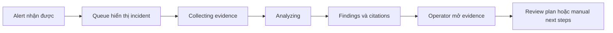

# Template giao diện và luồng UI UX CloudOps Copilot

Đặc tả này đi cùng [proposal release](CLOUDOPS_COPILOT_RELEASE_PROPOSAL.md). Template tương tác nằm tại [cloudops-ui-template.html](docs/cloudops-ui-template.html); dữ liệu trong template là dữ liệu minh họa, mọi hành động được mô phỏng cục bộ. Đây là reference cho frontend React/Vite, chưa là implementation kết nối backend.

**Direction mới:** học phong cách Aurora và áp dụng shadcn/ui cho bản redesign theo [design direction](docs/UI_DESIGN_DIRECTION.md). Template HTML hiện tại giữ để đối chiếu luồng, chưa phải bản redesign Aurora/shadcn. UI đang mở review trong issue riêng; chưa chốt để chia epic.

## 1 Hướng thiết kế

Giao diện tổ chức theo công việc cần hoàn thành: chọn vấn đề, hiểu evidence, quyết định bước tiếp theo, kiểm tra kết quả và bàn giao. Không sao chép navigation hoặc màn hình Akmatori. Không đặt một hộp chat tổng quát làm trung tâm sản phẩm.

Tham khảo Aurora ở dark neutral shell, sidebar gọn, phân cấp title/metadata, citations và panel theo ngữ cảnh. CloudOps giữ bốn khu vực và luồng riêng; không copy chat history, brand hoặc command execution. Bản React dùng component shadcn/ui thật với semantic tokens, thay cho các control tự vẽ của HTML demo. Design direction có source/ảnh tham khảo, token và component mapping.

Các nguyên tắc:

- Một incident có một workspace; kết luận, evidence và hành động không bị tách sang ba ứng dụng.
- Cạnh mỗi claim quan trọng có đường mở evidence. Nguồn và thời gian được nhìn thấy trước khi đọc toàn bộ logs.
- Một primary action theo trạng thái. Khi không thể thực hiện, giải thích nguyên nhân và cho đường tiếp theo.
- Incident, investigation và action có nhãn riêng. “Analysis complete” không mang nghĩa “Recovered”.
- Theo dõi phiên bản; lần điều tra mới không thay thế bằng chứng dùng cho quyết định cũ.
- Đồ thị phục vụ câu hỏi cụ thể. Không thêm biểu đồ hoặc số tổng chỉ để lấp đầy dashboard.

## 2 Design tokens và components

| Thành phần | Quy định cho implementation |
|---|---|
| Nền và bề mặt | Neutral sáng/tối học từ Aurora, dark là reference chính; sidebar và content phân cấp nhẹ; panel/drawer opaque; semantic shadcn tokens |
| Màu ngữ nghĩa | Primary trung tính tương phản rõ; blue cho citation/focus; amber cho cần chú ý; đỏ cho thất bại; xanh cho verified outcome. Mỗi trạng thái có chữ và icon; thay teal mặc định của demo cũ |
| Typography | Sans-serif cho nội dung; monospace cho namespace/resource ID, log, diff. Body khoảng 14–16px, supporting text tối thiểu 12px |
| Spacing | Thang 4/8px; density phù hợp bảng incident và evidence; phân biệt group bằng khoảng cách |
| Controls | shadcn Button/Input/Select/Dialog/Sheet/Tabs/Badge/Table; label rõ, variants nhất quán. Không dùng icon-only cho approve/reject/resolve |
| Status | Compact badge kèm text; busy state có tên thao tác, không có phần trăm giả |
| Evidence | Source chip, timestamp, UID/workload, freshness, excerpt; citation button mở drawer có context |
| Diff | Before/after của từng field với đơn vị; không chỉ dùng màu thêm/xóa; raw JSON có thể mở bổ sung |
| Metrics | Đơn vị, time window, legend, deploy/action marker; missing sample là gap |
| Feedback | Inline validation cho form, banner cho dependency failure, toast chỉ cho thông báo không cần giữ lâu |
| Motion | Chuyển trạng thái ngắn; không animate charts liên tục; tôn trọng reduced motion |

Desktop từ khoảng 1100px dùng navigation trái, content trung tâm và Next step panel bên phải. Tablet gộp Next step xuống dưới findings hoặc drawer; mobile từ 320px dùng navigation dạng hàng/menu, stack panels và giữ đầy đủ nhãn. Bảng chỉ scroll ngang khi không thể chuyển thành item list. Không giấu tiêu chí approval chỉ vì màn hình nhỏ.

Accessibility: target tương tác chạm khoảng 44px; focus visible; native controls; dialog có title, focus handling và Escape khi phù hợp; lỗi form có `role=alert`; cập nhật outcome có `aria-live`. Contrast cần kiểm tra trên cả theme trước release. Template là layout reference, không thay thế accessibility testing của bản React.

## 3 Sitemap và route contracts

| Route đề xuất | Màn hình | Nội dung chính |
|---|---|---|
| `/login` | Login | Account/password, lỗi xác thực, trạng thái đang gửi; không có public sign-up |
| `/queue` | Work queue | Filter theo attention/status/workload, search, freshness, nút Investigate |
| `/incidents/:id` | Incident workspace | Findings, Evidence, Activity, Compare; Next step theo trạng thái |
| `/incidents/:id?action=:actionId` | Action deep link | Cùng workspace, mở đúng plan/version; không tạo một action detail page trùng |
| `/workloads` | Workloads | Deployment trong scope, readiness/restarts, last investigation; chọn workload |
| `/workloads/:id` | Workload detail | Health, thay đổi gần nhất, related incidents và Investigate |
| `/workloads?tab=recommendations` | Recommendations | Reports, requested window/coverage, current/recommended values, exclusions và export |
| `/knowledge` | Knowledge | Catalog, search, tags, source/version; runbook read view |
| `/connections` | Connections | Integration health, freshness, model, observed usage, lỗi và config help |

Search/filter/tab/selected run có thể lưu trong URL để chia sẻ lại đúng ngữ cảnh. Browser back giữ filter/scroll hợp lý. Query string không chứa raw telemetry, secret hoặc auth token. Handoff export ghi permalink cùng snapshot IDs; link chỉ mở được với quyền của người xem.

## 4 Màn hình và hành vi chi tiết

### Work queue

Ưu tiên “Needs attention”, “Awaiting decision”, “Verifying”, “Blocked” và “Resolved”. Mỗi hàng hiển thị incident title, workload/namespace, severity có nguồn, incident state, investigation/action state, freshness và actor acknowledge nếu có.

Default sort ưu tiên việc cần hành động và thời điểm cập nhật; operator có thể filter/search. Empty state phân biệt không có incident với filter không có kết quả. Một banner mất telemetry không làm tất cả workload biến thành healthy. Nút Investigate luôn có thể mở form nếu operator còn quyền, dù không có alert.

### Incident workspace

Findings mặc định hiển thị kết quả mới nhất đã hoàn tất, kèm run/time và trạng thái nếu có run mới đang chạy. Nếu run mới thất bại, giữ kết quả cũ với nhãn cũ/stale, không hiển thị như mới thành công.

Học từ Aurora, Findings tách “Đã kiểm tra/loại trừ” và “Chưa kiểm tra”. Mỗi kết luận loại trừ có lý do, evidence IDs và window/coverage; lỗi kết nối, thiếu quyền hoặc không thu được dữ liệu nằm trong chưa kiểm tra, không có dấu check xanh giả. Hướng dẫn bổ sung bằng chứng dẫn đến re-investigate có scope, không mở terminal hoặc agent chat. Đây là hai nhóm trong màn hiện có, không thêm navigation.

Evidence drawer gồm nội dung gốc đã redaction, source, UID, observed/collected timestamps và window. Citation thiếu hoặc sai scope được hiển thị là kết quả không hợp lệ; không tạo hyperlink đến nguồn không tồn tại.

Activity sắp theo thời gian, lọc hệ thống/người dùng nếu cần. Note có actor/time; chưa cần mentions hoặc collaborative editing. Compare hiển thị hai run cụ thể cùng evidence khác biệt; thay đổi hash không được diễn giải tự động thành nguyên nhân.

Next step có bốn nhóm: cần thêm evidence; hướng dẫn thủ công; cần review plan; đang thực thi/xác minh. Sau success vẫn có bước operator xác nhận resolution hoặc tiếp tục điều tra.

### Workloads và recommendations

Inventory chỉ chứa Deployments allowlisted, không xây object explorer toàn Kubernetes. Workload không có telemetry hiển thị unknown. Nút Investigate prefill scope từ workload hiện tại.

Workload detail có known-good baseline: hiển thị current revision, health/stability window, candidate hash và bản đã xác nhận. Operator chọn Confirm known-good, đọc snapshot/digest rồi xác nhận; server kiểm tra lại trạng thái trước khi lưu. Unhealthy/changed candidate bị chặn. Luồng này chuẩn bị điều kiện cho restore và chỉ ghi metadata của app, không sửa workload. Khi chưa có baseline mà workload đã lỗi, Next step ghi “No confirmed known-good baseline”, trả manual-only và link Workload detail; không đề nghị xác nhận workload đang lỗi. Setup scenario restore phải xác nhận baseline trước fault injection.

Baseline có trạng thái có/không, thời điểm/tuổi snapshot và revision đã xác nhận; restore preview hiển thị lại nguồn này. Không có diff hoặc thay đổi chỉ ở config ngoài template thì manual-only, không gợi ý restore sẽ hoàn tác ConfigMap/Secret.

Recommendations hiển thị CPU request, memory request/limit, usage quan sát, window, coverage và version KRR. Excluded/insufficient/stale là kết quả bình thường có giải thích, không dùng zero thay giá trị thiếu. Export không đồng nghĩa apply. Không đặt nút “Save $X” khi chưa có billing evidence.

### Knowledge và connections

Knowledge dùng catalog read-only với nội dung/source/version. Link từ một investigation mở đúng runbook version đã dùng; version hiện hành và snapshot cũ phân biệt rõ. Index lỗi có ảnh hưởng đến retrieval nhưng vẫn cho xem file đã có.

Connections phân biệt connectivity, credentials/config issue, stale source và rate limit. Hiển thị endpoint label, model ID, runtime đang dùng, last success/attempt/error và capabilities đã kiểm chứng. Test connection phân biệt transport OK với RCA contract OK; token usage thiếu thì ghi unavailable, không hiện zero. Endpoint/model được cấu hình phía server, không khóa Google/Gemini. Không có secret editor, arbitrary endpoint editor hoặc số quota remaining suy đoán. Hướng dẫn cấu hình giải thích base URL, credential reference, model và budget; embedding là kết nối optional riêng.

## 5 Luồng UI UX từ đầu đến cuối

### A Alert đến incident và giải thích

Alert trùng cập nhật context liên quan thay vì tạo hàng mới mỗi lần webhook. UI hiển thị lần thấy đầu/cuối; ingestion failure phải hiện ở health/log vận hành, không giả tạo incident thành công.

### B Điều tra thủ công và điều tra lại

1. Bấm Investigate, chọn namespace/Deployment, câu hỏi và window.
2. Form kiểm tra trường bắt buộc, scope và window; submit chỉ thành công khi server trả run/incident identity.
3. Theo dõi queued/collecting/analyzing. Người dùng có thể chuyển màn hình và quay lại.
4. Kết quả có citations hoặc insufficient-evidence với thông tin cần bổ sung.
5. Sau thay đổi do người vận hành, bấm Re-investigate, nhập reason, tạo run mới.
6. Compare chọn run trước/sau. Plan chưa thực thi bị stale khi dữ liệu liên quan thay đổi; cần plan mới và approval mới.

### C Review và thực thi hành động

1. Next step trình bày reason, target UID/workload, diff, prerequisites, rủi ro, expected outcome, expiry và rollback eligibility.
2. Review mở vùng xác nhận cùng plan hash/version. Approve và Reject có label riêng; reject ghi reason.
3. Approve gửi identity/hash/idempotency key, nút chuyển pending. UI chỉ hiển thị Approved sau server ACK.
4. Server trả conflict/expired/denied thì giữ context, nêu nguyên nhân và hướng replan hoặc nhờ operator.
5. Executing rồi Verifying hiển thị tiến trình theo event thực, before/after và telemetry window. Không có nút approve lại.
6. Succeeded, Failed, No-op, Uncertain, Rolled back hoặc Manual intervention có nội dung riêng. Success đưa nút Resolve; uncertain đưa bước kiểm tra thủ công. Nếu rollback eligible, operator mở inverse diff, xác nhận rollback và chờ backend kiểm tra/audit; không tự rollback và không bỏ qua stale checks. Inconclusive verification không hiển thị thành success.

Viewer nhìn thấy plan và outcome nhưng không có mutation; nơi cần quyết định hiển thị “Operator approval required”. Không chỉ ẩn button rồi bỏ kiểm tra server.

### D Resolution và bàn giao

Operator xem verification, nhập resolution reason và resolve. Khi action đang executing/verifying, giữ incident trong queue và yêu cầu hoàn tất/reconcile trước khi resolve; resolution không được che một thay đổi đang diễn ra. Resolve làm vô hiệu các plan chưa thực thi; nếu decision và execution claim đang cạnh tranh, server trả conflict thích hợp.

Reopen giữ lịch sử và yêu cầu reason. Handoff summary có thể xuất ở mọi trạng thái; ghi rõ unresolved/uncertain khi chưa xong. Khi resolve, lưu handoff snapshot gắn resolution và các run/action IDs, gồm cả điều đã loại trừ/chưa kiểm tra. Reopen không ghi đè snapshot cũ. Preview hiện thời và snapshot lúc resolve được ghi nhãn riêng; template tạo bằng dữ liệu app, không thêm suy luận AI mới. Không cần postmortem editor/version-restoration UI hay artifacts workspace riêng.

Re-investigate không làm mất action đang executing/verifying; UI giữ execution panel độc lập hoặc chặn tạo plan mới cho đến khi action kết thúc. Cancel chỉ có ở run queued/waiting-for-quota; không giả định hủy được provider call đang chạy.

### E Provider unavailable hoặc thiếu evidence

Queue và workspace vẫn xem được dữ liệu đã thu. Banner hiển thị reason/last attempt; operator xem runbooks và ghi chú, retry khi phù hợp hoặc resolve thủ công với lý do. Không cho approve một plan mới suy từ output lỗi. Plan cũ hợp lệ chỉ tiếp tục sau kiểm tra state/preconditions như mọi action khác.

Blocked filter tổng hợp các incident có run waiting-for-quota/failed/insufficient-evidence, queued với queue_reason=capacity, hoặc execution uncertain/manual-intervention, loại incident đã resolved. “Analysis deferred” là nhãn của queued/capacity, không là enum mới. Alert resolved hiện như một tín hiệu để operator xem xét resolution; không tự đóng incident.

### F Resource recommendation

Chọn workload hoặc tab Recommendations → chọn report/window → đọc coverage/exclusions → so sánh current/observed/recommended → export. Nếu dữ liệu chưa đủ, UI giải thích cần thu thêm dữ liệu; không có nút tự hạ giới hạn an toàn để bỏ exclusion.

## 6 Ma trận trạng thái giao diện

| Tình huống | UI bắt buộc | Hành động được phép |
|---|---|---|
| Loading lần đầu | Skeleton phù hợp cấu trúc, tên thao tác | Chuyển khu vực; không hiển thị số 0 giả |
| Empty dataset | Empty state và lý do | Investigate nếu operator |
| Empty filter | Giữ filter, báo không có kết quả | Clear filter |
| Partial evidence | Nguồn có/thiếu, thời gian và limitations | Xem evidence, runbook, điều tra lại |
| Quota/provider failure | State chờ/lỗi, last attempt và retry policy | Xem dữ liệu, ghi note, retry khi server cho phép |
| Stale evidence/plan | Dấu stale rõ, nêu điều kiện đổi | Xem snapshot cũ; re-investigate/replan |
| Approval pending | Disable double-submit, giữ plan version | Chờ server; reload có thể reconcile |
| Expired/rejected | Decision history và reason | Tạo plan mới; incident vẫn mở |
| Failed verification | Các check đạt/không đạt, rollback eligibility | Rollback theo policy hoặc manual intervention |
| Uncertain write | Nêu chưa biết kết quả ghi, trạng thái/deadline reconciliation | Không retry mù; xem latest target hoặc lỗi đọc. Hết budget → manual intervention/outcome unknown; operator ghi nhận bàn giao và resolve có reason, target vẫn khóa write xuyên incident |
| No-op | Nêu workload đã thay đổi/hồi phục trước apply | Review evidence và resolve thủ công |
| Read-only user | Dữ liệu vẫn đầy đủ, mutation disabled/có giải thích | Xem và xuất nội dung được phép |
| Session expired | Thông báo và login lại; giữ route an toàn | Sau login đọc lại state, không tự replay approval |
| Recommendation thiếu dữ liệu | Không có số recommendation giả | Xem coverage và điều kiện thu thêm |

## 7 Phạm vi prototype và nghiệm thu frontend

Prototype minh họa app shell, queue, incident workspace, forms và các trạng thái chính bằng dữ liệu giả có nhãn. Các tương tác không gọi provider, Kubernetes hay gửi phê duyệt thật. Các giả thuyết UX cần walkthrough: người dùng tìm được bằng chứng nhanh hơn, hiểu tác động trước approval và bàn giao không mất context.

Template mô phỏng rút gọn: queue chỉ có All/Awaiting approval/Manual guidance; chưa click-through rollback, uncertain và no-op hoặc lưu resolution snapshots bền vững. Một số biến demo dùng stale để biểu diễn plan vô hiệu sau resolve và gộp failed thành Manual intervention. React phải theo enum/domain contracts trong proposal (invalidated, failed và manual_intervention riêng), đủ queue filters ở mục 4, không sao chép state machine rút gọn. Rollback UI có cửa sổ eligibility/expiry riêng tính từ outcome verification xác định, không dùng TTL approval gốc. Connections hiển thị CloudOps worker, configured model endpoint và capabilities; không có màn quản trị runtime Akmatori/Aurora.

Resolve demo giải thích snapshot nhưng chưa có đầy đủ snapshot preview/history; handoff là bản xem từ state hiện tại. Bản React phải preview nội dung sẽ lưu và cho đọc/export từng resolution theo proposal. Với manual intervention/outcome unknown, panel có latest read/error, lý do bàn giao, nút yêu cầu reconcile và form ghi evidence xác minh thủ công; resolve giữ badge unknown và khóa target. Chỉ bỏ khóa khi xác minh cả outcome lẫn khả năng worker/request cũ ghi muộn, không có override trống. Các API `window.openai` của template chỉ phục vụ preview trong host, không mang sang React.

Trong implementation React/Vite, chia component theo domain: AppShell, QueueFilters, IncidentRow, InvestigationForm, FindingsPanel, EvidenceTimeline/Drawer, RunCompare, DecisionPreview, ApprovalConfirmation, ExecutionStatus, ActivityNotes, HandoffPreview, WorkloadSummary, RecommendationTable và ConnectionStatus. Không chia thành nhiều app hoặc lặp action detail ở queue và incident.

Frontend acceptance gồm responsive ở desktop/tablet/mobile, keyboard/dialog focus, contrast, back/deep link/filter state, server-driven mutation feedback và session expiry. Ba bài walkthrough bắt buộc: manual OOM investigation đến verification/resolution; stale-plan rejection đến re-investigation; quota unavailable đến manual handoff.

Những phần có thể giảm độ bóng trước release: synchronized chart brushing, rich diff animations, AI-written delta, PDF handoff và saved presets. Các bước nghiệp vụ và failure states nêu trên vẫn phải tồn tại.
