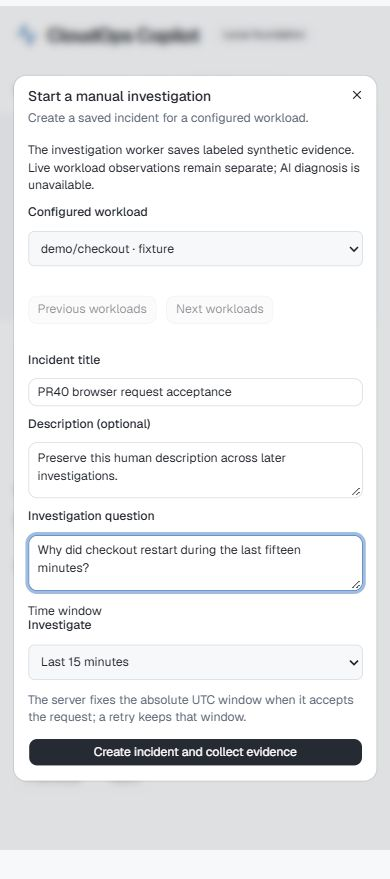
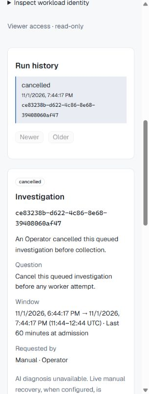

# Investigation request admission: local verification

This receipt covers [#35](https://github.com/pho-veteran/cloudops-copilot/issues/35), not all of E03. Verification date: 2026-11-01. Application fixes are in `22529aa` and `ef79fc5`; the companion test and evidence in this branch record the remaining acceptance. Collection stays explicitly synthetic. No Alertmanager sender, new diagnosis or new recovery engine is claimed.

## Environment and checks

An isolated Docker Compose project used PostgreSQL 17.11 and Linux Python 3.13.11/uv 0.9.26. Test databases ended in `_test`. Browser journeys used the persisted API and database at loopback HTTP; no simulation or ignored certificate error was used. Web checks used Node 24.21.0.

| Check | Observed result |
|---|---|
| Full backend suite at `22529aa` | 700 passed, including migrations, authorization, jobs, producer/consumer and real PostgreSQL race checks |
| Final targeted recovery/admission/worker checks at `ef79fc5` | 77 passed, including approval in the shared execution-state fixtures and a real two-process deferred restart |
| Web tests and build | 92 passed; type-check and production build passed |
| Source lint/format and deterministic contracts | Passed; deliberate schema drift was rejected |
| Final-head CI | Required before merge; current results are attached to [PR #40](https://github.com/pho-veteran/cloudops-copilot/pull/40/checks) |

Two regressions were reproduced before repair: resolve/claim with a proposed plan caused a PostgreSQL deadlock/503, and approval retained the admission lock during a live probe. Tests now enforce Run-before-plan locking, unlocked live preflight and fresh commit-time validation. Approval rejects unclassified execution states even when a lock flag is false. Unknown-outcome target locks remain intact.

The capacity race observes three contenders waiting on the advisory lock before releasing them into available dispatch slots. The restart test launches two different worker PIDs: the first cannot dispatch while J is full; after it exits and capacity is freed, the replacement promotes the same persisted Run without another admission, creating one Job and one attempt.

## Browser journeys

| Scenario | Observed result |
|---|---|
| New request at 390px, keyboard Tab/Enter | Question and 15-minute absolute window saved; focus reaches the enabled submit button |
| Attach at 320px | Explicit UTC interval and new reason saved; original description and earlier Run preserved |
| Future or 61-minute custom window | Validation guidance shown; review disabled |
| Accepted response deliberately lost | The retry reused the key, incident, Run and exact window; replay returned the actual terminal state. Database checks found one incident and one Run |
| Queued cancellation and resolve | With worker paused, cancellation recorded zero attempts. Resolve retained the cancelled Run; resolved incidents offered no new-Run form |
| Session/role and restart | Viewer could read records but had no create/request/cancel controls. API/worker/web restart and browser reload preserved the selected IDs and window |

Both viewport widths had no horizontal page overflow. The changed cancelled/no-attempt copy was checked after deploying the fixes. Screenshots use disposable local data:

## Reproduction and boundaries

Use the locked toolchain and database setup in [README](../../README.md), then run the backend suite with `TEST_DATABASE_URL` pointing only to a disposable `_test` database. On Windows, use Linux containers for executor flock checks and make the full source tree available to the test process. Focused regressions are `tests/test_incident_lock_order.py` and `tests/test_deferred_restart.py` under `services/backend`; web commands are `npm --prefix apps/web test` and `npm --prefix apps/web run build`.

Detailed scratch logs remain local; maintainers can rerun the committed tests. Future execution states are labeled producer-contract fixtures, not live engine proof. Real authenticated Alertmanager delivery remains #36/#39. Legacy recovery proposal/read probes retain bounded row-lock contention as documented in [admission operations](../features/incidents/admission.md#lock-order); this does not claim a fully lock-free runtime. E03 remains open for intake, operational queue, structured handoff and integrated acceptance.
