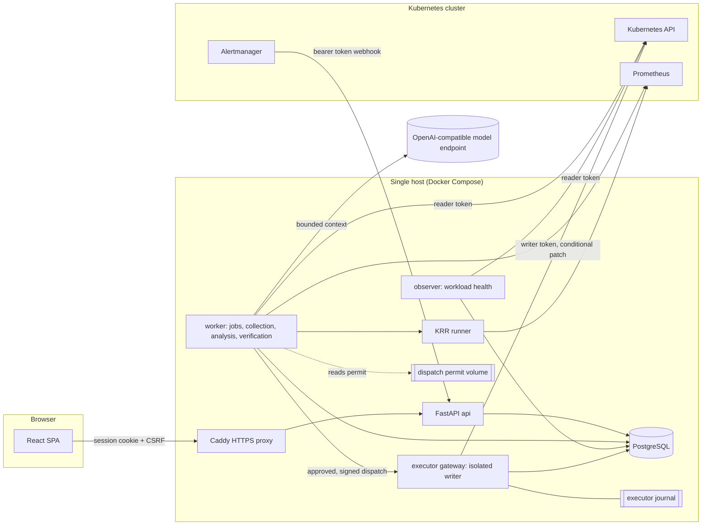

# CloudOps Copilot system design

This folder describes the design of CloudOps Copilot as implemented on `main` (`9eb2b06`),
for the capstone report. It explains what each part does, why it is designed that way,
and what has been measured. Feature-level operating instructions stay in the other
files under `docs/`. The diagnosis improvement loop is described in
[docs/engine-loop/](../engine-loop/README.md).

| File | Contents |
| --- | --- |
| [README.md](README.md) | Problem, scope, architecture, technology, design decisions, measured results, limitations |
| [domain-and-workflows.md](domain-and-workflows.md) | Glossary, state machines, end-to-end workflows, role matrix |
| [data-model.md](data-model.md) | PostgreSQL tables, relationships, job and lease tables, immutability and retention, state outside the database |
| [interfaces.md](interfaces.md) | Processes and entrypoints, REST API surface and conventions, external integrations, frontend structure |
| [core-diagnosis.md](core-diagnosis.md) | Evidence collection, family eligibility, context construction, prompt and model call, validation and repair, Knowledge, rules comparator, scoring |
| [core-recovery-and-runtime.md](core-recovery-and-runtime.md) | Durable jobs, workload scope and baselines, recovery planning, approval and execution safety, verification, restore invariants, resource recommendations, security model |

Availability labels used throughout:

- **Default:** runs in the standard Compose stack.
- **Opt-in:** implemented, but requires a trusted host configuration (reader or writer
  credentials, model profile, qualification).
- **Fixture-only:** labelled synthetic data for development and tests.
- **Simulation-only:** the `?simulation=1` browser simulation. It never produces API
  results.

## 1. Problem and scope

A small operations team running Kubernetes needs one place to understand an incident:

1. collect trustworthy evidence;
2. get an evidence-cited diagnosis;
3. choose a bounded recovery;
4. verify the outcome;
5. hand the case to the next operator.

The common alternative is ad hoc `kubectl` and dashboards, plus chat-style AI answers
that cite nothing and may act without guardrails.

Scope of the implemented system:

- **Cluster and workloads:** one Kubernetes cluster, configured namespaces and an
  allowlist of stateless `apps/v1` Deployments (at most 100).
- **Intake:** Alertmanager webhook and manual investigation.
- **Five diagnosis families:**
  - CrashLoop or startup failure;
  - OOM and restarts;
  - traffic latency or errors;
  - Pending or unschedulable (manual guidance only);
  - ImagePull failure (manual guidance only).
- **Three bounded recovery actions:** restore a confirmed known-good Deployment template,
  apply a server-defined memory profile, and set an absolute replica count. Each needs
  applicable evidence, explicit Operator approval and fresh checks.
- **Incident lifecycle:** notes, re-investigation, Run comparison, immutable handoff and
  resolution snapshots, reopen.
- **Knowledge:** versioned runbooks with full-text retrieval.
- **Resource reports:** advisory KRR reports and exports. Nothing is applied.
- **Access:** Viewer and Operator roles.
- **Connections:** operational visibility of sources and freshness.

Explicitly out of scope:

- arbitrary shell, patch or manifest execution;
- node or namespace operations, cloud writes;
- general chat, automatic approval;
- multi-cluster, multi-tenant, HA, SSO;
- ticketing or chat integrations.

## 2. Architecture

Key properties:

- **One Python codebase, several entrypoints.** `services/backend/src/cloudops/entrypoints`
  contains `api.py`, `worker.py`, `observer.py`, `dispatch.py`, `dispatch_admin.py`,
  `cli.py`, `recovery_restore.py`, `diagnosis_evaluate.py` and `diagnosis_recovery.py`.
  Feature modules under `features/` own their schemas, services and persistence.
  `shared/` contains only config, database and job mechanics.
- **PostgreSQL holds all application state, including durable jobs.** Jobs are claimed
  with leases, heartbeats and fencing tokens. Database transactions end before any
  network call. A stale worker cannot publish results.
- **Credentials are separated.** Collection and observation use a read-only Kubernetes
  identity. Only the executor holds the writer identity, and only for allowlisted
  targets. The browser talks only to the product API.
- **The model is an advisor.** Its output is validated against the exact evidence that
  was sent. It cannot approve, execute or verify anything.

## 3. Technology

| Layer | Technology (pinned) |
| --- | --- |
| Frontend | React 19.3, TypeScript 7.0, Vite 8.3, Tailwind CSS 4.3, shadcn/ui components, TanStack Query 5.90, Vitest 5.0; API types generated from OpenAPI |
| Backend | Python 3.13.18, FastAPI 0.159, Pydantic 2.12, SQLAlchemy 2.0.44, Alembic 1.17 (20 migrations, head `0020_operations_quota_wait_index`), psycopg 3.2, httpx 0.28 |
| Database | PostgreSQL 17.12; full-text search (`tsvector`) for Knowledge |
| Runtime | Docker Compose; Caddy 2.11 for same-origin HTTPS |
| Lab | K3s 1.37.1 in Docker, Prometheus, kube-state-metrics, Alertmanager, KRR; driven by `scripts/manage-local-lab.py` |
| Model | Any OpenAI-compatible Chat Completions endpoint, configured by a trusted `DiagnosisModelProfile/v1` |

## 4. Design decisions

| # | Decision | Rationale |
| --- | --- | --- |
| D1 | Own the finite workflow in one FastAPI and React codebase; no agent framework, workflow engine or message broker | The workflow is fixed (collect, analyze, plan, approve, execute, verify, hand off). Owning it keeps every state transition testable and auditable |
| D2 | Durable jobs in PostgreSQL with leases and fencing | Survives worker crashes without extra infrastructure; stale workers cannot publish. A database lease cannot retract a Kubernetes write that was already sent, so writes need their own safety (D4, D5) |
| D3 | Model output is evidence-bearing advice | One provider-independent client. Server code fixes parameters, validates schema, scope and citations, and decides eligibility. Protocol compatibility does not prove diagnostic quality, so quality needs separate qualification |
| D4 | Separate authority and state | Reader and writer credentials are split. Roles are checked server-side. Incident, investigation, plan, execution, verification and recommendation states are independent axes, so for example an unknown write outcome is never hidden by resolving an incident |
| D5 | Preserve provenance and uncertainty | Evidence pins source, window, time, UID and digest. Runbooks pin versions. Missing data is never zero. An unknown write outcome keeps the target quarantined until proof excludes a late write; a timeout or operator confidence is not proof |

## 5. Core algorithms in one paragraph each

- **Evidence collection** ([core-diagnosis.md §2](core-diagnosis.md)). For one
  UID-bound Deployment and an absolute time window, the worker collects up to 12 slots:
  state, events, current and previous logs, ConfigMap metadata, and six Prometheus
  series. All are bounded (10 Pods, 20 containers, 200 lines or 32 KiB per log),
  redacted, digested and stored with coverage status.
- **Diagnosis** ([core-diagnosis.md §3-7](core-diagnosis.md)).
  1. A family is eligible only when all of its required slots are usable.
  2. Evidence is selected per slot with fixed caps and orders, then aliased (E001…).
  3. Runbook excerpts are added (K001…).
  4. The result is checked against an egress policy and a byte budget.
  5. It is sent in one model call.
  6. The output (`RCAAdvice/v1`) is parsed and structurally validated, with one repair,
     and normalized to an `RCAResult` with resolved citations.
- **Recovery** ([core-recovery-and-runtime.md §4-6](core-recovery-and-runtime.md)).
  1. A deterministic planner maps an eligible finding to one of three templates. It
     checks controller ownership (HPA), capacity and no-op conditions, and produces a
     digest.
  2. Approval binds that exact digest.
  3. The executor re-validates the intent and applies a conditional JSON patch
     (UID and resourceVersion tests).
  4. The executor classifies the outcome (succeeded, no-op, failed, outcome unknown,
     manual intervention).
  5. Verification runs a qualified post-check profile.
  6. An inverse rollback is offered only when it is proven safe.
- **Runtime** ([core-recovery-and-runtime.md §2, §7](core-recovery-and-runtime.md)).
  - **Job claiming:** `SKIP LOCKED` claiming, a 30-second lease, 5-second heartbeats and
    at most 3 attempts.
  - **Dispatch permit:** a trusted permit outside the database gates all job dispatch,
    so a restored database cannot replay approvals.

## 6. Measured results

| Measurement | Setting | Result | Source |
| --- | --- | --- | --- |
| Controlled diagnosis qualification | 12 synthetic E06 cases, `gpt-6.1-sol`, prompt v3, one trial each | 10/10 positives (2/2 per family, 4/4 Pending/ImagePull manual-only), healthy abstention and injection case safe; all 5 negatives/controls pass | `docs/evidence/e06-r5/README.md` |
| Live recovery campaign R3 | 15 slots on the owned K3s lab | Cause category 5/15 (traffic 5/5, memory 0/5, restore 0/5). 9/15 stopped before the model call (context over 65,536 bytes). Rules baseline 0/15 | `docs/evidence/e10-s6/r3-20261125/README.md` |
| Write safety | Same campaign | 24 Deployment patches reconciled, 0 uncontrolled writes | same |
| Stage timing | Same campaign, 6 captured slots | Detect median 15.3 s, collect 7.3 s, analyze 11.3 s; one approved scale verified in 180.9 s | same |
| Test suite | `main` at `31b9a1c` | 2565 backend tests, 295 web tests passing | `docs/engine-loop/environment.md` |

The R3 failure analysis ([engine-loop README](../engine-loop/README.md#root-causes-found-in-final-context-diagnosticsjson))
found the following:

- Most of the serialized context is metadata overhead, not evidence.
- Lab resets do not clear events between trials.
- Logs are nearly absent from the context.
- Live events are not actually ordered newest-first ([core-diagnosis.md](core-diagnosis.md)).

These are the first targets of the improvement loop.

## 7. Limitations

- **Single-host, single-cluster deployment.** HTTPS is published on loopback only.
- **Narrow capacity model for writes.** Scale-up requires exactly one schedulable,
  untainted node and rejects templates with volumes, affinity, tolerations and similar
  fields (`features/workloads/kubernetes.py`).
- **Limited inputs.** Deployments only. Prometheus series must carry a `deployment_uid`
  label.
- **Diagnosis quality is not yet established on live data** (5/15). The planned stages
  A-E in [docs/engine-loop/algorithm.md](../engine-loop/algorithm.md) address this.
- **Hardening is deliberately limited for this capstone.** Missing: login throttling,
  per-component database roles, security headers and non-root containers (see
  [core-recovery-and-runtime.md §10](core-recovery-and-runtime.md)).
