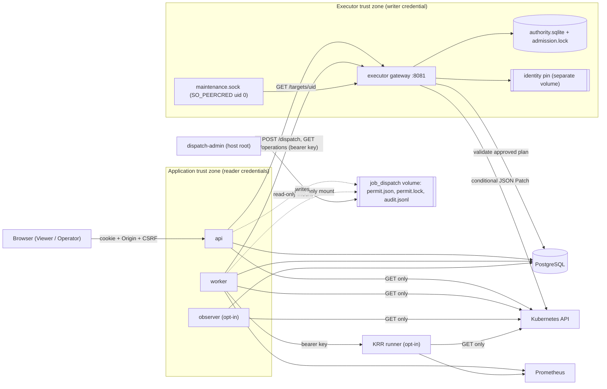
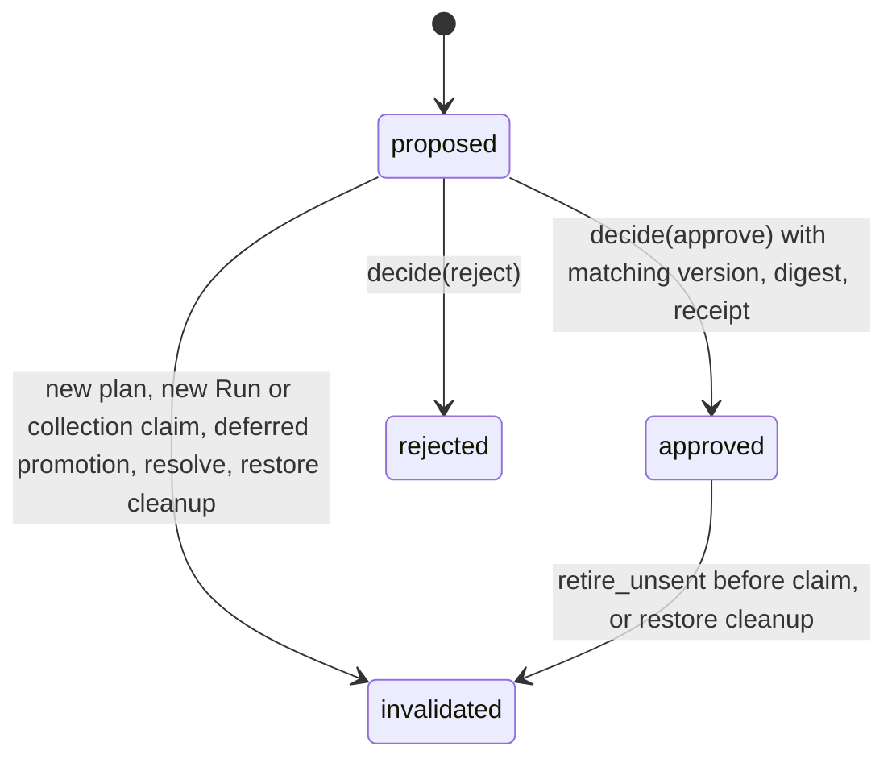
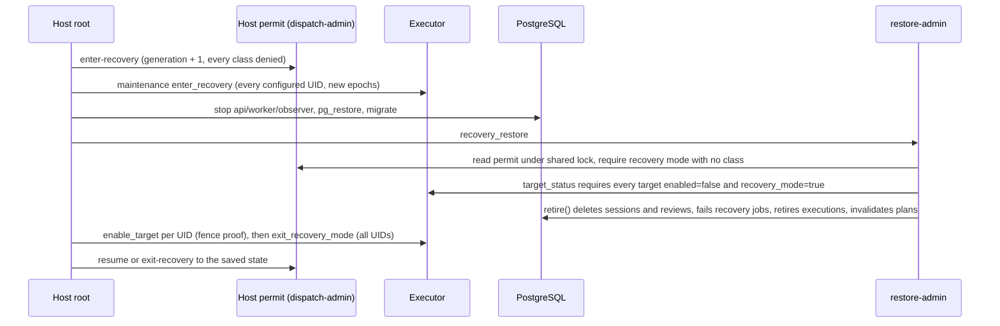

# Core algorithms: runtime, recovery and execution safety

This chapter describes how CloudOps Copilot runs background work, binds Kubernetes workloads, plans and approves a recovery change, sends one guarded write, verifies the result and survives a database restore. It also covers the advisory resource reports, connection checks and the security model. Diagnosis (evidence assembly and model analysis) is described in [core-diagnosis.md](core-diagnosis.md). Entities and tables are in [data-model.md](data-model.md), HTTP contracts in [interfaces.md](interfaces.md) and user workflows in [domain-and-workflows.md](domain-and-workflows.md).

All paths below are relative to `services/backend/src/cloudops/` unless they start with `docs/`, `scripts/`, `services/` or a Compose file name.

**Availability labels used in this chapter**

| Label | Meaning |
| --- | --- |
| Default | Runs in the base `compose.yaml` stack (`db`, `migrate`, `api`, `worker`, `web`) without extra profiles or overlays. |
| Opt-in | Needs an explicit Compose profile, overlay file or trusted configuration file (for example `RECOVERY_POLICY_FILE`). |
| Lab-only | Exists only for the owned local K3s lab or a probe script; not a product behaviour. |

## 1. Runtime architecture

### 1.1 Processes

| Process | Entrypoint | Availability | Credentials it holds |
| --- | --- | --- | --- |
| API | `entrypoints/api.py` | Default | Database URL; read-only permit mount; scoped Kubernetes/Prometheus reader files when configured. No executor dispatch key. |
| Worker | `entrypoints/worker.py` | Default | Database URL; read-only permit mount; reader files; executor dispatch key and KRR request key (integration overlay only). |
| Observer | `entrypoints/observer.py` | Opt-in (`--profile observation`) | Database URL (own pool of 2); Kubernetes reader only. No jobs, no writer, no dispatch key. |
| Executor gateway | `features/recovery/gateway.py` `main()` | Opt-in (`compose.integration.yaml`, lab overlays) | The only Kubernetes writer credential; SQLite authority journal; external identity pin; dispatch key; database URL. Refuses to start unless `os.getuid() == 0`. |
| KRR runner | `services/krr/runner.py` | Opt-in (integration overlay) / lab profile `lab-krr` | Kubernetes reader and Prometheus read config; KRR request key. Read-only root filesystem, `cap_drop: [ALL]`, 32 MiB tmpfs. |
| `dispatch-admin` | `entrypoints/dispatch_admin.py` | Opt-in (profile `dispatch-admin`) | Writable permit volume. No database URL. |
| `executor-init` | `features/recovery/authority.py` | Opt-in (profile `maintenance`) | Writable executor authority and identity volumes. |
| `restore-admin` | `entrypoints/recovery_restore.py` | Opt-in (`compose.restore-admin.yaml`) | Database URL; read-only permit and executor authority mounts. |

### 1.2 Component diagram



### 1.3 Trust boundaries

1. **Reader versus writer.** API, worker, observer and KRR receive reader files only (`KUBE_READ_CONFIG`, `PROMETHEUS_READ_CONFIG`). The `Kubernetes` class in `features/workloads/kubernetes.py` sends `PATCH` only when a caller passes a patch, and only the gateway does that. The lab RBAC lets the writer `get`/`patch` named Deployments only (`docs/e01-local-lab.md`, "Writer and maintenance protocol").
2. **Dispatch authority outside PostgreSQL.** Whether any job class may run is decided by `permit.json` on a host volume, not by any database row (`shared/dispatch_permit.py`).
3. **Executor isolation.** The gateway keeps its own SQLite journal, admission lock and an identity pin stored outside the journal directory (`authority.identity_path`, `authority.read_identity`). Maintenance happens only over a Unix socket whose peer UID must be 0 (`Gateway.maintain`). No application container mounts that socket.
4. **Separate keys.** Only the worker mounts the gateway dispatch key and the KRR request key. The gateway compares the bearer value with `hmac.compare_digest` (`create_gateway_app`).

## 2. Durable job engine

Sources: `shared/jobs.py`, `shared/dispatch_permit.py`, `entrypoints/worker.py`, `entrypoints/dispatch.py`, `docs/job-dispatch.md`. Status: Default.

### 2.1 Data and kinds

- `Job` (one row per `(kind, subject_id)`, unique): `state` in `queued | running | held | completed | failed | cancelled`, `attempts`, `max_attempts` (default 3), `lease_token`, `lease_until`, `due_at`.
- `JobAttempt`: one row per claim, with its own `lease_token`, final state (`running`, `succeeded`, `failed`, `expired`) and the permit `authority_id`/`generation` that admitted it. These permit columns are evidence only; they never grant permission.
- `JobCheckpoint`: committed stages, primary key `(job_id, stage)`, with a monotonically increasing `sequence` and a JSON `carry` of at most 16 KiB.
- `entrypoints/dispatch.py` `PERMIT_CLASSES` maps the seven worker kinds to four permit classes: `analysis`, `collection` (collection, recovery reconciliation, recovery verification), `recommendation`, `recovery_execution`. The worker refuses to start if its handler set differs from this map. A kind outside the map is never claimed.

### 2.2 Dispatch permit gate

`DispatchGate.admitted()` takes a **shared** `flock` on `permit.lock`, reads `permit.json` (at most 16 KiB, closed Pydantic schema) and yields an `Admission`. `_evaluate` denies with a reason when the file is missing (`permit_missing`), unreadable (`permit_invalid`), older than the highest generation this process has seen or past `valid_until` (`permit_stale`), in recovery mode with no classes (`recovery_mode`), or not listing the job's class (`class_denied`). `dispatch-admin` writes a new permit under an **exclusive** lock with fsync and atomic replace; `enter-recovery`, `resume` and `exit-recovery` each increment `generation`, `renew` does not.

`Admission.permits(kind, authority, generation)` is true only when the class is allowed **and** the attempt's recorded authority and generation equal the current permit's. Raising the generation therefore retires every attempt admitted under the old one.

### 2.3 Claim, lease, heartbeat and fencing

```text
claim_next(handlers, gate):                       # shared/jobs.py
  with gate.admitted() as adm, one DB transaction:
    kinds = handlers ∩ adm.kinds;  if empty: return None   # denied kinds consume no attempt
    loop:
      job = SELECT ... WHERE kind IN kinds AND (due_at IS NULL OR due_at <= now)
              AND (state='queued' OR (state='running' AND lease_until <= now))
            ORDER BY created_at, id FOR UPDATE SKIP LOCKED LIMIT 1
      if none: return None
      if job.state == 'running': mark its JobAttempt 'expired'      # takeover of a dead worker
      if job.attempts >= job.max_attempts: job.state='failed'; handler.failed(terminal=True); return None
      if handler.eligible(job.subject) is False: job.state='cancelled'; continue
      break
    job.attempts += 1; job.state='running'; job.lease_token = uuid4()
    job.lease_until = now + 30 s                                    # Settings.lease_seconds
    insert JobAttempt(number, lease_token, permit authority/generation)
    handler.started(job.subject)
    return Claim(...)
```

- **SKIP LOCKED** lets several workers claim different jobs without waiting on each other. Cancel and resolve paths use `retire_queued`, which also skips a locked job, so they never wait for a claimer.
- **Heartbeat.** `run_once` starts a `keep_lease` thread that every 5 s (`Settings.heartbeat_seconds`) upserts the `collector` row in `WorkerHeartbeat` and calls `renew(claim)`. If renewal fails, it sets `lease_lost`.
- **Fence.** `owned()` requires `state='running'`, the same `lease_token` and `lease_until > now()` (database clock). `_fenced()` adds `Admission.permits(...)`. Every write that matters goes through `_fenced` under `gate.admitted()`: `checkpoint`, `finish`, `defer_owned` (via its caller), the reconciliation and verification runners.
- **Call-start admission.** `start_call(claim, gate)` is a short fenced transaction run immediately before each external call (source read, KRR request, executor dispatch). The worker wraps it as `_require_dispatch`, which raises `Interrupted` on failure. Neither the host lock nor any database lock is held across the network call.
- **Lock order.** Host shared permit lock first, then one short PostgreSQL transaction; never the reverse.

```text
finish(claim, handler, result | error):
  with gate.admitted(), DB transaction:
    if not _fenced: return False                 # obsolete result is dropped
    if error: job → 'failed' if attempts >= max else 'queued'; handler.failed(...)
    else:     handler.publish(result); optional final checkpoint; job → 'completed'
    clear lease
defer_owned(db, claim, due_at):                  # same transaction as the feature outcome
  attempt → 'succeeded'; job → 'queued' with due_at (or 'held' if due_at is None); clear lease
```

`defer_owned` is how periodic work (reconciliation polls, verification slots) waits without holding a lease: each poll is a new attempt, so `max_attempts` bounds the total number of polls.

### 2.4 Deferred runs and capacity

`queue_limit` is 100 active (`queued` or `running`) jobs (`Settings.queue_limit`, `features/investigations/promotion.jobs_full`). Manual work is rejected with `409 queue_full` when the queue is full. Automatic Alertmanager admission (`features/incidents/service.py`) instead creates a Run with `queue_reason='capacity'` and no Job, until `DEFERRED_RUN_LIMIT` (default 100, range 1..1000) deferred Runs exist; then it returns `503 capacity_exhausted`. On every worker cycle, `promote_deferred(limit=5)` promotes the oldest deferred Runs, each in its own short transaction under `gate.admitted()`, stops while `collection` is denied or the queue is full, invalidates proposed recovery plans for that incident and inserts the collection Job.

### 2.5 Crash semantics

| Failure | Effect |
| --- | --- |
| Worker dies mid-attempt | Lease expires after at most 30 s; the next `claim_next` marks the attempt `expired` and starts a new attempt if budget remains. Committed checkpoints are reused (`committed_stages`). |
| Worker loses its lease but keeps running | `lease_lost` stops it at the next `start_call`; any later `checkpoint`/`finish` returns `False` and writes nothing. |
| Permit generation changes | All existing attempts fail `_fenced`; work already past `start_call` may complete its network call but cannot publish. A fenced attempt still counts toward `max_attempts`. |
| Budget exhausted | `handler.failed(..., terminal=True)` records the feature-level failure. |

**No exactly-once external call.** The engine provides at-most-once *publication* per attempt, not exactly-once side effects. A call admitted by `start_call` may be repeated by the next attempt after a crash. Read-only calls (collection, KRR) accept this. The one non-idempotent call, the executor dispatch, is protected separately by the persisted `Execution.dispatch_started_at` marker and by the gateway's per-operation journal (Section 5).

## 3. Workload scope, observation and baselines

### 3.1 UID binding (Default for fixtures, Opt-in for live v2 scope)

`features/workloads/reconcile.sync` resolves configured names to Deployment UIDs:

```text
sync(db):
  scope, digest = load_scope(WORKLOADS_FILE)
  txn1: lock scope state; validate cluster fingerprint binding; latest_sequence += 1 → seq
  reads: for each Deployment (≤100), lookup with a shared 60 s deadline, no DB transaction open
  txn2: lock state; abort if latest_sequence != seq (superseded) or file digest changed
        validate binding again; publish_live(...) or publish_legacy(...); applied_sequence = seq
```

The v2 policy pins the cluster with `SHA256(normalized_server + "\n" + SHA256(CA_DER))` (`scope_config.cluster_fingerprint`). Outcomes (`docs/workload-scope.md`): same UID keeps the workload UUID and history; a new UID retires the old identity and creates a new one that inherits no baseline; a real Kubernetes 404 marks the target missing; 403/timeout keeps the previous identity and reports unavailable; a wrong pin publishes nothing. Every publication advances the workload's `observation_epoch`, which later fences late observations. Live reads re-check the UID: `Kubernetes.deployment` raises `target_changed` when `metadata.uid` differs.

### 3.2 Observation and freshness (Opt-in observer)

The observer (`entrypoints/observer.py`) polls due workloads with `observation_service.due`/`observe_direct`. It does not use the job table. Bounds come from `observation_settings.POLICY`: 30 s poll, 60 s stale, 12 s read deadline, 15 s lease, 4 global slots (3 scheduled), at most 9 GETs and 2 MB per response. `observation_service.claim` serializes lease admission with `pg_advisory_xact_lock(742027)`. `finalize` publishes only when the workload is still active and its `observation_epoch`, token, sequence and deadline match the claim.

Health (`observation_evaluator.evaluate`) is one of `healthy`, `progressing`, `degraded`, `scaled_to_zero`, `unknown`. Pods count only after owner traversal Pod → ReplicaSet → Deployment UID. Freshness is separate from health: a complete success no older than 60 s is fresh. A newer denied, partial or failed attempt makes current health unknown even when the last success is young.

### 3.3 Two-observation baseline confirmation (Opt-in, needs observer reader)

`features/workloads/baseline_service.py`:

```text
candidate(workload):                       # Viewer or Operator
  obs1 = observe_direct(purpose="baseline_candidate")      # fresh read, never cached
  require complete + healthy; obs1 age within [-1 s, 15 s]; identity and epoch match
  store BaselineCandidate(digest = SHA256(canonical envelope), session binding)
confirm(candidate_id, digest):             # Operator only
  require same session binding, same digest, 5 s ≤ now - created_at, first read ≤ 5 min old
  obs2 = observe_direct(purpose="baseline_confirm")
  require obs2 healthy/complete, same identity/epoch/generation,
          digest(envelope(obs2)) == candidate digest, 5 s ≤ obs2 - obs1 ≤ 5 min,
          compare(obs1, obs2) comparable with restart_delta == 0
  insert immutable Baseline(both summaries, actor, digest)
```

The envelope `deployment-images-resources/v1` holds identity plus per-container image and CPU/memory request/limit strings and configuration reference identities. Secrets, environment values and command lines are excluded.

## 4. Recovery planning

Sources: `features/recovery/plans.py`, `service.py`, `policy.py`, `capacity.py`, `fields.py`, `features/workloads/kubernetes.py`.

### 4.1 Templates

| Template | Builder | Desired state | Extra eligibility |
| --- | --- | --- | --- |
| `restore_deployment_template` | `plans.desired_fields` | Containers copied from a confirmed v1 baseline | Baseline digest and second observation present; same identity; same container set and identical configuration references; non-empty supported diff; all restored images in `qualified_images`. |
| `set_memory_profile` | `plans.desired_fields` | Named profile's memory request/limit on its listed containers | Profile for this UID; current memory request in `(0, profile.request]` and current limit `< profile.limit` (a real increase). |
| `scale_deployment` | `plans.desired_fields` or `service.propose` | Absolute replicas | Replicas differ from current; scale bound 1..3 (`ScaleSelector`); `Kubernetes.capacity` for the added Pods. |

Advice-origin plans (`AdvicePlanRequest`) additionally pass `plans.advice_source`: the exact latest completed Run and operational Analysis, a `supported` result naming this template, and every cited evidence entry still resolving to the same SHA-256 and entry digest. The model never chooses parameters; the profile, baseline or replica count comes from trusted policy or the Operator.

Operator manual scale (`service.propose`) has two forms. Without a qualified verification profile it builds the **legacy v1 content** (Default when an executor exists): acknowledgement-only, no automatic verification or inverse. With policy and a matching profile, `plans.manual_content` builds `RecoveryPlan/v2` content instead (Opt-in).

### 4.2 Eligibility checks

All builders run these checks inside the proposal transaction:

1. `service._available_locally`: the workload is `live_kubernetes`; no execution for it holds a lock or is classified `active`/`unrecognized` (`classification.classify`); no execution was created in the last 30 s (cooldown).
2. `service.available` → gateway `GET /targets/{uid}`: target `enabled` and not in `recovery_mode`; its `epoch` is copied into the plan.
3. `Kubernetes.deployment` (UID match) and `Kubernetes.controllers`: any `autoscaling/v2` HPA, or `autoscaling.k8s.io/v1` VPA if that API exists, whose target name equals the Deployment raises `controller_conflict`.
4. `fields.selected`: unsupported configuration references make the plan manual-only.
5. Capacity. `Kubernetes.capacity_budget(deployment, additional_pods)` returns `capacity_unproven` unless all of the following hold:
   - requests use only `cpu`/`memory` (no extended resources);
   - **exactly one** node is schedulable (not `unschedulable`, no taints); the code states the supported topology is one node and refuses to aggregate across nodes;
   - the Pod template sets none of `affinity`, `nodeSelector`, `topologySpreadConstraints`, `volumes`, `tolerations`, `nodeName`, `runtimeClassName`, `schedulingGates`, `hostNetwork`, uses the default scheduler and has no `hostPort`;
   - the node is `Ready` with no Memory/Disk/PID pressure;
   - existing non-terminal Pods on the node plus `additional_pods × template requests` fit `allocatable` CPU, memory and Pod count. `pod_requests` sums init containers conservatively and adds Pod overhead.

   Legacy scale passes only the replica increase. For v2, `capacity.candidate_capacity` builds the candidate template and reserves `replicas + surge` Pods for restore/memory (surge from `maxSurge`, 0 for `Recreate`), keeping all existing allocations, because old Pods may still be terminating.
6. `policy.safe_resources` bounds requests/limits by `max_cpu`/`max_memory`.

Any failure returns `{"state": "manual_only", reason}` rather than an error, so the UI shows guidance instead of a plan.

### 4.3 Digest, expiry and lifecycle

The plan `content` holds workload identity, template, selector, policy id/version/digest, `before`, `desired`, `diff`, configuration references, target epoch, observed `resourceVersion`, `expires_at` (now + 300 s, `plan_ttl_seconds`) and, when qualified, `execution_capability = "conditional_dispatch_v2"`, the verification profile and its digest, and an optional rollback contract (`plans.qualify`). `ActionPlan.digest = SHA256(canonical JSON(content))` (`investigations/locators.digest`). Content never changes after insert; any change needs a new plan.



Expiry is not a stored state: `expires_at <= now()` makes `read`, `decide`, the job claim and the gateway refuse the plan. "Stale" is also derived: `service.read` recomputes live validity on every read (profile still current, target active, same epoch, `preflight(...) == content.before`) and reports `valid=false` with a reason; the row stays `proposed` until it is decided, expires or is invalidated. `service.invalidate(db, incident_id)` is called by every proposal, `investigations/service.py` (new Run), `collector.CollectionHandler.eligible` (collection claim), `promotion.promote_deferred`, `incidents/lifecycle.py` (resolve), and `rollback.propose`.

## 5. Approval and execution safety

### 5.1 Review receipt and digest-bound decision

`service.read` issues a review token, stores only its hash in `PlanReview`, binds it to `SHA256(session.csrf_token)` and expires it at `min(plan.expires_at, now + 60 s)`. `service.decide` runs in two transactions so that no lock spans Kubernetes I/O:

```text
decide(plan_id, body{version, digest, review_token, decision}):
  T1 (no row locks): lock_principal(operator); _decision_rows(locked=False)
       → version and digest equal (compare_digest), plan proposed and unexpired, incident not resolved,
         receipt unconsumed/unexpired/bound to this session, no active Run (approve),
         require_plan + require_inverse for v2, workload active, _available_locally, queue not full
  live: authority = gateway target(uid); if approve: deployment, controllers, live = preflight(...)
  T2 (row locks, admission lock): repeat all checks with FOR UPDATE; identity tuple, plan tuple and
       authority.epoch unchanged; live == content.before
       if approve:                                    # transactional outbox
         Execution(state='queued', holds_lock=True); dispatch_request = frozen RecoveryDispatch/v2 (or v1 dict)
         Job('recovery_execution_v1', subject = execution.id)
       review.consumed = True; plan.state = approved | rejected
```

The approval, the frozen dispatch request and the job commit together, so there is no approved plan without its job and no job without its approval.

### 5.2 Worker execution

`service.execute(execution_id, before_call)` with `ExecutionHandler`:

1. `ExecutionHandler.eligible` (inside the claim): refuse and record `denied`/`not_sent` if the plan is no longer approved, the incident is resolved, the workload is inactive, the plan expired, or an inverse lost its authority. A job whose dispatch already started is always eligible, so it can only read receipts.
2. If `dispatch_started_at` is already set, the attempt may only read the gateway receipt, bounded by `admit_receipt_read` (deadline and `RECONCILE_ATTEMPTS = 6`). The mutation is **never** resent.
3. For v2, `verification.prepare` captures the 60 s pre-change window (Section 6) and may end with `no_op` or `denied` before any write.
4. A second locked transaction rechecks `require_plan`, `require_inverse`, `state in {executing, rolling_back}`, `holds_lock`, plan approved and unexpired, `dispatch_request` unchanged, workload active; then sets `dispatch_started_at = now` and `reconcile_deadline = now + 120 s`. This durable marker is committed **before** the call.
5. `before_call()` (`start_call`), then `POST /dispatch`. Any transport error becomes `outcome_unknown`.

### 5.3 Gateway admission and the conditional patch

```text
Gateway.dispatch(body):                       # under flock(admission.lock) and the pinned journal
  prior = attempts[body.execution_id]
  if prior: return prior.result if prior.digest == SHA256(body) else 409 dispatch_conflict
  target = targets[uid]; require enabled, not recovery_mode, target.epoch == body.epoch
  require body.expires_at > now
  current = kube.deployment (UID check); kube.controllers
  v2:     validate_intent(body, workload, current, journal); candidate_capacity; patch = conditional_patch
  legacy: kube.capacity; require resourceVersion and snapshot(current) == body.before; build 3-op patch
  re-check expiry
  on any check failure: journal attempt 'denied' with its reason; return receipt
  targets[uid].enabled = 0; journal attempt 'dispatching'; COMMIT (fsync, WAL, synchronous=FULL)
  try PATCH (application/json-patch+json)
     2xx            → 'acknowledged', target re-enabled, receipt carries new resourceVersion
     404/409/422    → 'denied' (atomic precondition failed, nothing applied), target re-enabled
     anything else  → 'outcome_unknown', target stays disabled (quarantine)
```

`dispatch_validation.validate_intent` (v2 only) independently verifies, from the trusted policy file, the application database and the live object: the exact policy id/version/digest; `approved_plan` (plan approved with a decider, original active live workload and unresolved incident, TTL not longer than policy, execution is the active claimed one holding the lock, plan digest recomputes, and template, epoch, expiry, before, desired, selector and policy all equal the request); the live selected fields and `resourceVersion` equal `before`; `field_scope` (scale changes only replicas 1..3; restore and memory never change replicas; memory never changes image or CPU; identical desired and before is `no_op`); resource bounds; then the per-template check: `restore_baseline` (exact baseline digest and references), the named memory profile values, or `inverse_values` (Section 6.3). The legacy v1 path has none of these database checks; it relies on the epoch, expiry, UID/resourceVersion and `snapshot()` equality.

`dispatch.conditional_patch` is built by the gateway, never by the caller:

```json
[
  {"op": "test", "path": "/metadata/uid", "value": "<original UID>"},
  {"op": "test", "path": "/metadata/resourceVersion", "value": "<captured resourceVersion>"},
  {"op": "replace", "path": "/spec/template/spec/containers/0/resources/limits/memory", "value": "<profile limit>"}
]
```

The two `test` operations make the API server reject the whole patch if the object was replaced or modified since the approved observation. Only changed fields get a `replace`. Kubernetes RBAC cannot restrict JSON Patch paths, so this closed builder is the field boundary.

### 5.4 Outcome classes

`RecoveryOutcome/v1` (`outcomes.project`) keeps three dimensions apart: `attribution` (`not_sent`, `acknowledged`, `denied`, `outcome_unknown`), `verification` (`not_performed`, `pending`, `passed`, `failed`, `inconclusive`) and `future_authority`. The execution state is the summary:

| State | When | Target lock |
| --- | --- | --- |
| `succeeded` / `rolled_back` | v2 acknowledged and qualified verification passed (inverse gives `rolled_back`) | released |
| `no_op` | Pre-change check found the target already healthy; no gateway call | released |
| `failed` | v2 acknowledged; complete qualified observations failed a condition | released |
| `manual_intervention` | Denied, not sent, legacy v1 acknowledgement, or inconclusive verification | released |
| `outcome_unknown` ("uncertain") | Write admitted but no exact receipt within the reconciliation budget | **held** until root maintenance |

`classification.classify` fails closed: any contradictory combination is `unrecognized` and blocks new plans for the target.

### 5.5 Reconciliation (read-only)

When the receipt is unknown and the 120 s deadline has not passed, `ExecutionHandler.publish` sets `reconciling` and adds `recovery_reconciliation_v1` with `max_attempts = 6`. `reconciliation.reconcile` increments `reconcile_attempts`, calls `start_call`, reads `GET /operations/{id}` and the live Deployment, and records whether the desired fields match. Only an exact gateway receipt changes attribution. Matching fields alone never do, because another writer could have produced them. Otherwise it defers 10 s (`RECONCILE_INTERVAL_SECONDS`) with `defer_owned`, and on exhaustion `exhausted()` keeps `outcome_unknown` with the lock held.

### 5.6 Quarantine and late-write exclusion

A target is quarantined (gateway `enabled = 0`) at gateway start (all targets get a new epoch and `recovery_mode = true`; interrupted `dispatching` attempts become `outcome_unknown`), while a write awaits acknowledgement, after an unknown result, after `enter_recovery`, and after any unexpected maintenance error. Only root maintenance lifts it:

```text
maintain(enable_target | release_uncertain_target | exit_recovery_mode, targets, reason, evidence):
  require peer uid 0 (SO_PEERCRED); request_id idempotent by digest; reason, evidence and exact targets present
  enter_recovery / exit_recovery_mode must name every configured target
  for non-exit operations: set enabled = 0 and a NEW epoch for each target; commit   # retires old approvals
  prove(uid):
    current healthy (all replica counters equal desired, observedGeneration current); no controller conflict
    every unresolved attempt has a parseable request with uid and captured resourceVersion
    PATCH [test uid, test current resourceVersion, add annotation writer-fence = nonce]
    re-read (≤5 s for readiness); require nonce present, healthy, and new resourceVersion
      different from every unresolved attempt's captured resourceVersion
  in the application DB: executions holding a lock → maintenance_released, acknowledged ones become
    manual_intervention, the rest stay outcome_unknown; unfinished verification retired as inconclusive
  record exclusions(attempt_id, request_id); enabled = (op != release_uncertain_target)
```

Why the fence excludes a late write: every functional patch tests its captured `resourceVersion`. The fence patch itself is conditional on the current version and changes it. Kubernetes applies the two patches in some order. If the delayed patch lands first, the fence's `test` fails and maintenance is denied. If the fence lands first, the delayed patch's `test` fails. Either way, no old patch can apply after a successful fence. Elapsed time or an expired worker lease is never accepted as proof. ResourceVersions are compared for equality only.

## 6. Verification and inverse rollback (Opt-in)

Sources: `features/recovery/verification_policy.py`, `verification.py`, `verification_evaluator.py`, `rollback.py`; `docs/recovery-verification.md`.

### 6.1 Qualified profiles

`RECOVERY_VERIFICATION_FILE` lists `RecoveryVerificationProfile/v1` entries for one UID and template, with exact containers and immutable `sha256:` image IDs, allowed replicas, thresholds (`minimum_coverage ≥ 0.9`, `minimum_rps`, `minimum_load_ratio ≥ 0.9`, `maximum_error_ratio`, `maximum_p95_seconds`) and the eight required query identities. `configured_profiles` keeps only profiles whose `source_digest` equals the current reader/Prometheus binding (`source_digest()`). `load_for` requires exactly one match. `require_plan` is re-run at read, decision, claim, dispatch and every verification slot. Any change to the profile, policy or source makes the plan non-executable or the verification inconclusive. No default profile ships; qualification is a deployment-operator responsibility.

### 6.2 Algorithm

```text
prepare (before dispatch):
  reserve Verification row first; capture 60 s pre-change window (rollout, events, metrics)
  require offered traffic and complete rollout evidence           → else denied
  forward and already healthy with passing application metrics    → no_op (no gateway call)
  forward and healthy without a failed application symptom        → denied (symptom not established)
  an interrupted baseline is never re-read against a new window   → prepare a new plan
begin (on exact acknowledged receipt):
  ack must lie within [dispatch_started_at, now + 1 s]; deadline = ack + 180 s (scale) | 300 s (restore, memory)
  state = verifying; Job recovery_verification_v1(due_at = ack, max_attempts = window/30 + 3)
verify (each 30 s slot):
  slot = max(next_slot, floor((now - ack)/30)); persist next_slot = slot + 1 BEFORE reading
  read rollout/state/events/metrics; store sample once per slot; defer to next slot
  last slot: evaluate(); finalize()
```

`evaluate` scores samples after the 60 s settling period (5 for scale, 9 for restore/memory). It adds an **inconclusive** reason for missing, late or wrong-identity samples, restart counter resets, Pod replacement, unavailable metrics, stale offered traffic or coverage below the profile minimum. It adds a **failure** for new restarts, a new OOM after acknowledgement, a new Warning event after settling, a scored rollout that is not healthy, or an application threshold failure. Result: `inconclusive` if any reason exists, else `failed` if any failure, else `passed`. A deadline overrun, slot budget exhaustion, policy change or target change finalizes as inconclusive. Missing data is never filled with zeros, and a crashed worker cannot repeat a slot or extend the window. For memory, `passed` means observed mitigation, not a repaired leak.

### 6.3 Inverse rollback eligibility

When the policy sets `inverse_policy = captured-old-state/v1` and `inverse_window_seconds = 600`, `rollback.contract` stores the inverse safety contract in the forward plan before approval. It requires that the old state passes `safe_old_state` (bounds, replicas 1..3, `inverse_qualified_states` entry for restore/memory, qualified old images) and has its own verification profile. `rollback.arm`, called from `finalize`, creates a `RollbackWindow` only for a forward v2 execution that has an exact acknowledged receipt whose time equals the verification anchor, an unchanged contract, and a finalization after the verification deadline. The window opens at `eligible_from = finalized_at` and closes at `deadline = verification.deadline + 600 s`, so a late finalization shortens the window. `rollback.propose` builds the inverse by swapping `before` and `desired`; caller values are rejected. In the gateway, `inverse_values` requires the forward attempt to be `acknowledged` in the journal, exact swapped values, inverse qualification, and allows one inverse per forward (`inverse_links`). An inconclusive forward result alone grants nothing.

## 7. Backup and restore safety invariants (Opt-in procedure)

Sources: `features/recovery/restore.py`, `entrypoints/recovery_restore.py`, `docs/release-restore.md`, `docs/job-dispatch.md`.

Three authorities live outside PostgreSQL and are never part of a database backup: the host dispatch permit, the executor journal and the executor identity pin. A backup is one `pg_dump` snapshot. Its **cutoff** lies between two recorded `now(), pg_current_xact_id()` reads taken before and after the dump. Everything committed after the cutoff is lost, and the procedure says so explicitly.



Invariants and the mechanism that enforces each one:

1. **A restored approval cannot replay.** `restore.retire` deletes every `LoginSession` and `PlanReview`, fails queued/held/running `recovery_execution_v1`, reconciliation and verification jobs, and invalidates proposed plans and the approved plans of retired executions. Independently, the restored `dispatch_request` carries an epoch that `enter_recovery` retired, so the gateway returns `target_quarantined` even after the target is enabled again. A reused execution id with different content gets `dispatch_conflict`. The permit generation change fences any restored attempt.
2. **Absence of evidence is not evidence of no write.** Each active restored execution becomes `outcome_unknown` with the lock held, unless its result was already acknowledged (then `manual_intervention` without lock). `dispatch_started_at` and `reconcile_deadline` are set to now, so the row cannot be dispatched as fresh work.
3. **All targets are quarantined, including targets with no restored rows.** `enter_recovery` and `exit_recovery_mode` reject a target list that differs from the full allowlist, and `closed_gateway_targets` refuses cleanup unless every configured target reports `enabled=false` and `recovery_mode=true`.
4. **Authority cannot be recreated silently.** A missing or replaced journal or pin makes `read_identity` fail: the gateway refuses to start or returns `503 authority_unavailable`. `executor-init` is a separate trusted step and grants no enablement.
5. **New writes need fresh human intent.** After enablement, a write still needs a new plan, a new session-bound review and a new approval.

The procedure does not detect an unannounced database rollback performed outside it (`docs/job-dispatch.md`).

## 8. Resource recommendations (advisory only)

Sources: `features/recommendations/*`, `services/krr/runner.py`, `docs/resource-reports.md`. Admission and stored reports are Default; live KRR invocation is Opt-in (runner and `RECOMMENDATION_SOURCE_POLICY` configured).

- **Admission** (`api.create`): Operator only; `requested_hours` 6..24 (default 6); at most one queued/running report per workload; shared queue limit. Creates job `recommendation_report_v1` (permit class `recommendation`).
- **Invocation bounds.** Only the six-hour profile invokes KRR; other durations end `insufficient_data` without a tool call. Worker side: `producer.RUNNER_DEADLINE_SECONDS = 150` covers connect, headers and the full response; the source collector (`sources.py`) has a 45 s total deadline, 5/8 s phase timeouts, at most 23 GETs, 8 MiB per response, 256 series per metric and 200,000 samples. Runner side: one concurrent invocation, 16 KiB request, `subprocess.run(timeout=120)`, 2 MB raw report, 256 KiB normalized response. The runner re-attests the metrics source and compares the target scope before and after the run (`runner_target_changed`).
- **138-second cap (Lab-only).** The 138 s figure is the `--short` mode of `scripts/probe-resource-history.py` (`Recipe.cap = 3 + 3 × 15 + 90`). It bounds the owned-lab load recipe after preflight and marks the result `short_harness_only`. It is not a product KRR timeout and never qualifies advice.
- **Eligibility and coverage.** `coverage.assess` counts distinct 60 s bins per Pod UID/container lifetime: ratio ≥ 0.95, longest gap ≤ 300 s, newest sample within 120 s of the lifetime end. `qualification.qualify` sets each resource to `eligible`, `insufficient_data` or `excluded`. Exclusions include unknown resource managers, VPA, unsupported HPA metrics (a CPU/memory HPA target excludes that resource), unsupported Pod shapes, and memory suppression on proven or unknown in-window OOM or restarts.
- **Immutable reports and exports.** `service.publish` validates that the output matches the admitted identity and profile, caps the payload at 256 KiB, and writes `export_text` (canonical JSON) plus `export_sha256` inside the fenced `finish` transaction. `ReportHandler.eligible` refuses to claim a report whose `export_text` exists, so a losing worker cannot replace it. Applicability (`current`, `stale` at age ≥ 24 h or on identity/template/resource drift, `unknown`) is computed at read time and kept out of the export bytes.
- **No auto-apply.** No route converts a report into a plan or a write. A worker crash can repeat a read-only KRR invocation; leases and the permit fence publication, not the external read.

## 9. Connections and freshness

Sources: `features/connections/service.py`, `features/health/service.py`, `docs/connection-checks.md`. Default (provider checks need reader configuration).

```text
create(component ∈ {cluster, prometheus, database, worker}, idempotency key):   # Operator, Origin, CSRF
  prepare provider config before taking the lock
  lock admission; same key → return the existing attempt
  one in-flight attempt per component; 60 s cooldown from admission → 409 check_cooldown
  commit the attempt with deadline_at (8 s wall budget) BEFORE the provider read
  one provider request; settle only if the captured workload UID and config binding still match
```

`status_for` projects the latest receipt in this order: configuration issue, `never_observed`, `binding_changed` (receipt made for another workload or configuration), a future timestamp (`invalid_timestamp`), then age. A successful cluster or Prometheus check older than 300 s (`CHECK_FRESHNESS_SECONDS`) becomes `evidence_stale`. A worker heartbeat older than 45 s (`worker_stale_seconds`) becomes `heartbeat_stale`. Last attempt, success and failure times are reported separately. `health.service.project` assembles the passive health page from persisted state and configuration: database, worker heartbeat, collector configuration, Kubernetes observation freshness (`cluster_observation`, 60 s stale from the observer), collection dispatch status from the permit, executor and KRR configuration (runner availability is shown as unknown, not probed) and the latest qualified report. Health pages never call providers.

## 10. Security model summary

- **Sessions.** Login (`access/service.login`) verifies an scrypt hash (n=16384, r=8, p=1) and spends the same work on unknown users via a dummy hash. It issues a random token in an `HttpOnly`, `SameSite=Lax` cookie, `Secure` when `COOKIE_SECURE=true` (the default), and stores only `SHA256(token)`. Lifetime is `SESSION_SECONDS` (1..28800, default 8 h). Role changes and re-provisioning delete the user's sessions; restore deletes all sessions.
- **Roles.** `viewer` (read and export) and `operator` (mutations). `access/dependencies.operator` checks the role before CSRF; long operations re-check with `lock_principal(..., operator=True)` inside the transaction.
- **CSRF and Origin.** Every mutation needs exactly one `Origin` header equal to `WEB_ORIGIN` and exactly one `X-CSRF-Token` equal to the session's token (`check_csrf`, constant-time compare). Plan review receipts are additionally bound to the CSRF token hash and expire within 60 s.
- **Credential separation.** Reader files for API/worker/observer/KRR, the writer only in the gateway, dispatch and KRR keys only in the worker, permit writes only in `dispatch-admin`, maintenance only for peer UID 0.

**Known gaps accepted for the capstone scope** (verified in source and Compose files):

| Gap | Fact |
| --- | --- |
| No login throttling | `access/service.login` has no rate limit, lockout or delay beyond scrypt cost. |
| Shared database role | `api`, `worker`, `observer` and `executor` connect as the same PostgreSQL role `cloudops`. The gateway reads plans in `validate_intent` and updates executions in `maintain` with it. Database-level least privilege is not enforced. |
| Root containers | `services/backend/Dockerfile` sets no `USER`; the gateway requires UID 0; the KRR runner defaults to `0:0` (`CLOUDOPS_KRR_RUN_AS`). Write isolation relies on read-only mounts. The diagnosis gateway overlay runs as `65534`. |
| Unauthenticated target status | Gateway `GET /targets/{uid}` requires no key. It returns epoch, enabled flag and proof metadata on the internal Compose network; port 8081 is not published to the host in the reviewed Compose files. |
| Single-node capacity proof | Multi-node clusters, affinity, volumes and similar placements always end `capacity_unproven` (manual guidance). |

## Unverified or out-of-scope points

- Exact RBAC rules for reader and writer accounts are taken from `docs/e01-local-lab.md`; the RBAC manifests created by `scripts/bootstrap-integration.py` were not re-read for this chapter.
- Internals of `observation_evaluator.evaluate`, `qualification.qualify` and `verification_sources.capture` are summarized from their documentation and top-level branches, not line by line.
- Evidence receipts under `docs/evidence/` were not re-validated; statements about lab campaigns are quoted from the owning documents.
