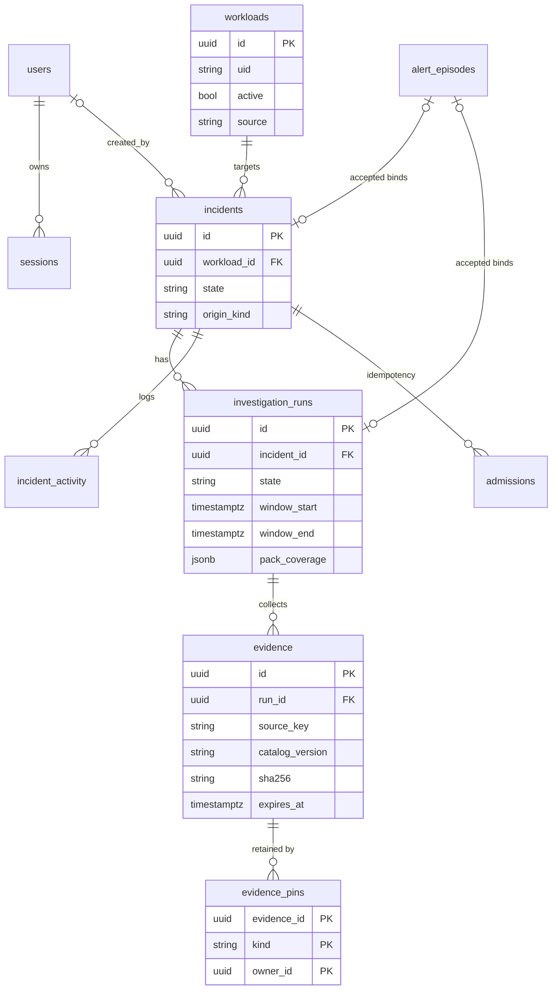
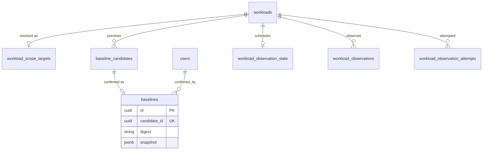
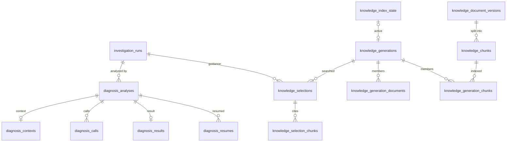
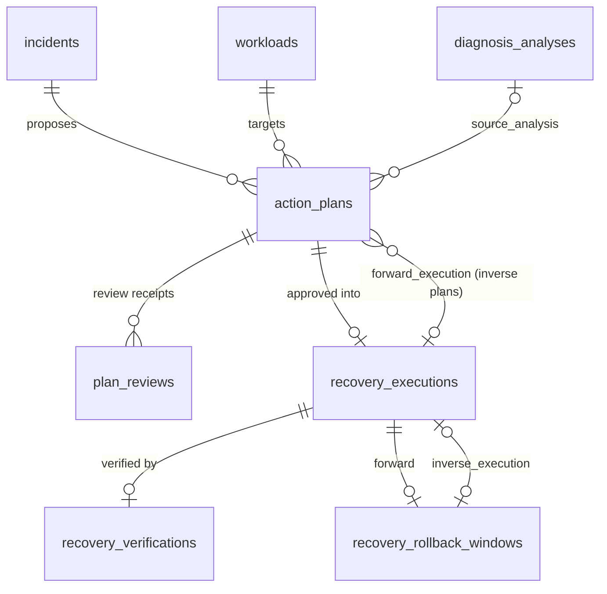
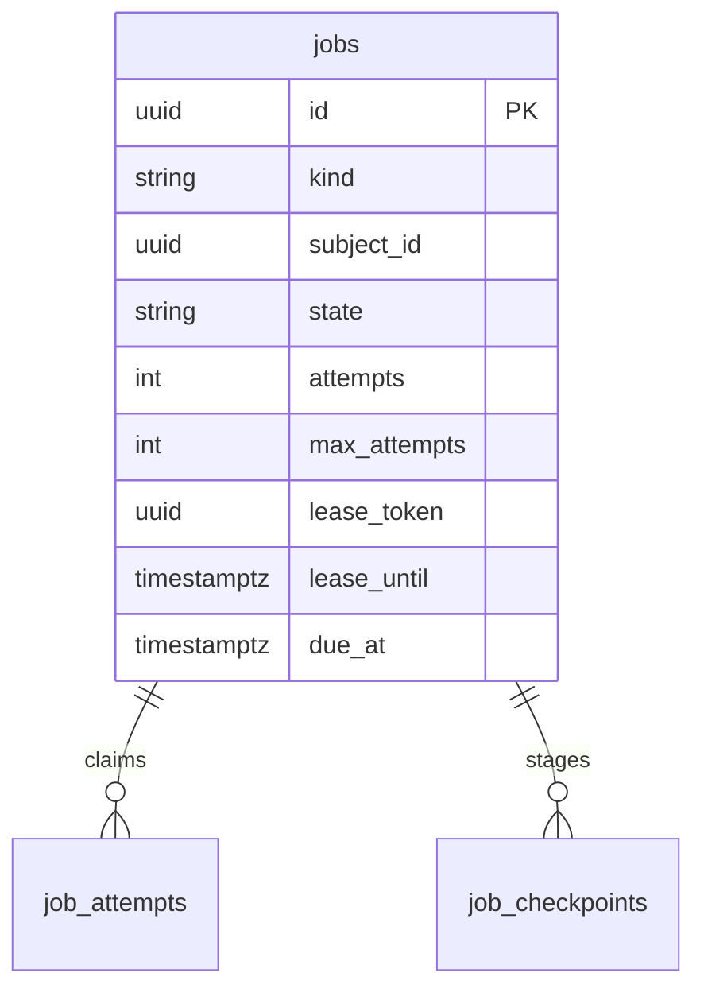

# Data model

CloudOps Copilot stores application state in one PostgreSQL 17 database (`compose.yaml`, image `postgres:17.12-bookworm`) through SQLAlchemy 2 ORM models. Each feature module owns its tables (`features/<feature>/models.py`). Shared job and heartbeat tables live in `shared/jobs.py` and `shared/database.py`. Concepts and state machines are in [domain-and-workflows.md](domain-and-workflows.md), and the processes that write each table are in [interfaces.md](interfaces.md).

All paths below are relative to `services/backend/src/cloudops/` unless they start with `services/`, `docs/` or `contracts/`.

## Schema facts

| Fact | Value | Source |
|---|---|---|
| Migration tool | Alembic, applied by `cli bootstrap` in the `migrate` service before API and worker start | `entrypoints/cli.py`, `compose.yaml` |
| Migration count | 20 sequential revisions | `services/backend/migrations/versions/` |
| First revision | `0001_runtime` | `0001_runtime.py` |
| Head revision | `0020_operations_quota_wait_index` (down revision `0019_connection_checks`) | `0020_operations_quota_wait_index.py` |
| Table count | 44 application tables (each created by a migration and mapped by an ORM model) | `grep create_table` over migrations, `__tablename__` over models |
| Startup guard | API, worker and observer call `require_schema()` and refuse to run against an unmigrated schema | `shared/database.py`, `entrypoints/*.py` |
| Database triggers | None found in migrations. Immutability is enforced by unique constraints, check constraints and service code | `migrations/versions/*.py` |
| Downgrade policy | Several feature migrations refuse to downgrade when the downgrade would discard retained evidence, for example 0008, 0009, 0012, 0015, 0016 and 0019 | `docs/foundation.md`, `docs/job-dispatch.md`, `docs/diagnosis-lifecycle.md`, `docs/recovery-verification.md`, `docs/connection-checks.md` |

Conventions: primary keys are UUIDs (`uuid4`) unless noted, timestamps are `timestamptz`, and structured documents are `JSONB`.

## Tables by feature

### Access (E01): `features/access/models.py`

| Table | Key columns | Notes |
|---|---|---|
| `users` | `id`, `username` (unique), `password_hash`, `role` | `role IN ('viewer','operator')`. Passwords are hashed with scrypt (`n=16384, r=8, p=1`) in `features/access/service.py`. |
| `sessions` | `token_hash` (PK), `user_id`, `csrf_token`, `expires_at` | The cookie token is stored only as a SHA-256 hash. Each session has its own CSRF token. |

### Workloads, scope, baselines, observations (E02): `features/workloads/models.py`, `observation_models.py`

| Table | Key columns | Notes |
|---|---|---|
| `workloads` | `id`, `cluster`, `namespace`, `name`, `uid`, `active`, `source`, `retirement_reason`, `observation_epoch` | Unique `(cluster, namespace, name, uid)`. `source` defaults to `development_fixture`. |
| `workload_scope_state` | `id=1`, `latest_sequence`, `applied_sequence`, `mode`, `cluster_key`, `fingerprint`, `config_digest` | Singleton (`CHECK id = 1`). Pins the cluster identity for versioned scope. |
| `workload_scope_targets` | `cluster`, `namespace`, `name`, `configured`, `workload_id`, `state`, `reason` | One row per configured name. Unique `(cluster, namespace, name)`. |
| `baseline_candidates` | `workload_id`, `digest`, `snapshot` | Preview captured before confirmation. |
| `baselines` | `workload_id`, `candidate_id` (unique), `digest`, `snapshot`, `confirmed_by`, `confirmed_at` | Immutable confirmed record. All are retained. |
| `workload_observation_state` | `workload_id` (PK), `next_due_at`, `lease_token`, `lease_until`, outcome and binding fields | Observer scheduling and lease state, separate from product jobs. |
| `workload_observations` | `workload_id`, `epoch`, `observed_at`, `payload`, `comparison` | Kept for 7 days and at most 1,024 rows per workload (`observation_settings.py`, `cleanup()` in `observation_service.py`). |
| `workload_observation_attempts` | `workload_id`, `sequence`, `started_at`, `outcome`, `reason` | Same retention bound as observations. |

### Incidents and alert intake (E03): `features/incidents/models.py`, `intake_models.py`

| Table | Key columns | Notes |
|---|---|---|
| `incidents` | `workload_id`, `title`, `description`, `state`, `created_by`, `origin_kind`, `origin_source_id`, `first_seen_at`, `last_seen_at`, `severity`, `severity_provenance`, `alert_signal` | Check `incident_origin`: an operator origin has an actor and no source, and an alertmanager origin has a source and no actor. |
| `admissions` | `actor_id`, `key`, `request_hash`, `incident_id`, `run_id`, `signature_version` | Idempotency record. Unique `(actor_id, key)`. |
| `incident_activity` | `incident_id`, `kind`, `text`, `actor_id`, `created_at`, `snapshot` | Notes and transitions. A `resolve` row stores the frozen `HandoffSnapshot` in `snapshot`. |
| `alert_episodes` | `source_id`, `fingerprint`, `starts_at_key`, `outcome`, `workload_uid`, `incident_id`, `run_id`, `signal` | Unique `alert_episode_key`. Check `episode_binding`: only `accepted` episodes link an incident and a Run. Never pruned. |
| `alert_intake_receipts` | `delivery_id`, `received_at`, `source_id`, `alert_status`, `outcome`, `reason`, plain ID links | No foreign keys, so pruning stays independent. The newest 5,000 are kept (`docs/alert-intake.md`). |

### Investigations and evidence (E04): `features/investigations/models.py`

| Table | Key columns | Notes |
|---|---|---|
| `investigation_runs` | `incident_id`, `state`, `reason`, `requested_by`, `origin_kind`, `question`, `question_source`, `window_start`, `window_end`, `window_source`, `queue_reason`, `outcome_code`, `pack_coverage`, `provider_call` | Checks `run_origin`, `run_window` (start before end), `run_queue_reason` and `run_provider_call`. Partial unique index `one_open_run_per_incident`. Partial indexes `ix_runs_deferred` and `ix_runs_quota_wait`. |
| `evidence` | `run_id`, `workload_uid`, `source_key`, `source_kind`, `catalog_version`, `schema_version`, `payload_kind`, `observed_at`, `collected_at`, `requested_window`, `time_relation`, `coverage`, `query_metadata`, `sha256`, `redaction_policy_version`, `expires_at`, `payload` (deferred load) | Unique `(run_id, source_key, catalog_version)`. |
| `evidence_pins` | `evidence_id`, `kind`, `owner_id` (composite PK) | Kinds used in code: `latest`, `resolution`, `analysis`. |

### Shared jobs and heartbeats (E04 mechanics): `shared/jobs.py`, `shared/database.py`

| Table | Key columns | Notes |
|---|---|---|
| `jobs` | `kind`, `subject_id`, `state`, `attempts`, `max_attempts` (default 3), `lease_token`, `lease_until`, `due_at`, `error` | Unique `(kind, subject_id)`. `subject_id` is a polymorphic UUID with no foreign key; it points to a Run, Analysis, model check, Execution or report depending on `kind`. |
| `job_attempts` | `job_id`, `number`, `lease_token` (unique), `state`, `started_at`, `finished_at`, `permit_authority`, `permit_generation` | One row per claim. States: `running`, `expired`, `succeeded`, `failed`. |
| `job_checkpoints` | `job_id` + `stage` (PK), `sequence`, `attempt_number`, `lease_token`, `permit_authority`, `permit_generation`, `committed_at`, `carry` | `stage` must match `^[a-z_]+(:[a-z0-9_.]+)?$`. `carry` holds the cross-source budget between checkpoints. |
| `worker_heartbeats` | `name` (PK), `observed_at` | Written every worker cycle and lease renewal (`entrypoints/worker.py`). |

### Knowledge (E05): `features/knowledge/models.py`

| Table | Key columns | Notes |
|---|---|---|
| `knowledge_document_versions` | `document_key`, `version`, `title`, `guide_kind`, `tags`, `applicability`, `source_path`, `provenance`, `content` (bytes), `content_sha256`, `metadata_sha256` | Unique `(document_key, version)`. |
| `knowledge_chunks` | `document_version_id`, `chunker_version`, `ordinal`, `heading_path`, `heading_locator`, `start_byte`, `end_byte`, `content`, `content_sha256` | Unique chunk identity. Checks on ordinal and byte offsets. |
| `knowledge_generations` | `fingerprint` (unique), `source_digest`, chunker, index, search and ranking versions, `config_digest`, counts | One indexed corpus snapshot. |
| `knowledge_generation_documents` | `generation_id`, `document_version_id`, `search_vector` (tsvector, GIN) | Generation membership with full-text vector. |
| `knowledge_generation_chunks` | `generation_id`, `chunk_id`, `document_version_id`, `search_vector` (tsvector, GIN) | Composite foreign keys keep each chunk inside its document. |
| `knowledge_index_attempts` | `fence`, `phase`, `outcome`, `source_digest`, `generation_fingerprint`, `reason` | One row per CLI index run. |
| `knowledge_index_state` | `id=1`, `active_generation_id`, `current_attempt_id`, `last_success_attempt_id`, `fence` | Singleton control row. This is the only mutable Knowledge pointer. |
| `knowledge_selections` | `run_id`, `generation_id`, `consumer`, `request_identity`, `actor_id`, `payload` | Unique `(run_id, consumer, request_identity)`. |
| `knowledge_selection_chunks` | `selection_id`, `ordinal` (0–9), `generation_id`, `chunk_id` | Exact chunk references of a selection. |

### Diagnosis (E06): `features/diagnosis/models.py`

| Table | Key columns | Notes |
|---|---|---|
| `diagnosis_analyses` | `run_id`, `purpose`, `state`, `phase`, `reason`, `identity`, `dispatch_epoch`, `calls`, `repairs`, `wait_mode`, `earliest_retry`, `deadline` | Unique `(run_id, purpose)`. Check `calls` 0..3 and `repairs` 0..1. |
| `diagnosis_contexts` | `analysis_id` (PK), `digest`, `snapshot`, `summary` | `snapshot` is the private working copy. It is cleared at terminal states, while `digest` and `summary` remain (`discard_working_context`). |
| `diagnosis_calls` | `analysis_id`, `number`, `lease_token` (unique), `phase`, `request_digest`, `admitted_at`, `settled_at`, `receipt` | The send reservation is committed before HTTP. |
| `diagnosis_results` | `analysis_id` (PK), `payload` | Immutable `RCAResult/v1` (or abstention). |
| `diagnosis_checks` | `actor_id`, `idempotency_key` (unique), `identity`, `state`, `deadline`, `receipt` | Fixed harmless model probes. |
| `diagnosis_resumes` | `idempotency_key` (PK), `analysis_id`, `actor_id` | Replay record for Operator resume. |

### Recovery (E07): `features/recovery/models.py`

| Table | Key columns | Notes |
|---|---|---|
| `action_plans` | `incident_id`, `workload_id`, `version`, `template`, `origin`, `source_analysis_id`, `forward_execution_id`, `content`, `digest`, `target_epoch`, `state`, `rationale`, `expires_at`, `decided_by` | Immutable `content` and `digest`. Only `state` and decision fields change. |
| `plan_reviews` | `plan_id`, `token_hash` (unique), `session_binding`, `expires_at`, `consumed` | Session-bound review receipt (binding is the hash of the session CSRF token). |
| `recovery_executions` | `plan_id` (unique), `workload_id`, `state`, `holds_lock`, `maintenance_released`, `result`, `dispatch_request`, `dispatch_started_at`, `reconcile_deadline`, `reconcile_attempts` | Partial unique index `one_recovery_per_target` on `workload_id WHERE holds_lock`. |
| `recovery_verifications` | `execution_id` (PK), `profile`, `profile_digest`, `baseline`, `acknowledged_at`, `deadline`, `next_slot` (0..11), `samples`, `result`, `finalized_at` | Check `deadline > acknowledged_at`. |
| `recovery_rollback_windows` | `forward_execution_id` (PK), `eligible_from`, `deadline`, `policy_digest`, `inverse_execution_id` (unique) | Check `deadline > eligible_from`. |

### Recommendations (E08) and connections (E09)

| Table | Key columns | Notes |
|---|---|---|
| `recommendation_reports` | `workload_id`, `state`, `requested_hours`, `tool_version`, `schema_version`, `input_identity`, `profile`, `result_v2`, `export_text`, `export_sha256`, `created_by`, `finished_at` | Keyset index `(created_at, id)`. Partial index for qualified v2 history. (`features/recommendations/models.py`) |
| `connection_checks` | `component`, `status`, `reason`, `source`, `created_by`, `idempotency_key` (unique), `attempted_at`, `deadline_at`, `binding_key`, `config_id`, `target`, `metrics` | Bounded explicit source-check receipts. (`features/connections/models.py`) |

## Relationships

The diagrams show the main foreign keys. Columns are abbreviated.

### Core incident, investigation and evidence

### Workload scope, baselines and observations

### Diagnosis and Knowledge

### Recovery

### Jobs

## Job, attempt and lease mechanics

Source: `shared/jobs.py`, `entrypoints/worker.py`, `entrypoints/dispatch.py`, `shared/config.py`.

| Job kind | Subject | Permit class |
|---|---|---|
| `development_collection_v1` | `investigation_runs.id` | `collection` |
| `diagnosis_analysis_v1` | `diagnosis_analyses.id` | `analysis` |
| `diagnosis_probe_v1` | `diagnosis_checks.id` (`max_attempts=1`) | `analysis` |
| `recommendation_report_v1` | `recommendation_reports.id` | `recommendation` |
| `recovery_execution_v1` | `recovery_executions.id` | `recovery_execution` |
| `recovery_reconciliation_v1` | `recovery_executions.id` (`max_attempts=6`) | `collection` |
| `recovery_verification_v1` | `recovery_executions.id` | `collection` |

- **Claim.** `claim_next()` selects the oldest eligible job (`ORDER BY created_at, id ... FOR UPDATE SKIP LOCKED`) whose state is `queued`, or `running` with an expired lease, and whose `due_at` has passed. It then asks the feature handler `eligible()`. A job the feature retires becomes `cancelled` without an attempt.
- **Lease.** Each claim issues a new `lease_token`, sets `lease_until = now + 30 s` and inserts a `job_attempts` row that records the permit authority and generation. A heartbeat thread renews the lease every 5 seconds.
- **Fencing.** Checkpoints, finish and call-start admission require the current lease token, an unexpired lease and the same permit generation. An older token cannot publish.
- **States.** Job states are `queued`, `running`, `held` (waiting for an explicit Operator resume, with no `due_at`), `completed`, `failed` and `cancelled`.
- **Lock order.** Host permit lock, then one short PostgreSQL transaction, never the reverse. No transaction or host lock spans a network call (`docs/job-dispatch.md`).

## Immutability, versioning and retention rules

| Record | Rule | Source |
|---|---|---|
| Evidence | Immutable per `(run_id, source_key, catalog_version)`. Identical republication keeps IDs, and conflicting content is rejected. SHA-256 covers the canonical post-redaction JSON. Purge clears only `payload`; metadata and digest remain, and reads return `410 evidence_expired`. | `features/investigations/storage.py`, `docs/foundation.md` |
| Evidence retention | `expires_at = collected_at + 30 days`. `latest`, `resolution` and `analysis` pins hold content independently. Purge is the trusted `cli evidence-purge [--apply]` command. | `storage.py`, `retention.py`, `entrypoints/cli.py` |
| Run request | Question, window and origin are fixed at admission. Legacy rows keep `not_captured` instead of an invented window. | `features/investigations/models.py` |
| Baselines | Confirmed rows are never updated or deleted. Legacy `v0` rows keep their original JSON and digest. | `docs/workload-baselines.md` |
| Runbook versions | The same `(document_key, version)` with different bytes or metadata is rejected against all retained history. Removing a document changes only generation membership. There is no purge command. | `docs/knowledge-index.md` |
| Knowledge selection | The first successful selection for a Run is kept, including a saved no-match, even after reindexing. | `docs/run-guidance.md` |
| Analysis | `diagnosis_results` is immutable. The private context snapshot is discarded at terminal states while the digest and summary remain. | `features/diagnosis/lifecycle.py` |
| Plans | `content` and `digest` are immutable. A changed target needs a new plan. | `features/recovery/service.py` |
| Verification | The first finalization time and result are immutable (`finalize()` returns early when already finalized). | `features/recovery/verification.py` |
| Resolution snapshot | `HandoffSnapshot/v3` and its Markdown are frozen on the `resolve` activity row. Reopen, later notes and later Runs do not regenerate it. Older v1, v2 and unversioned saves keep their bytes. | `features/incidents/lifecycle.py`, `handoff.py` |
| Recommendation report | `export_text` and `export_sha256` are written once in the fenced terminal transaction. `publish()` refuses a report that already has export text. Read-time applicability is excluded from the bytes. | `features/recommendations/service.py`, `docs/resource-reports.md` |
| Report history | Keyset pagination over `(created_at, id)`. Replaced workload identities stay separate. | `docs/resource-reports.md` |

## State stored outside PostgreSQL

| Store | Location | Contents | Writer | Source |
|---|---|---|---|---|
| Dispatch permit | `JOB_DISPATCH_ROOT` (`job_dispatch` volume at `/run/cloudops-job-permit`) | `permit.json` (`DispatchPermit/v1`: authority ID, generation, mode, allowed classes, validity), `permit.lock`, append-only `audit.jsonl` | `dispatch_admin` only. API and worker mount it read-only. | `shared/dispatch_permit.py`, `docs/job-dispatch.md` |
| Executor journal | `EXECUTOR_ROOT/authority.sqlite` (`executor_authority` volume) | SQLite tables `control`, `targets` (uid, epoch, enabled, proof), `attempts`, `audit`, `exclusions`, `inverse_links` | Executor gateway process. **Opt-in** (`compose.integration.yaml`). | `features/recovery/gateway.py` |
| Executor identity pin | `EXECUTOR_AUTHORITY_PIN` (`executor_identity` volume), required to be outside the journal directory | Device and inode identity of the journal | `executor-init` (`recovery.authority`) | `features/recovery/authority.py` |
| Gateway maintenance socket | `EXECUTOR_ROOT/maintenance.sock` | Unix socket authenticated by peer credentials (`SO_PEERCRED`). Not a store, but part of the authority boundary. | Gateway | `gateway.py` |
| Runbook sources | `runbooks/*.md`, `runbooks/catalog.json` in the repository | Reviewed corpus. It is read only by the trusted `knowledge-index` CLI. The searchable index itself is in PostgreSQL (`tsvector` columns). | Source control | `docs/knowledge-index.md` |
| Trusted configuration | Files named by `WORKLOADS_FILE`, `KUBE_READ_CONFIG`, `PROMETHEUS_READ_CONFIG`, `DIAGNOSIS_*_FILE`, `RECOVERY_*_FILE`, `ALERT_INTAKE_CONFIG` | Scope, read credentials, model and egress policy, recovery policy, intake token digest | Deployment operator | [interfaces.md](interfaces.md) |
| Simulation state | Browser localStorage (`cloudops-experience-v1`) | **Simulation** only | Browser | `apps/web/src/App.tsx` |
