# Domain model, state machines and workflows

This document describes the CloudOps Copilot domain: the concepts the system stores, the state machines that govern them, and the end-to-end workflows that connect them. Table layouts and module ownership are in [data-model.md](data-model.md); processes, HTTP routes and integrations are in [interfaces.md](interfaces.md). Diagnosis internals are in [core-diagnosis.md](core-diagnosis.md), and recovery and runtime internals are in [core-recovery-and-runtime.md](core-recovery-and-runtime.md).

## Availability labels

Every behaviour below is tagged with one of these labels.

| Label | Meaning |
|---|---|
| **Default** | Implemented and active in the default `docker compose up` stack (`compose.yaml`). |
| **Opt-in** | Implemented, but disabled until a trusted deployment operator supplies configuration files or credentials (for example `KUBE_READ_CONFIG`, `DIAGNOSIS_PROFILE_FILE`, `RECOVERY_POLICY_FILE`, `ALERT_INTAKE_CONFIG`). |
| **Fixture** | Produced by a labelled synthetic source. The default collection mode `COLLECTION_SOURCE_MODE=development_fixture` (`compose.yaml`) stores synthetic evidence that never satisfies live pack coverage and never authorizes a cluster write (`README.md`). |
| **Simulation** | Exists only in the browser simulation at `?simulation=1` (`apps/web/src/main.tsx`, `apps/web/src/demo/model.ts`). It keeps state in localStorage and makes no backend, Kubernetes or model calls. |

## Domain glossary

| Term | Definition | Source |
|---|---|---|
| Workload | One Kubernetes Deployment bound to `(cluster, namespace, name, uid)`. A changed Deployment UID creates a different persisted identity. Retired identities stay readable in history but cannot admit new work. | `features/workloads/models.py` (`Workload`), `README.md` |
| Scope | The host-configured allowlist of Deployments. Synchronization resolves names to UIDs and records per-target state; it writes application metadata only and grants no writer authority. A singleton row stores the pinned cluster fingerprint and config digest. | `features/workloads/scope_config.py`, `reconcile.py`, `docs/features/workloads/scope.md` |
| Observation | A persisted, sanitized rollout-health reading of one workload by the separate observer process (**Opt-in**, `observation` Compose profile). | `features/workloads/observation_*.py`, `docs/features/workloads/observation.md` |
| Baseline | An immutable, Operator-confirmed known-good snapshot (`deployment-images-resources/v1`) built from two fresh, healthy, identical observations at least five seconds apart, confirmed within five minutes. All confirmed baselines are retained. | `features/workloads/baseline_service.py`, `docs/features/workloads/baselines.md` |
| Incident | The unit of operator work for one workload. Origin is either `operator` (with an actor) or `alertmanager` (with a configured source ID), enforced by a database check constraint. | `features/incidents/models.py` (`ORIGIN_CHECK`) |
| Alert episode | One Alertmanager firing episode keyed by `(source_id, fingerprint, startsAt)`. An accepted episode binds exactly one incident and one Run. Episodes are never pruned because they are the deduplication identity. | `features/incidents/intake_models.py`, `docs/features/incidents/alert-intake.md` |
| Investigation Run | One evidence-collection request for an incident with an immutable question, an absolute UTC window (15/30/60-minute preset or an explicit 1–60 minute interval) and an origin. At most one non-terminal Run exists per incident (partial unique index `one_open_run_per_incident`). | `features/investigations/models.py`, `docs/features/incidents/admission.md` |
| Job / attempt | A durable background work item (`jobs`) and each leased execution of it (`job_attempts`). Default budget: three attempts, 30-second lease, 5-second heartbeat. | `shared/jobs.py`, `shared/config.py` |
| Checkpoint | A committed, fenced stage of a job, for example `collect_source:<source_key>`, so a takeover reuses committed sources instead of reading them again. | `shared/jobs.py` (`JobCheckpoint`), `docs/features/investigations/job-dispatch.md` |
| Evidence | One immutable record per `(run_id, source_key, catalog_version)` holding redacted, bounded payload, coverage, time relation and the SHA-256 of the canonical stored JSON. | `features/investigations/models.py`, `storage.py` |
| Source / catalog | The `standard_v1` catalog has five Kubernetes slots, six Prometheus query slots and `development_fixture`. | `features/investigations/catalog.py` |
| Pack coverage | Per-diagnosis-family coverage derived from required and optional sources for `crashloop_startup`, `oom_restarts`, `traffic_latency_errors`, `pending_unschedulable` and `image_pull`. Status is `available`, `partial` or `unavailable`. | `features/investigations/catalog.py` |
| Evidence pin | A retention hold on evidence content. Kinds in code are `latest` (last useful Run of an unresolved incident), `resolution` (saved resolution) and `analysis` (temporary hold during an Analysis). Unpinned content expires 30 days after collection. | `features/investigations/storage.py`, `features/diagnosis/pins.py` |
| Analysis | One bounded diagnosis of a Run (`purpose` is `operational` or `evaluation`), with at most 3 model calls, 1 repair and a 15-minute deadline. **Opt-in**: it requires a qualified model profile. | `features/diagnosis/models.py`, `lifecycle.py` |
| Finding: `RCAAdvice/v1` | The model's raw structured output. It cites evidence and runbooks only by alias (`E001`, `K001`) and contains no scope, endpoint or action parameters. | `features/diagnosis/advice.py` |
| Finding: `RCAResult/v1` | The server-normalized, evidence-bound result, with aliases resolved to exact citations. It is marked `machine_validation=structural_v1` and `quality=not_established`. | `features/diagnosis/advice.py` |
| Knowledge / runbook guidance | Immutable runbook document versions and chunks, indexed in generations. A Run guidance selection is the first saved full-text retrieval for a Run. It is methodology, not telemetry, diagnosis or execution approval. | `features/knowledge/*`, `docs/features/knowledge/run-guidance.md` |
| Plan | An immutable recovery proposal (`scale_deployment`, `restore_deployment_template` or `set_memory_profile`) with a content digest, target epoch and 5-minute TTL. | `features/recovery/models.py`, `service.py` |
| Approval | An Operator decision on an exact plan version and digest, bound to a session-scoped review receipt (`plan_reviews`). | `features/recovery/service.py` |
| Execution | One approved operation sent through the isolated executor gateway (**Opt-in**), holding a per-workload target lock (`one_recovery_per_target`). | `features/recovery/models.py`, `gateway.py` |
| Verification | Fixed-window post-change checks against a qualified profile (180 s for scale, 300 s for restore or memory), stored apart from Runs. **Opt-in.** | `features/recovery/verification*.py`, `docs/features/recovery/verification.md` |
| Inverse plan | A separately approved rollback derived by swapping the acknowledged before and desired states, available only inside a recorded rollback window. **Opt-in.** | `features/recovery/rollback.py` |
| Recommendation report | A versioned, advisory KRR resource report for one workload, with immutable terminal export bytes. There is no apply route. | `features/recommendations/*`, `docs/features/resources/reports.md` |
| Handoff / resolution snapshot | Markdown composed from stored records only. Resolving an incident freezes a `HandoffSnapshot/v3` envelope (snapshot plus Markdown) on the `resolve` activity row. | `features/incidents/handoff.py`, `lifecycle.py` |

## State machines

### Incident

Source: `features/incidents/lifecycle.py` (`transition`), `features/incidents/schemas.py`. **Default.**

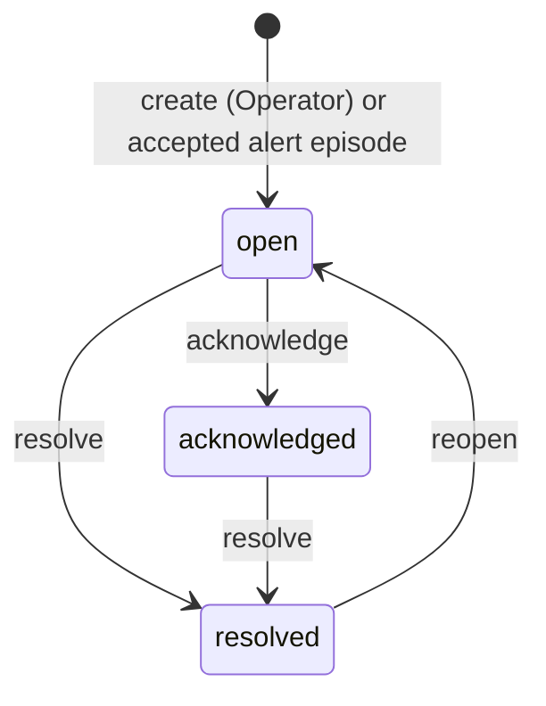

- Every transition requires an Operator and a reason, and appends an `incident_activity` row.
- Resolve fails with `409 execution_active` while an admitted execution blocks. In one transaction it retires unsent executions, cancels queued Runs (`incident_resolved`), invalidates proposed plans, pins referenced evidence and freezes the snapshot.
- Reopen re-pins the newest usable Run (`pin_latest_on_reopen`) and does not change saved snapshot bytes.
- A resolved Alertmanager notification sets only `alert_signal=resolved`. It never resolves, reopens or cancels anything (`docs/features/incidents/alert-intake.md`).

### Investigation Run

Source: `features/investigations/states.py`, `schemas.py` (`RunState`, `OutcomeCode`), `collector.py`, `features/diagnosis/lifecycle.py`.

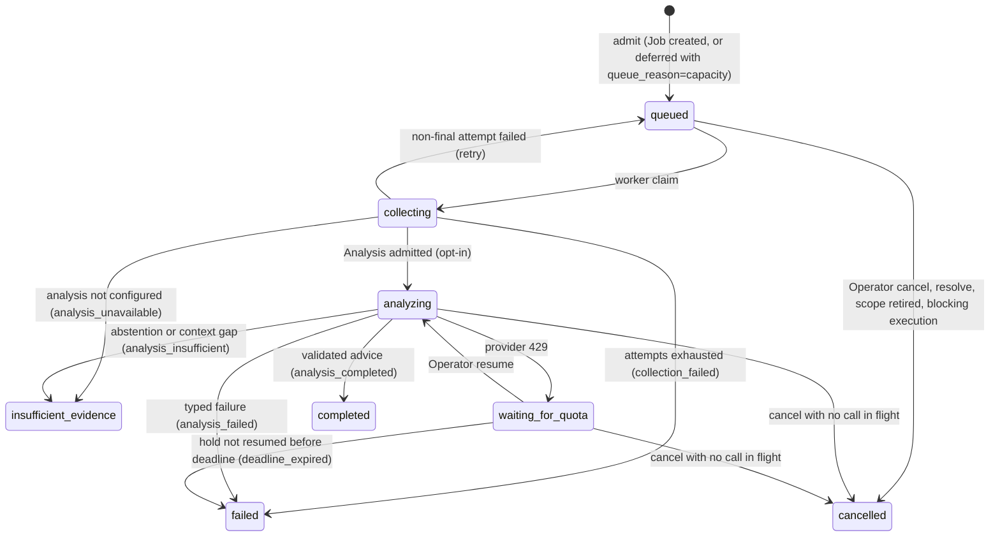

Non-terminal states are `queued`, `collecting`, `analyzing` and `waiting_for_quota`. Terminal states are `insufficient_evidence`, `completed`, `failed` and `cancelled`. Late collection callbacks never change a cancelled Run (`CollectionHandler.started/failed/publish` return early). Cancel rules are in `docs/features/investigations/job-dispatch.md`: a `collecting` Run, or one with a provider call `in_flight`, returns `409 run_not_cancellable`. The `terminal()` helper in `features/diagnosis/lifecycle.py` maps any failed operational Analysis, including an expired quota hold swept by `expire_waits()` in `worker.py`, to Run `failed` / `analysis_failed`.

### Analysis

Source: `features/diagnosis/lifecycle.py` (`ACTIVE`, `terminal`, `cancel_unsent`), `worker.py` (`_wait`), `service.py` (resume). **Opt-in.**

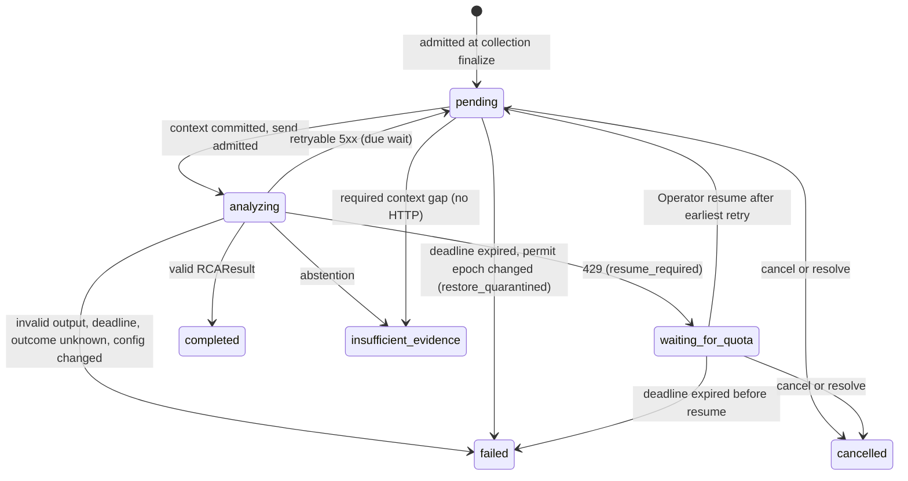

`ACTIVE = ("pending", "analyzing", "waiting_for_quota")`. A reservation that was admitted but never settled becomes `failed` with reason `provider_outcome_unknown` and is never replayed.

### Plan

Source: `features/recovery/api.py` (`state: Literal["proposed","approved","rejected","invalidated"]`), `service.py` (`invalidate`, `retire_unsent`, decision), `restore.py`. **Default** for the manual scale path; **Opt-in** for advice-derived v2 plans.

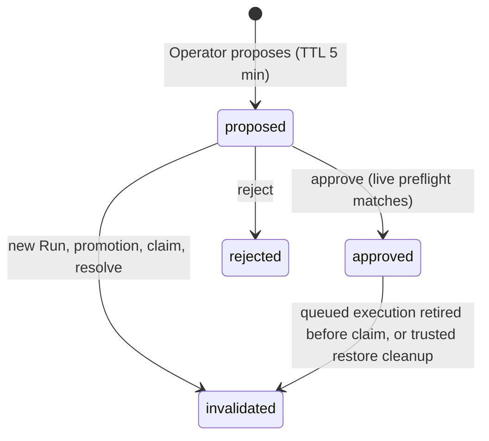

Expiry is not a stored state. A decision after `expires_at` returns `409 plan_refetch_required`, and a changed target returns `409 plan_changed`. The tracker's framework list (`awaiting_approval`, `stale`, `expired`) appears only in the simulation model (`demo/model.ts`, `PlanStatus`).

### Execution

Source: `features/recovery/classification.py` (`ACTIVE`, `TERMINAL`), `service.py` (`ExecutionHandler`), `verification.py` (`begin`, `finalize`), `reconciliation.py`. **Opt-in** (it needs the executor gateway).

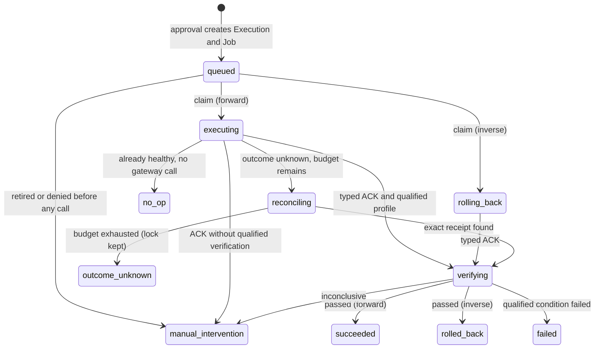

`classify()` maps each state to `active`, `terminal`, `terminal_unknown_locked`, `terminal_unknown_released` or `unrecognized`. `active` and `unrecognized` block new Runs, promotion, claims and resolution. Unknown states fail closed. Reconciliation allows at most 6 receipt reads within a 120-second deadline (`outcomes.py`, `docs/guides/foundation.md`). The tracker term `uncertain` corresponds to the implemented `outcome_unknown`.

### Verification

Source: `features/recovery/outcomes.py` (`Verification` literal), `verification.py`.

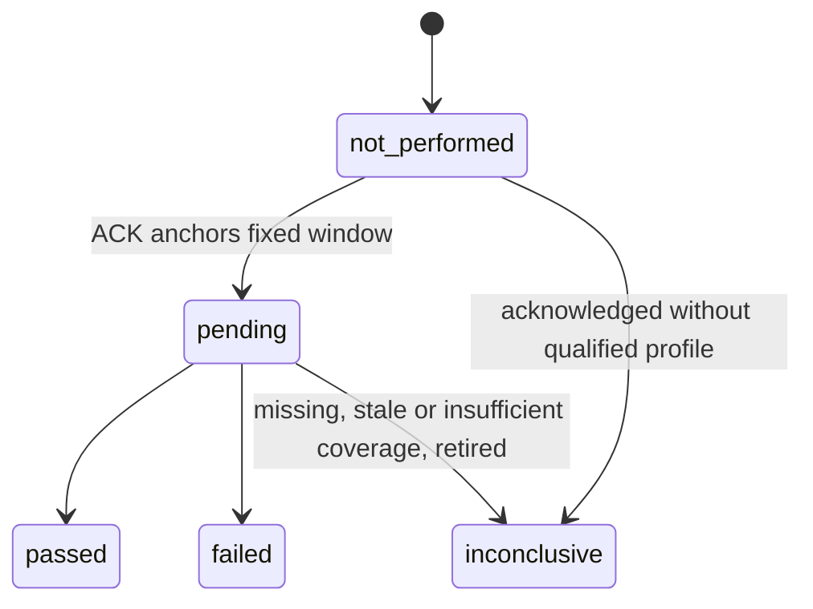

`RecoveryOutcome/v1` reports three separate fields: attribution (`not_sent`, `acknowledged`, `denied`, `outcome_unknown`), verification, and future authority (`target_locked`, `maintenance_proof_recorded_recheck_required`, `fresh_preflight_required`). The first finalization time is immutable.

### Recommendation report

Source: `features/recommendations/worker.py`, `service.py` (`publish`), `schemas.py` (`ResultState`). The job is **Default**; numeric advice needs the opt-in KRR runner and qualification.

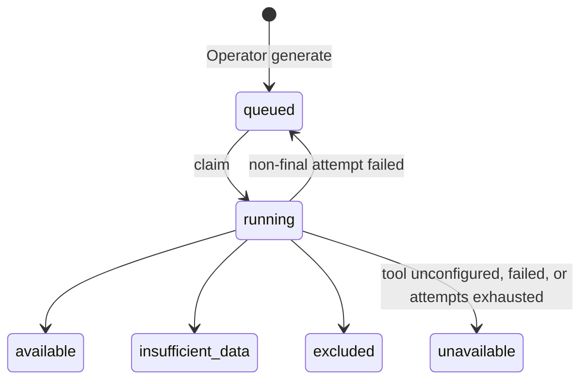

Applicability (`current`, `stale`, `unknown`) is computed at read time and is not part of the export bytes. The tracker term `stale` is therefore a read projection, not a stored state.

### Why these are separate axes

Tracker decision D4 (system tracker #3) requires incident, investigation, plan, execution and recommendation state to be independent. The code follows it:

- Each axis has its own table and its own transition owner, so one feature cannot overwrite another's state. Incidents are owned by `features/incidents`, Runs by `features/investigations`, Analyses by `features/diagnosis`, plans and executions by `features/recovery`, and reports by `features/recommendations`.
- Interactions go through narrow predicates instead of shared enums. Examples are `nonterminal_run()` (`investigations/states.py`) and `blocking_execution()` and `classify()` (`recovery/classification.py`).
- The separation keeps uncertainty visible. A resolved incident can still hold an `outcome_unknown` execution with its target lock. A `completed` Run grants no plan approval. Verification `inconclusive` is not success.

## End-to-end workflows

### (a) Alertmanager alert → incident → Run → collection (**Opt-in** intake)

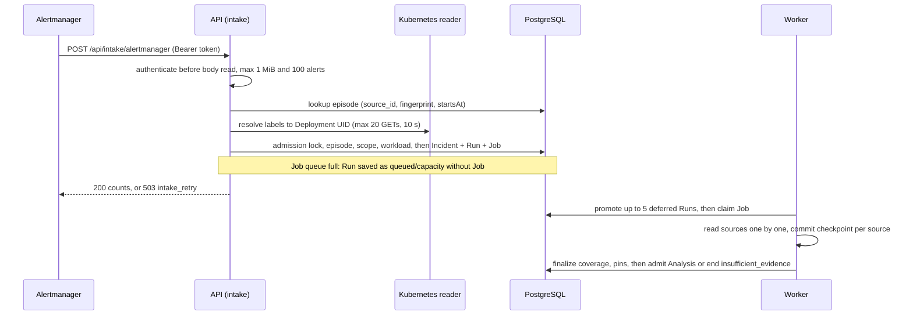

Sources: `features/incidents/intake_api.py`, `intake_service.py`, `features/investigations/promotion.py`, `collector.py`, `entrypoints/worker.py`.

### (b) Manual investigation (**Default**)

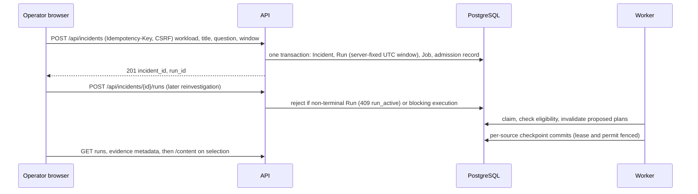

Idempotency keys are scoped per actor. The same key with different input returns `409 idempotency_conflict` (`features/incidents/service.py`, `docs/features/incidents/admission.md`).

### (c) Collection → analysis → findings (**Opt-in** analysis)

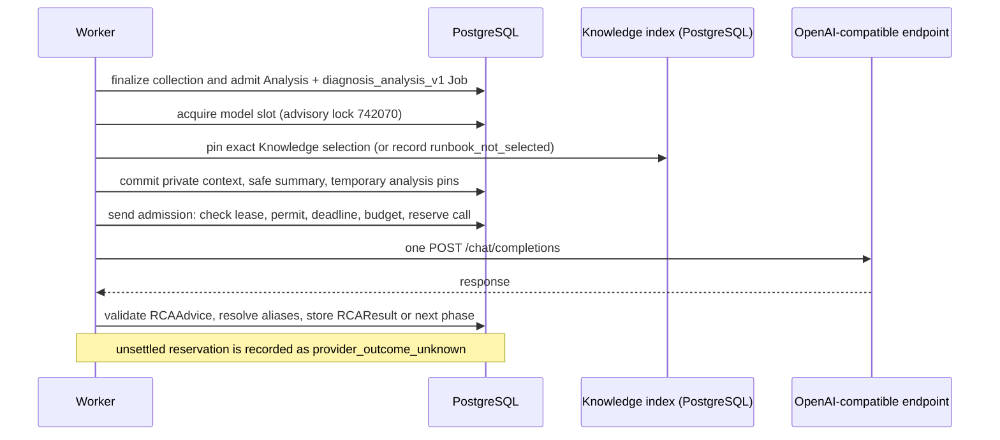

Without a qualified profile, `admit()` sets the Run to `insufficient_evidence` / `analysis_unavailable` and sends no request (`features/diagnosis/lifecycle.py`). See [core-diagnosis.md](core-diagnosis.md).

### (d) Plan → Operator approval → executor → verification → resolution (**Opt-in** execution)

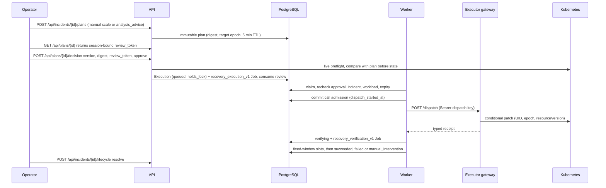

Sources: `features/recovery/service.py`, `gateway.py`, `verification.py`. Without a qualified profile, an acknowledged legacy scale ends `manual_intervention` / `inconclusive` (`docs/guides/foundation.md`).

### (e) Re-investigation and comparison (**Default**)

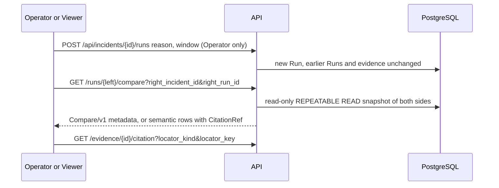

A same-name replacement Deployment returns `status=not_comparable`, and unrelated workloads return 422 (`docs/features/investigations/comparison.md`, `features/investigations/comparison_api.py`). Comparison never starts collection or creates pins.

### (f) Handoff, resolve and reopen with frozen snapshots (**Default**)

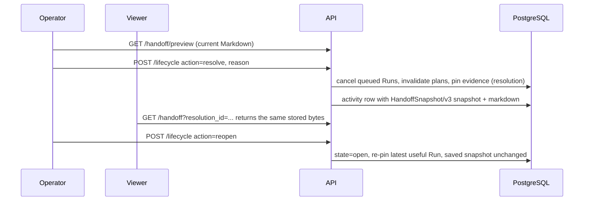

Saved v1, v2 and unversioned snapshots keep their original renderer and bytes (`docs/guides/foundation.md`, `features/incidents/handoff.py`).

## Roles and permission matrix

Roles are `viewer` and `operator` (`users.role` check constraint, `features/access/models.py`). Route dependencies in `features/access/dependencies.py` decide access. `current_session` allows any signed-in role. `operator` requires the Operator role plus an exact Origin and CSRF match. `mutation_session` allows any role with Origin and CSRF.

| Capability | Viewer | Operator | Trusted host / maintenance |
|---|---|---|---|
| Read workloads, scope, observations, baselines, recovery context and availability | Yes | Yes | n/a |
| Read incidents, activity, handoff preview and export | Yes | Yes | n/a |
| Read Runs, evidence metadata and content, timeline, comparison, citations | Yes | Yes | n/a |
| Read analysis, model status and checks, Knowledge, Run guidance | Yes | Yes | n/a |
| Read plans (session-bound review receipt), executions, verification, rollback | Yes | Yes | n/a |
| Read and export recommendation reports, connection checks, alert receipts, operations | Yes | Yes | n/a |
| Create incident or Run, cancel Run, note, acknowledge, resolve, reopen | No (`403 permission_denied`) | Yes | n/a |
| Confirm baseline, create Run guidance, resume analysis, queue model probe | No | Yes | n/a |
| Propose plan or inverse plan, approve or reject plan | No | Yes | n/a |
| Generate recommendation report, run connection check | No | Yes | n/a |
| Log out own session | Yes | Yes | n/a |
| Provision accounts, change roles, revoke sessions | No | No | `cli account`, `account-role`, `revoke-sessions`, `revoke-all-sessions` |
| Purge expired evidence, build Knowledge index | No | No | `cli evidence-purge [--apply]`, `knowledge-index` |
| Issue or transition the dispatch permit | No | No | `dispatch_admin` (allowlisted OS UID) |
| Executor target enable or quarantine, restore cleanup | No | No | `recovery.maintenance` over Unix socket, `recovery_restore`, `diagnosis_recovery` |
| Alertmanager delivery | No | No | Machine Bearer token only, never a session |

No HTTP route issues dispatch permits, edits the Knowledge corpus, purges evidence or releases an executor target (`entrypoints/dispatch_admin.py`, `entrypoints/cli.py`, `features/recovery/gateway.py`). Both roles can read all incidents; there is no per-tenant ACL (`docs/features/investigations/comparison.md`).
