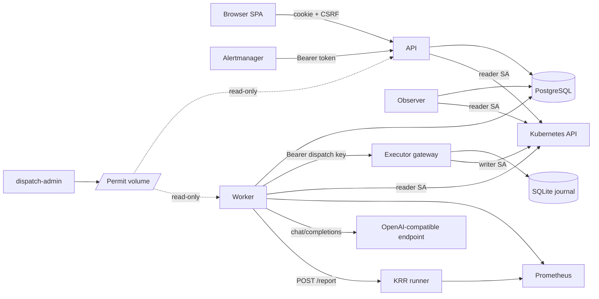

# Interfaces: processes, API, integrations and frontend

This document lists the runtime processes, the REST API surface, the external systems the backend talks to, and the structure of the web client. Domain concepts are defined in [domain-and-workflows.md](domain-and-workflows.md) and tables in [data-model.md](data-model.md). The executor and runtime internals are in [core-recovery-and-runtime.md](core-recovery-and-runtime.md), and the model path is in [core-diagnosis.md](core-diagnosis.md).

Availability labels (**Default**, **Opt-in**, **Fixture**, **Simulation**) have the meaning defined in [domain-and-workflows.md](domain-and-workflows.md#availability-labels). Backend paths are relative to `services/backend/src/cloudops/`.

## Processes and entrypoints

All backend processes are built from one Python codebase and one image (`services/backend/Dockerfile`). Tracker decision D1 calls for a React/Vite SPA, FastAPI, PostgreSQL and API, worker and executor entrypoints from one codebase.

| Process | Command | Owns | Credentials it may hold | Availability |
|---|---|---|---|---|
| `migrate` | `python -m cloudops.entrypoints.cli bootstrap` | Alembic upgrade to head and workload scope synchronization. Runs to completion before API and worker. | Database | **Default** |
| `api` | `uvicorn cloudops.entrypoints.api:app` on port 8000 (loopback only in Compose) | All REST routes, session auth, admission transactions. Startup validates settings, the deferred-run limit, intake config, collection mode and schema. | Database; reader configs; permit volume read-only; never the executor writer or gateway socket | **Default** |
| `worker` | `python -m cloudops.entrypoints.worker` | Claims jobs of the seven kinds in `entrypoints/dispatch.py`, deferred-Run promotion, model-wait expiry, heartbeats | Database; reader configs; permit read-only; model credential (worker only); executor dispatch key and KRR key (**Opt-in**) | **Default** |
| `observer` | `python -m cloudops.entrypoints.observer` | Read-only polling of configured Deployments into `workload_observation*`. No inbound port, no product jobs. | Database; Kubernetes reader | **Opt-in** (`observation` profile) |
| `executor` (gateway) | `python -m cloudops.features.recovery.gateway` on port 8081 | Isolated Kubernetes writer: `GET /targets/{uid}`, `POST /dispatch`, `GET /operations/{id}`; SQLite journal; Unix maintenance socket. Refuses to start unless it runs as root. | Kubernetes writer (`EXECUTOR_KUBE_CONFIG`), allowlist, dispatch key | **Opt-in** (`compose.integration.yaml`) |
| `executor-init` | `python -m cloudops.features.recovery.authority` | Initializes the journal and writes the external identity pin | Journal volumes | **Opt-in** (`maintenance` profile) |
| `dispatch-admin` | `python -m cloudops.entrypoints.dispatch_admin` | `status`, `bootstrap --fresh-install`, `enter-recovery`, `resume --class`, `exit-recovery`, `renew` on `DispatchPermit/v1`. No database access. | Writable permit volume; allowlisted OS UID (`JOB_DISPATCH_ADMIN_UIDS`) | **Default** (profile-gated, trusted host) |
| Maintenance CLI | `python -m cloudops.entrypoints.cli <cmd>` | `account`, `account-role`, `revoke-sessions`, `revoke-all-sessions`, `sync-workloads`, `evidence-purge [--apply]`, `knowledge-index`, `knowledge-status` | Database | **Default** (trusted host) |
| Executor maintenance client | `python -m cloudops.features.recovery.maintenance` | `status`, `target_status`, `enter_recovery`, `enable_target`, `release_uncertain_target`, `exit_recovery_mode` over the peer-authenticated socket | OS peer credentials | **Opt-in** |
| Restore cleanup | `cloudops.entrypoints.recovery_restore`, `cloudops.entrypoints.diagnosis_recovery` | Post-restore session revocation and retirement of restored recovery or model work, while dispatch stays denied | Permit authority and database | **Opt-in** (trusted) |
| Owned-lab evaluation | `cloudops.entrypoints.diagnosis_evaluate --owned-test-lab --run-id` | Admits one `evaluation` Analysis through the normal worker | Database | **Opt-in** (test lab only) |
| `web` | Vite dev server on port 5173, proxying `/api` to `API_PROXY_TARGET` | Serves the SPA | None | **Default** |
| KRR runner | `services/krr/runner.py` on port 8082, `POST /report` | One authenticated, finite, read-only KRR invocation | Kubernetes reader, Prometheus read config, runner key | **Opt-in** (`compose.integration.yaml`) |

Sources: `compose.yaml`, `compose.integration.yaml`, `entrypoints/*.py`, `features/recovery/gateway.py`, `features/recovery/maintenance.py`, `services/krr/runner.py`, `apps/web/vite.config.ts`.

## REST API conventions

Sources: `features/access/dependencies.py`, `features/access/api.py`, `shared/errors.py`, `entrypoints/api.py`, `docs/foundation.md`.

| Concern | Rule |
|---|---|
| Session | `POST /api/login` sets the HttpOnly, `SameSite=Lax` cookie `cloudops_session`, with `max_age=SESSION_SECONDS` (default 28,800). `Secure` follows `COOKIE_SECURE`. The server stores only the SHA-256 of the token. |
| CSRF | Each session has its own CSRF token, returned in `SessionView.csrf_token`. Every non-GET request except login and the intake webhook must send exactly one `X-CSRF-Token` header equal to it, compared in constant time. |
| Origin | Mutations and login require the `Origin` header to equal `WEB_ORIGIN` exactly (`403 origin_denied`). |
| Roles | `current_session`: any signed-in role. `operator`: Operator role plus Origin and CSRF (`403 permission_denied` for Viewer). `mutation_session`: any role plus Origin and CSRF (used by logout). |
| Idempotency-Key | A UUID header. It is required on `create_incident`, `create_run`, `resume_analysis` and `create_model_check`, and optional on `create_connection_check` (`contracts/openapi.json`). It is bound to the actor, operation and canonical request. A replay returns the original result, and a changed request returns `409 idempotency_conflict`. The client never retries a mutation automatically. |
| Error envelope | `{"error": {"code": "...", "message": "..."}}` (`ErrorEnvelope`). Status codes: 401 session, 403 role, Origin or CSRF, 404 missing or mismatched scope, 409 conflict, 410 expired evidence, 413 or 415 intake body, 422 validation, 503 database unavailable or intake retry. |
| Pagination | Offset style for incidents, Runs, workloads, scope and diagnosis checks: `limit` 1..100 (default 25), `offset` 0..100000, response `next_offset` (`docs/foundation.md`). Plan and execution lists accept only `offset`. Keyset style (`cursor`, `next_cursor`) for activity, alert receipts, baselines, observations, recommendation reports, Knowledge documents, comparisons and citation targets. |
| Caching | A middleware sets `Cache-Control: no-store` on every response. |
| Contracts | `contracts/openapi.json` and `apps/web/src/lib/api/generated/schema.d.ts` are generated by `scripts/contracts.py --write`. They are not edited by hand (`AGENTS.md`). |

## REST API surface

There are 66 operations in `contracts/openapi.json`. Role values: **Public**, **Session** (Viewer or Operator), **Operator**, **Self** (any role, with Origin and CSRF), **Machine** (intake Bearer token). Roles are taken from route dependencies and router-level `dependencies=[Depends(current_session)]`.

### Access and health

| Method | Path | Role | Purpose |
|---|---|---|---|
| POST | `/api/login` | Public (Origin checked) | Verify credentials and create a session |
| GET | `/api/session` | Session | Current principal and CSRF token |
| POST | `/api/logout` | Self | End own session |
| GET | `/api/health/live`, `/api/health/ready` | Public | Liveness and database readiness |
| GET | `/api/health` | Session | Classified component observations |

### Workloads and baselines

| Method | Path | Role | Purpose |
|---|---|---|---|
| GET | `/api/workloads`, `/api/workloads/{workload_id}` | Session | Inventory and detail |
| GET | `/api/workloads/scope` | Session | Configured scope targets and their state |
| GET | `/api/workloads/{id}/observation`, `/observations` | Session | Latest persisted observation and history |
| GET | `/api/workloads/{id}/baseline-candidate` | Session | Direct bounded read that prepares a candidate (may persist observation metadata) |
| POST | `/api/workloads/{id}/baseline` | Operator | Confirm an immutable baseline |
| GET | `/api/workloads/{id}/baselines` | Session | Baseline history |

### Incidents, lifecycle and intake

| Method | Path | Role | Purpose |
|---|---|---|---|
| GET | `/api/incidents` | Session | Work queue with filters, sort and views |
| POST | `/api/incidents` | Operator | Create incident, first Run and Job in one transaction |
| GET | `/api/incidents/{incident_id}` | Session | Incident detail |
| POST | `/api/incidents/{id}/notes` | Operator | Add a note |
| POST | `/api/incidents/{id}/lifecycle` | Operator | `acknowledge`, `resolve` or `reopen` with a reason |
| GET | `/api/incidents/{id}/activity` | Session | Keyset activity history |
| GET | `/api/incidents/{id}/handoff/preview`, `/handoff` | Session | Current or saved (`resolution_id`) handoff, as JSON or as Markdown download |
| POST | `/api/intake/alertmanager` | Machine | Alertmanager webhook v4 receiver |
| GET | `/api/alert-receipts` | Session | Sanitized intake outcomes |

### Investigations, evidence and comparison

| Method | Path | Role | Purpose |
|---|---|---|---|
| GET, POST | `/api/incidents/{id}/runs` | Session / Operator | List Runs, or request a new investigation |
| GET | `/api/incidents/{id}/runs/{run_id}` | Session | Run detail, progress and metadata-only evidence |
| POST | `/api/incidents/{id}/runs/{run_id}/cancel` | Operator | Cancel a cancellable Run |
| GET | `.../runs/{run_id}/evidence/{evidence_id}` and `/content` | Session | Evidence metadata and bounded payload (409 unavailable, 410 expired) |
| GET | `.../runs/{run_id}/timeline` | Session | Run timeline from stored records |
| GET | `.../runs/{run_id}/compare` | Session | `Compare/v1` two-Run comparison (read-only snapshot) |
| GET | `.../evidence/{evidence_id}/citation`, `/citation-targets` | Session | Resolve or list exact citation locators |

### Knowledge and Run guidance

| Method | Path | Role | Purpose |
|---|---|---|---|
| GET | `/api/knowledge/documents`, `/documents/{document_version_id}`, `/chunks/{chunk_id}` | Session | Full-text catalog search and exact version or chunk reads |
| GET | `/api/knowledge/index-status` | Session | Index status projection |
| GET, POST | `/api/incidents/{id}/runs/{run_id}/knowledge` | Session / Operator | Read, or create once, the saved guidance selection |
| GET | `.../knowledge/selections/{selection_id}/chunks/{chunk_id}` | Session | Resolve an exact selected chunk |

### Diagnosis

| Method | Path | Role | Purpose |
|---|---|---|---|
| GET | `/api/incidents/{id}/runs/{run_id}/analysis` | Session | `AnalysisView/v1` with nullable `RCAResult` |
| POST | `.../analysis/resume` | Operator | Resume an eligible quota hold |
| GET | `/api/diagnosis/status` | Session | Model identity, qualification and dispatch state (no network call) |
| GET, POST | `/api/diagnosis/checks` | Session / Operator | Probe history, or queue one fixed probe |

### Recovery

| Method | Path | Role | Purpose |
|---|---|---|---|
| GET | `/api/recovery-policy` | Session | Configured policy and qualified profiles (no provider call) |
| GET, POST | `/api/incidents/{id}/plans` | Session / Operator | List plans, or propose a manual or advice-derived plan |
| GET | `/api/plans/{plan_id}` | Session | Exact plan plus session-bound review receipt |
| POST | `/api/plans/{plan_id}/decision` | Operator | Approve or reject an exact version, digest and receipt |
| GET | `/api/incidents/{id}/executions`, `/api/executions/{execution_id}` | Session | Execution history and detail with `RecoveryOutcome/v1` |
| GET | `/api/executions/{id}/verification`, `/rollback` | Session | Verification record and rollback eligibility |
| POST | `/api/executions/{id}/inverse-plans` | Operator | Propose the captured inverse (rationale only) |
| GET | `/api/workloads/{id}/recovery-availability`, `/recovery-context` | Session | Target authority and blockers, and read-only baseline context |

### Recommendations and connections

| Method | Path | Role | Purpose |
|---|---|---|---|
| GET, POST | `/api/recommendation-reports` | Session / Operator | Report history, or generate a report (6..24 hours) |
| GET | `/api/recommendation-reports/{id}`, `/export` | Session | Exact report, and immutable export bytes (`409 report_not_final` before terminal) |
| GET, POST | `/api/connection-checks` | Session / Operator | Check receipts, or run one bounded source check |
| GET | `/api/connection-checks/status` | Session | Assessment for Kubernetes, Prometheus, database and worker |
| GET | `/api/connections/operations` | Session | Job counts and dispatch status per kind, blocked and quota-waiting Runs, verification slots (one read-only snapshot) |

FastAPI also serves `/openapi.json`, `/docs` and `/redoc` publicly. These are inventoried separately by `services/backend/tests/permission_inventory.py` (`docs/foundation.md`).

## External integrations

| System | Used by | Configuration | Credential separation | Availability |
|---|---|---|---|---|
| Kubernetes API, reader | API (alert identity, baseline candidate, plan preflight, connection check), worker (collection, reconciliation and verification reads), observer, KRR runner | `KUBE_READ_CONFIG`: JSON with one HTTPS `server`, `ca_data` and reader `token`. `WORKLOADS_FILE` for scope. ConfigMap metadata only when `KUBE_CONFIGMAP_ENABLED=1`. | Read-only service account. Never mounted into the gateway as a writer. | **Opt-in** (`COLLECTION_SOURCE_MODE=live_kubernetes`). Default is the fixture. |
| Kubernetes API, writer | Executor gateway only | `EXECUTOR_KUBE_CONFIG`, `EXECUTOR_ALLOWLIST` | Only the gateway holds it. The worker holds only the dispatch key (`compose.integration.yaml`). | **Opt-in** |
| Prometheus | Worker (six fixed metric slots, verification queries), connection checks, KRR runner | `PROMETHEUS_READ_CONFIG`. HTTPS validation, no proxy or redirect, 4-second request bound, 2 MiB response cap, 25-series cap (`docs/recovery-verification.md`). | Read credential only | **Opt-in** (`COLLECTION_SOURCE_MODE` includes `prometheus`) |
| Alertmanager webhook | Inbound to API | `ALERT_INTAKE_CONFIG`: `source_id`, `cluster`, `token_sha256`. Only the digest is stored. | Machine Bearer token. Sessions never grant intake. | **Opt-in**. Without config, the route returns `503 intake_unavailable`. |
| OpenAI-compatible endpoint | Worker only | `DIAGNOSIS_PROFILE_FILE`, `DIAGNOSIS_EGRESS_FILE`, optional `DIAGNOSIS_QUALIFICATION_FILE` (`compose.diagnosis.yaml`). The worker appends `/chat/completions`. | API key in a worker-only env file. Never in API responses or frontend code. | **Opt-in**. Default makes no HTTP calls. |
| KRR runner | Worker (`recommendation_report_v1`) | `KRR_RUNNER_URL`, `KRR_RUNNER_KEY`, `KRR_RUNNER_IMAGE_DIGEST`, `RECOMMENDATION_SOURCE_POLICY` | Runner key file. Runner container is read-only with all capabilities dropped. | **Opt-in**. Without a runner, reports end `unavailable`. |
| Executor gateway | Worker (dispatch, receipts), API (`GET /targets/{uid}` for authority) | `EXECUTOR_URL`, `EXECUTOR_DISPATCH_KEY` | HMAC-compared Bearer key on dispatch and operation reads | **Opt-in** |

Every outbound call runs outside a database transaction and after call-start admission against the dispatch permit (`docs/job-dispatch.md`). Exactly-once external effects are not promised (`README.md`).

## Frontend structure

Source: `apps/web/src`. Stack: React 19, TypeScript, Vite, Tailwind, shadcn/ui (`components/ui`), TanStack Query and `openapi-fetch` (`apps/web/package.json`).

### Entry and simulation boundary

`main.tsx` reads `?simulation=1`. When it is set, the app lazily loads `App.tsx`, the **Simulation**, under a banner reading "Fixture simulation · No backend or live operations". Otherwise it renders `app/FoundationApp.tsx`, the persisted application and the default.

| Mode | Modules | Data source |
|---|---|---|
| Persisted (default) | `app/FoundationApp.tsx`, `app/routes.ts`, `features/<feature>/*`, `lib/api/*` | REST API via the generated client |
| Simulation | `App.tsx`, `demo/model.ts` ("Deterministic, local-only product simulation. No network, timers or credentials."), `features/IncidentWorkspace.tsx`, `features/SupportPages.tsx` | localStorage key `cloudops-experience-v1` |

The simulation's state enums differ from the backend. For example, its `PlanStatus` includes `awaiting_approval`, `stale` and `expired` (`demo/model.ts`). Its RCA and actions are fixtures and are never promoted into API results (`AGENTS.md`).

### App shell and routes

`FoundationApp.tsx` checks the session and shows `SignIn` when needed. It then renders a sidebar with **Work queue**, **Workloads**, **Connections**, **Resource reports** and **Knowledge**. `canMutate` is true only for the Operator role, so Viewers see no mutation controls, and the backend enforces the same rule. Routing is hash-based and validated (`app/routes.ts`):

| Hash route | Page | Retained parameters |
|---|---|---|
| `#/queue?...` | `features/incidents/WorkQueue` | search, workload, origin, state, severity, signal, sort, view, run_state, execution_class, anchor |
| `#/incidents/{id}?...` | `features/investigations/InvestigationWorkspace` | run, evidence, resolution, plan, execution, comparison (`compare_*`) and citation locator, `return_to` |
| `#/workloads?workload=&baseline=` | `features/workloads/Workloads` | selected workload and baseline |
| `#/connections` | `features/connections/Connections` | none |
| `#/reports?...` | `features/recommendations/Reports` | workload, report, hours, cursor |
| `#/knowledge?...` | `features/knowledge/Knowledge` | `q`, `tag` (up to 16), document, chunk, and incident, run and selection for Run guidance links, `return_to` |

### Feature modules

| Folder | Main components |
|---|---|
| `features/access` | `SignIn` |
| `features/incidents` | `WorkQueue`, `CreateIncident`, `IncidentActivity`, `AlertSignal`, `queries.ts` |
| `features/investigations` | `InvestigationWorkspace`, `EvidenceCatalog`, `MetricEvidence`, `LogEvidence`, `RunProgress`, `RunComparison`, `CitationTarget`, `HandoffReferences`, `request.tsx` |
| `features/diagnosis` | `Analysis` (findings), `ModelConnection` |
| `features/knowledge` | `Knowledge`, `KnowledgeStatus`, `RunGuidance` |
| `features/recovery` | `RecoveryPlans`, `PlanDiff`, `RecoveryEvidence` |
| `features/recommendations` | `Reports`, `ReportDetails` |
| `features/workloads` | `Workloads`, `Baselines`, `ScopeStatus`, `WorkloadHealth`, `WorkloadIdentity`, `WorkloadContext` |
| `features/connections` | `Connections`, `SourceChecks`, `AlertReceipts`, `OperationsPanel` |

### API client

`lib/api/client.ts` wraps `openapi-fetch` with the generated `paths` type from `lib/api/generated/schema.d.ts` (10,109 lines, generated). The wrapper:

- sends `X-CSRF-Token` on every non-GET/HEAD request after sign-in;
- uses `credentials: "same-origin"`;
- keeps a session generation counter that aborts in-flight requests and rejects late responses (`409 session_changed`) when the session changes;
- turns a 401 into a `cloudops:session-expired` event;
- unwraps the `ErrorEnvelope` into an `ApiError(status, code, message)`.

Pending Idempotency-Keys for investigation requests are cleared on session change (`clearRequestKeys` in `features/investigations/request.tsx`, used by `FoundationApp.tsx`).
